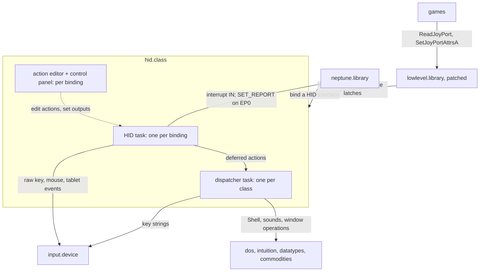

# hid.class - Architecture

> **Scope:** `hid.class`, the generic USB Human Interface Device driver: keyboards, mice, joysticks,
> gamepads, tablets, and the system and consumer controls on them. It is a client of
> `neptune.library`; read [neptune.library-architecture.md](neptune.library-architecture.md) first
> (task model §4, binding §5.5, settings §5.12).
>
> This document describes structure, behaviour and the rules that keep it correct. It names
> functions as anchors; the code is the reference for field layouts, timings and retry counts.

---

## 1. Purpose

`hid.class` turns any HID interface into Amiga input. Unlike `bootkeyboard`/`bootmouse`, which
speak only the fixed boot protocol, it parses the device's report descriptor, and it maps every
field through a configurable rule engine instead of a fixed table. It has five jobs:

1. **Model the device.** Parse the report descriptor into reports, collections and items.
2. **Assign behaviour.** Give every input item an action list: defaults generated per HID usage,
   or the user's saved mapping.
3. **Run the reports.** Extract each field from the interrupt reports and run its actions.
4. **Deliver.** Feed `input.device`, latch joystick state for the patched `lowlevel.library`, send
   output and feature reports (LEDs, rumble), and hand slow effects to a dispatcher task.
5. **Edit live.** Per binding, an action editor and a control panel for the output items.

It binds at the **interface** level, on `HID_CLASSCODE`, boot or report protocol alike.

---

## 2. Context



- **Downwards** it uses only the library: an EP0 pipe and one interrupt-IN pipe per binding, the
  HID descriptor cached at enumeration, the config tree, subtask spawning.
- **Upwards** it writes to `input.device` and patches `lowlevel.library`, so games read USB pads
  as native joyports and can drive rumble.
- **Sideways** it makes no calls into other classes.

**Split with the boot classes.** `hid.class` scans at priority 0, the boot classes at -100. The
shipping ROM does not contain `hid.class`: `romstartup` tries it, falls back to the boot classes,
and the AfterDOS pass of the first scan from a process releases their bindings (they set
`UCCA_AfterDOSRestart`) so the disk-loaded `hid.class` takes over (core doc §5.1).

---

## 3. Building blocks

The GUIs are `hid.gui.c` and `hidctrl.gui.c`, the usage-name tables `numtostr.c`; everything else
is in `hid.class.c`.

| Block | Responsibility | Anchors |
|---|---|---|
| **Class base** | Binding list, class-default config, patch vectors, dispatcher, global action variables | `NepHidBase`, `nh_DummyNCH`, `libExpunge` |
| **Binding** | One HID interface: pipes, `input.device` request, parsed model, event accumulators | `NepClassHid`, `usbForceInterfaceBinding`, `usbReleaseInterfaceBinding` |
| **HID task** | Owns pipes, model and accumulators; service loop | `nHidTask`, `nAllocHid`, `nFreeHid` |
| **Descriptor parser** | Descriptors into reports, collection tree, items, lookup maps, item IDs | `nReadReports`, `nParseReport` |
| **Pseudo reports** | `[Extra]` init/quit items; Wacom virtual report | `nAddExtraReport`, `nDetectWacom`, `nParseWacom` |
| **Action assignment** | Defaults per usage and collection; saved overrides | `nLoadActionConfig`, `nDetectDefaultAction`, `nLoadItem`, `nSaveItem` |
| **Action engine** | Field extraction, edge detection, transforms, type handlers | `nProcessItem`, `nDoAction`, `NepHidAction` |
| **Event flusher** | Per report: output/feature reports, mouse and tablet events, reset check | `nFlushEvents`, `nSendRawKey`, `nCheckReset` |
| **Joyport patch** | `lowlevel.library` vectors | `nInstallLLPatch`, `nReadJoyPort`, `nSetJoyPortAttrsA` |
| **Dispatcher** | Actions that must not run in the HID task | `nInstallLastActionHero`, `nLastActionHero`, `nSendKeyString` |
| **Config** | Class defaults, binding settings, change detection | `nLoadClassConfig`, `nLoadBindingConfig`, `nCalcConfigCRC` |
| **GUIs** | Action editor; output control panel | `nGUITask`, `nHIDCtrlGUITask` |

**The parsed model.** One `NepHidReport` per report ID holds `NepHidCollection`s (parent links form
the tree) holding `NepHidItem`s. An item is one variable field, or one array with a usage and an
action list per possible value. Each action-list header carries a 16-bit **item ID**
(`GET_WTYPE`/`SET_WTYPE` on `lh_Type`) that names it in saved config and in OUTPUT/FEATURE action
targets (rule 11).

---

## 4. Runtime model

| Task | Lifetime | Waits on |
|---|---|---|
| **HID task** | One per binding, bind to release | its port (pipe completions, wake-ups), CTRL-C |
| **Dispatcher** ("Last Action Hero") | One per class, from the first deferred action to the last `libClose` | its port, CTRL-C |
| **Action editor** | Per binding, on demand; on `nh_DummyNCH` it edits the class defaults | MUI |
| **Control panel** | Per binding, from HID task start; window shown only if configured | MUI, CTRL-C |

Library methods run in the **caller's** task; the joyport patches run in **whichever task calls**
`lowlevel.library`.

**The service loop** runs the `[Extra]` init actions and spawns the control panel, then repeats:
arm the IN pipe if running, `Wait`, process each completion, `nFlushEvents` (waking the editor if it
is tracking), and re-parse if a reload is flagged. CTRL-C ends it with the `[Extra]` quit actions.

**Priority.** Class tasks start at `pgc_SubTaskPri`; the HID task raises itself to at least
`INPUT_CLASS_TASK_PRI` (`nApplyInputTaskPriFloor`, `classes/common.h`; rule 1). The dispatcher and
the GUIs stay at `pgc_SubTaskPri`: the dispatcher runs user Shell commands and must not outrank them.

**Ownership.** The HID task owns pipes, model and accumulators, and the whole action engine runs
in it. Other writers: output item values (rumble patch, control panel; rule 8), action lists (the
editor, under `Forbid`), and the reload flag (`nLoadBindingConfig`, then a signal). `nReadJoyPort`
reads the joyport latches while walking the binding list under `Forbid`.

---

## 5. Key flows

### 5.1 Binding

```mermaid
sequenceDiagram
    participant CORE as neptune.library
    participant DISP as hid.class dispatcher
    participant T as new HID task

    CORE->>DISP: UCM_AttemptInterfaceBinding (class HID)
    DISP->>DISP: install joyport patch (once), load binding config
    DISP->>T: spawn, then wait (borrowing the caller's locks)
    T->>T: raise priority; open input.device, pick ADDEVENT or WRITEEVENT
    T->>T: open pipes; boot subclass: SET_IDLE 0, SET_PROTOCOL report
    T->>T: PS3 quirk; parse descriptors, assign actions, [Extra] and Wacom
    T-->>DISP: ready (success = task is running)
    DISP-->>CORE: binding
```

Boot devices are switched to report protocol because the class parses the real descriptor.
A device without an interrupt-IN endpoint binds only if it has no input items (output-only).

### 5.2 Parsing

`nParseReport` keeps a running global state (usage page, ranges, report size, count and ID, with
PUSH/POP) and accumulates local usage ranges until a Main item consumes them. INPUT/OUTPUT/FEATURE
create one item per variable field or one array item (with value buffers for diffing); COLLECTION
items build the tree. A new report ID switches to that report and clones the open collection chain
into it. The post-pass in `nReadReports` builds the report-ID lookup (`nch_ReportMap`) and flat
input, output and feature item maps, numbers the item IDs in parse order (each array value gets its
own), then calls `nLoadActionConfig`.

### 5.3 Assigning actions

Each variable item and each array value gets its saved action list, or else `nDetectDefaultAction`.
Defaults depend on the usage **and the enclosing collection**: X/Y in a mouse or tablet give
`MOUSEPOS`, in a joystick or gamepad threshold `DIGJOY` rules plus `ANALOGJOY`; buttons give mouse
buttons or pad buttons by the same test; the hat switch gives `DIGJOY` with a NAN rule that centres
it; modifiers give `QUALIFIER` and every key `KEYMAP`; Caps Lock also mirrors its qualifier to the
LED through conditional `OUTPUT` rules; digitizer usages give `TABLET`; system and consumer controls
give `EXTRAWKEY` (inert, §6). The `[Extra]` init item carries device init sequences (AipTek tablets).

### 5.4 The report path

The HID task strips the report ID, looks up the report and runs `nProcessItem` on each input item,
which runs `nDoAction` for each matching action (Wacom packets are tried by `nParseWacom` first).

- **Variable items:** a change runs DOWN or UP rules by direction, ALWAYS rules run every report,
  an out-of-range value runs only NAN rules. Click count and hold time are tracked per item.
- **Array items** are diffed against the previous report, releases first, then presses; each
  value runs its own action list or, if empty, the item's. This turns a keyboard's key array into
  key edges. An ErrorRollOver array is ignored (rule 5).
- **Effects:** keys and button clicks go out at once (a click carries the pending mouse delta);
  motion accumulates. `nFlushEvents` then sends touched output/feature reports, one relative
  `RAWMOUSE`, one absolute `NEWPOINTERPOS`/`NEWTABLET` with a tag list of what the device reported,
  and runs `nCheckReset` (Ctrl-Amiga-Amiga after the keyboard reset handlers, or Ctrl-Alt-Del).

### 5.5 The action engine

A `NepHidAction` has a type, a trigger (`DOWNEVENT`, `UPEVENT`, `ALWAYS`, `NAN`) and type
parameters. `nDoAction` applies the enabled transforms in order - abs-to-rel, clip (percent of range,
inverse, stretch), scale, condition (false suppresses the rule), value override - then the handler.

Conditions, value overrides and `HUA_VARIABLES` share one operand and operator set: operands are the
transformed or original value, constants, click count, hold time, qualifiers, random values, a
timer, eight per-binding **local** and eight class-wide **global** variables; operators cover
arithmetic, logic, bitwise, shifts and comparisons. Writing variables lets rules keep state across
reports and devices.

All types run in the HID task except `VANILLA`, `KEYSTRING`, `SOUND`, `SHELL` and the window and
screen operations of `MISC`, which go to the dispatcher (rule 7). `OUTPUT`/`FEATURE` and the
joyport types only set state that the flush or the patch consumes.

### 5.6 Feeding input.device

`IND_ADDEVENT` is `input.device` V47 (AmigaOS 3.2). It differs from `IND_WRITEEVENT` only in also
updating `input.device`'s state, which makes a held key auto-repeat. `nAllocHid` asks the opened
device once, with `nInputHasAddEvent()` (`classes/common.h`; `bootkeyboard` and `bootmouse` use the
same helper): `lib_Version >= 47` **and** `IND_ADDEVENT` listed in its `NSCMD_DEVICEQUERY` answer.
The result goes to `nch_OS4Hack`, copied to `nh_OS4Hack` for the dispatcher, and is logged with the
device's version (rule 2). Without it only the repeat is lost; the class tracks qualifiers itself.
Gated: key edges (`nSendRawKey`), relative mouse, buttons 1-3, key strings. Always
`IND_WRITEEVENT`: the wheel (rule 3), absolute/tablet events, the NewMouse button event, close-window.

### 5.7 Output and feature reports

OUTPUT/FEATURE actions, the rumble patch and the control panel set an item value, mark its report
touched, set `nch_OutFeatTouched` and signal. `nFlushEvents` encodes each touched report and sends
it as `SET_REPORT` on EP0. An interrupt-OUT endpoint, if present, is not used.

### 5.8 Joyports

`nInstallLLPatch` runs at the first bind and again on `UCM_DOSAvailableEvent` (`lowlevel.library`
is a disk library). It `SetFunction`s `ReadJoyPort` and, if the jump table reaches it,
`SetJoyPortAttrsA` (rule 9).

- **`nReadJoyPort`** calls the original, then for ports 0-3 applies each binding's port mode:
  leave, replace with USB, merge USB over the hardware buttons and directions, disable, or
  analogue. Analogue data can also be requested explicitly (`JP_ANALOGUE_PORT_MAGIC`, `SJA_Type`
  analogue), a Neptune extension.
- **`nSetJoyPortAttrsA`** calls the original, records the analogue override, and turns rumble tags
  into motor item values on the bindings whose rumble port matches (§5.7).
- The patches find the class base by name in the library list (no global). `libExpunge` restores
  each vector only if it is still ours, and refuses to expunge otherwise.

### 5.9 Deferred actions

`nDoAction` queues a message carrying the binding and the action, spawning the dispatcher first if
needed. The dispatcher requires `input.device`, `dos`, `intuition` and `layers`; `datatypes`
(sounds) and `commodities` (key strings) are optional (rule 12). Key strings become an event chain
(`nInvertString`) sent as down/up pairs through the dispatcher's own `input.device` request.

### 5.10 Configuration and live reload

- **Class defaults:** the settings (`HIDC`) and keymap (`KMAP`) chunks, held in `nh_DummyNCH`.
- **Per binding** (device ID + interface ID): settings, the keymap if it differs from the default,
  one form per report (`RPT0` + report ID, `XRPT`, `WCOM`), one form per item (by item ID), one
  `ACTN` form per action. The editor skips lists that match the generated defaults
  (`nCheckForDefaultAction`).

The editor changes the live action lists, so its edits act at once. A change made elsewhere (Neptune
USB loading prefs) arrives as `UCM_ConfigChangedEvent`: `usbDoMethodA` reloads the class defaults
and runs `nLoadBindingConfig` per binding, which compares a checksum of the binding's config
(`nCalcConfigCRC`) with the last one and, on a change, flags a reload. The HID task then stops both
GUIs, frees the model and re-parses. The check is skipped while that binding's editor is open; a
reload does not repeat the init actions or the protocol setup.

### 5.11 Device quirks

- **Wacom** (models in `WacomCapsTable`): a virtual report whose items point into a
  `struct WacomReport`; `nParseWacom` decodes the packets it recognises into it and runs them
  through `nProcessItem`. Other packets, and models not in the table, take the generic path.
- **PS3 Sixaxis:** silent until a feature `GET_REPORT`; `nQuirkPS3Controller` sends it at bind.

### 5.12 Suspend, resume and teardown

- **Suspend** (`UCM_AttemptSuspendDevice`, caller's task) clears the running flag and aborts the IN
  pipe without waiting; the HID task reaps it. **Resume** sets the flag and signals; the loop
  re-arms.
- **Pipe errors:** a STALL clears the endpoint halt before the retry. A long run of the same error
  makes the HID task give up and exit.
- **Release** stops the editor, the control panel and the HID task, in that order. The HID task runs
  the `[Extra]` quit actions, aborts and waits for the IN pipe, and frees everything. The last
  `libClose` stops the dispatcher; `libExpunge` removes the patches.

---

## 6. Design rules

Each rule exists because breaking it caused, or would cause, a real failure.

1. **The HID task runs at or above `INPUT_CLASS_TASK_PRI`.** On V47, `input.device` repeats a held
   key until this task delivers the key-up. At priority 5, a CPU-bound console handler or a
   scheduler working the low band (Executive) delayed key-ups by seconds, and every repeat period
   became a phantom key press.
2. **`IND_ADDEVENT` is gated on what `input.device` itself reports.** Ungated, a pre-V47 device
   rejects it with `IOERR_NOCMD`, nothing checks `io_Error`, and HID keyboards and mice are silently
   dead. The version alone is not enough: the 68k `input.device` 50.x (50.26, 2003) is V50 but
   predates 3.2, does not answer `NSCMD_DEVICEQUERY`, and treats command 24 as something else - a
   key sent with it repeats for ever. The 3.2 `input.device` (47.1) answers the query and lists 24.
3. **The wheel uses `IND_WRITEEVENT`.** N downs and one up are not a held key; under `IND_ADDEVENT`
   a late up adds scroll steps.
4. **Never send a key with no Amiga code.** The keymap's `0xff` ("no key") is unchanged by
   `IECODE_UP_PREFIX`, so its up reads as a down: under `IND_ADDEVENT`, a key that never releases.
5. **An ErrorRollOver array is ignored**, state kept. Diffing it would release every held key and
   press it again when it clears.
6. **`nCheckReset` reads `nch_LastRawKey`, not the event.** `DoIO` may destroy the event, and on a
   keyboard-and-mouse device the flush overwrites it with a mouse event first.
7. **Slow or blocking actions go to the dispatcher.** The HID task delivers key-ups and re-arms the
   pipe; a Shell command, sound load or requester there would stall input.
8. **Only the HID task sends output reports.** Other tasks set values, mark the report, set
   `nch_OutFeatTouched` (the flush skips everything without it) and signal. Sending from the patch or
   a GUI would race the HID task on EP0.
9. **`SetJoyPortAttrsA` is patched only if the jump table holds it.** It is a V40.27 addition that
   `OpenLibrary` cannot ask for; patching LVO -132 on an earlier 40.x writes below the library. The
   `lib_NegSize` check leaves it unpatched (NULL saved vector, so expunge skips it); pads still work
   digitally.
10. **Each GUI binds MUI through its own base.** `mui_base.h` takes the base from the task's
    `tc_UserData` (a writable global would block ROM residency). The control panel defines
    `MUI_BASE_FIELD = nch_HCMUIBase` before its first include of `hid.h`; reorder the includes and it
    silently uses the editor's base.
11. **Item IDs are positional and persistent.** Saved item forms and OUTPUT/FEATURE targets use
    them, so changing how the parser creates or numbers items remaps every saved configuration.
12. **`datatypes` and `commodities` are optional.** They are Workbench-disk libraries; requiring them
    would lose the whole action engine on a trimmed install. `nPlaySound` and `nInvertString` check
    their base.

**Known gaps.** `HUA_EXTRAWKEY` emission is compiled out, so the consumer and system defaults are
inert. Polling mode is compiled out, but a config with `cdc_PollingMode` set still takes that branch
and spins without `Wait`. `HUAT_MODULO` assigns instead of taking a remainder; `HUA_AREXX` has no
handler. `nCheckForDefaultAction` always checks the item's own list, so array entries are always
saved.

---

## 7. Interfaces

**Implemented (`usbclass` methods):** interface binding (attempt, force, release),
`UCM_OpenCfgWindow`, `UCM_OpenBindingCfgWindow`, `UCM_DOSAvailableEvent`, `UCM_ConfigChangedEvent`,
`UCM_AttemptSuspendDevice`/`ResumeDevice`. Attributes: `UCCA_Priority` 0, class and binding GUIs,
supports suspend, no AfterDOS restart, using-default-config.

**Used from the library:** interface and endpoint attributes, the descriptor cache, pipes (EP0,
interrupt IN, clear halt), the config tree, subtask spawning, lock borrowing, the error log.

**OS:** `input.device`, `lowlevel.library` (patched; extension in `include/libraries/lowlevel_ext.h`
and [lowlevel.doc.patch](lowlevel.doc.patch)), `keyboard.device` reset handlers, `intuition`,
`layers`, `dos`, `datatypes`, `commodities`, `muimaster`.

**USB:** HID 1.11 - HID and report descriptors, `GET_REPORT`, `SET_REPORT` (output, feature),
`SET_IDLE`, `SET_PROTOCOL`; the HID usage tables for the defaults.
