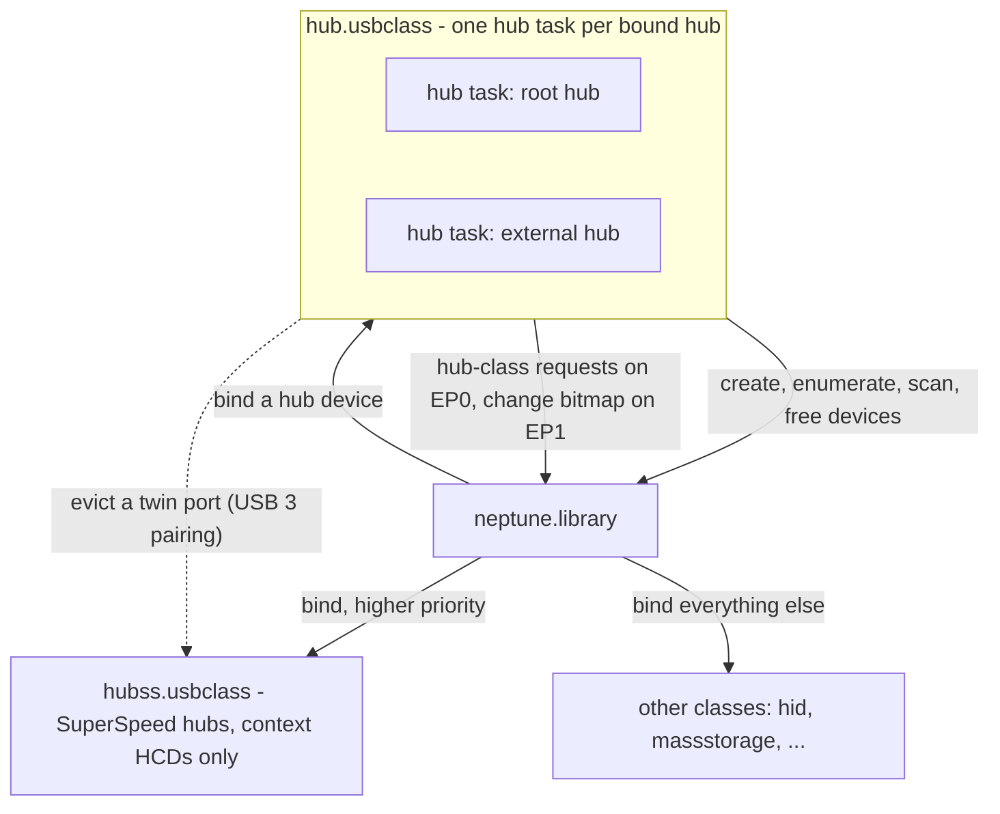
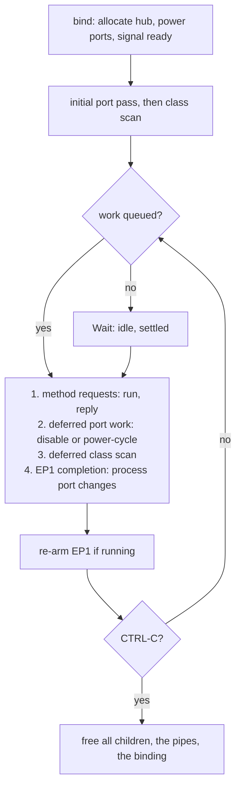
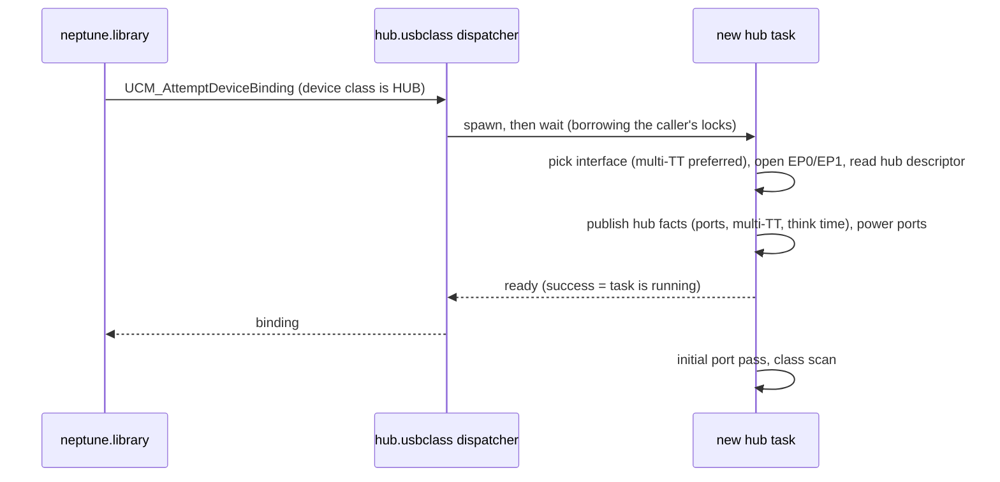
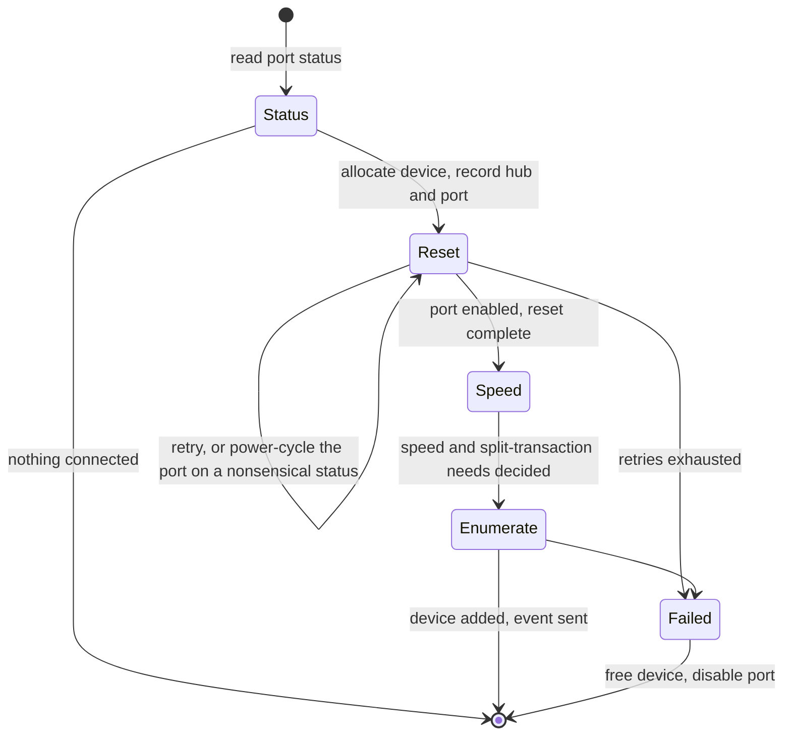
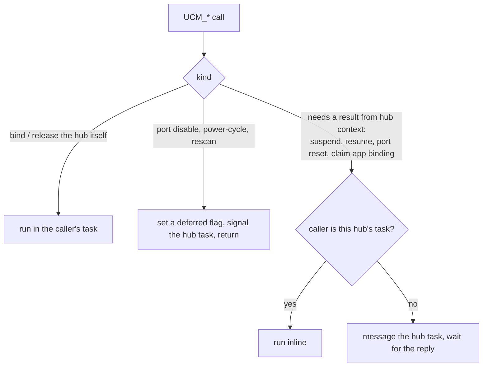

# hub.usbclass - Architecture

> **Scope:** `hub.usbclass`, the USB 1.1/2.0 hub driver and the class that builds the device tree.
> It is a client of `neptune.library`; read [neptune.library-architecture.md](neptune.library-architecture.md)
> first (connect and disconnect §5.4, release and claim routing §5.5). The SuperSpeed sibling is
> [hubss.class-architecture.md](hubss.class-architecture.md).
>
> This document describes structure, behaviour and the rules that keep it correct. It names
> functions as anchors; the code is the reference for field layouts, timings and retry counts.

---

## 1. Purpose

`hub.usbclass` is the one **mandatory** class. Without it the stack sees only the devices on the root
hub's ports. It has three jobs:

1. **Build the tree.** Every bound hub watches its ports, enumerates what is plugged in and hands
   the new device to the class scan. When that device is a hub, `hub.usbclass` binds it too, so the
   tree is discovered recursively.
2. **Track it live.** Connects, disconnects, over-current, power changes and remote wake-up are
   reported by the hub and turned into stack events.
3. **Serialise per-device changes.** Binding changes, suspend/resume and port resets for a device
   run in the task of the hub it hangs off, so they never race the hub's own port handling.

It binds at the **device** level, on `HUB_CLASSCODE`; a hub is the whole device.

---

## 2. Context

- **Downwards** it uses only the library: device lifecycle (`psdAllocDevice`, `psdEnumerateDevice`,
  `psdFreeDevice`), the class scan (`psdHubClassScan`), and two pipes per hub: EP0 for the
  standard hub-class requests and EP1, the interrupt endpoint that reports port changes.
- **Upwards** it provides nothing to applications. Its interface is the `usbclass` method set the
  library calls.
- **Sideways**, it makes one call into another class: evicting a twin port on the other half of a
  USB 3 hub (§5.4).

**Split with `hubss.usbclass`.** `hubss.usbclass` has the higher scan priority and accepts only
SuperSpeed hubs, and only on a context HCD. `hub.usbclass` accepts any hub and is the catch-all:
on a legacy HCD it also binds the SuperSpeed half of a USB 3 hub. That is why it carries the USB 3
pairing logic.

---

## 3. Building blocks

| Block | Responsibility | Anchors |
|---|---|---|
| **Class base** | List of bound hubs; the class-wide address-0 lock (§6, rule 3) | `NepHubBase`, `libInit` |
| **Binding** | One bound hub: its pipes, message ports, the per-port device table, deferred-work flags | `NepClassHub` |
| **Hub task** | The only place a hub's pipes and ports are touched; owns the service loop | `nHubTask`, `nAllocHub`, `nFreeHub` |
| **Method dispatcher** | Entry point for every `UCM_*` call; decides where each one runs (§5.5) | `usbDoMethodA`, `nHandleHubMethod` |
| **Port configurator** | Turns "something is connected to port N" into an enumerated device | `nConfigurePort`, `nClearPortStatus` |
| **USB 3 pairing** | Finds the other half of a USB 3 hub and keeps a device from enumerating on both | `nFindPeerHub`, `nNotifyPeerTwinEvict`, `nPortShadowedByPeer`, `nConnectShadowDebounce` |
| **Port power ops** | Per-device suspend, resume and reset at the hub port | `nHubSuspendDevice`, `nHubResumeDevice`, `nHubResetPort` |

The per-port device table (`nch_Downstream[]`) is the only record of what is on each port. There
is no per-port state machine: presence is "slot empty or not", and everything else is read from the
port's live status bits when needed.

---

## 4. Runtime model

**One task per hub.** Binding a hub spawns its task; a hub found downstream gets its own task when
it is bound. The task tree mirrors the USB tree, and removing a hub unwinds it leaf-first without
any explicit recursion: freeing a child hub's device releases its binding, which stops its task,
which frees its own children first.

**The service loop** waits on one signal set and handles four kinds of work:

- **Method requests** come from other tasks that need something done in this hub's context (§5.5).
- **Deferred work** is flags and per-port bitmasks set by the dispatcher (disable a port,
  power-cycle a port, rescan): a small work queue, serviced in the loop.
- **EP1 completions** carry the change bitmap: bit 0 for the hub, bit N for port N.

The loop is the **only submitter of EP1**, and it skips the `Wait` while deferred work is queued
(rule 2). A hub that is working through its ports, rather than idle in `Wait`, counts as
**settling**; `UCM_PortsPending` reports the number of settling hubs so the ROM boot gate can wait
for the first port pass to finish before the boot menu.

---

## 5. Key flows

### 5.1 Binding a hub

The bind is synchronous towards the library but the work happens in the new task:

Waiting with `psdBorrowLocksWait` is what lets the binding task wait for a task that itself needs
the library's locks (core doc §4.2). Publishing the hub facts in one `psdSetAttrs` matters on a
context HCD: their arrival is what makes the library send the controller its `UPDATE_HUB`.

### 5.2 Enumerating a port

`nConfigurePort` handles one port from "connected" to "enumerated device":

- **Speed** is decided from the status after reset. High speed, once seen, is never downgraded by
  a later retry. A low/full-speed device behind a USB 2.0 hub is marked as needing split
  transactions, so the library fills the TT fields when it builds pipes.
- **Address 0.** On a legacy HCD, a device being enumerated sits at USB address 0, so only one may
  do so at a time across all hubs. The class-wide lock is held for the whole of `nConfigurePort`
  (rule 3). On a context HCD the controller assigns addresses atomically and the lock is skipped.
  That is the only behaviour that differs between the two HCD kinds.
- The new device is then offered to the class scan, which may bind it to `hub.usbclass` again.

### 5.3 Hot-plug

When EP1 completes, the task reads the change bitmap:

- **Hub bit:** over-current unpowers all ports; a local-power change flips the hub between self-
  and bus-powered and recalculates the stack's power budget.
- **Port bits:** read and acknowledge the port's status, then act on each change:
  - **disconnect:** free the device, send `EHMB_REMDEVICE`, clear the slot;
  - **connect:** debounce, then `nConfigurePort` and class scan;
  - **suspend change:** a remote wake-up resumes the device's bindings; a port parked behind the
    stack's back is mirrored into the device's suspended flag;
  - **over-current:** unpower that port.
- **EP1 timeout:** the hub itself is gone. The task marks its device disconnected and stops. On the
  way out it reports every child as disconnected without asking the hub anything (rule 5), then
  frees them.

### 5.4 USB 3 hub-half pairing

A physical USB 3 hub is two logical hubs, a SuperSpeed half and a USB 2.0 half, sharing
connectors and power. A USB 3 device appears on the same port number of both halves. Unless the
halves cooperate, the device is enumerated twice.

- **Matching:** the two halves report the same **BOS Container ID**. VID/PID are not compared,
  because the halves legitimately differ. An all-zero ID (cheap hubs) disables pairing for that hub.
- **The SuperSpeed half wins.** After enumerating a device, the SS half asks its peer to disable
  the same port. It always asks, because the twin may still be mid-enumeration; the persistent
  deferred-disable flag covers that race. It never touches port power: the halves share one power
  rail per connector.
- **The USB 2.0 half defers.** It skips ports its SS peer already owns: in the initial pass, on a
  power-cycle, and on connect, after a short debounce that gives the SS link time to train. A USB
  2.0 hub with no peer pays no delay.
- The eviction is a `UCM_HubDisablePort` addressed by device. `hub.usbclass` serves both roles,
  because on a legacy HCD it is bound to both halves. The peer may be `hubss.usbclass`.

### 5.5 Method routing

Every `UCM_*` call lands in `usbDoMethodA`, which routes it one of three ways:

The synchronous path exists because these operations touch the hub's EP0 pipe and must not
interleave with the task's own port handling. The inline branch is required (rule 1). For suspend,
resume and port reset, the waiting caller can give up with CTRL-C, because the hub task may be
freeing the very device whose class task is asking.

The library no longer sends the two release methods; releases call the library's own primitives,
which serialise on the device lock (core doc §5.5). The handlers remain for ABI compatibility.

### 5.6 Suspend and resume

- **Per device** (`UCM_HubSuspendDevice` / `ResumeDevice`): park or unpark the device's port. The
  library's `psdSuspendDevice`/`psdResumeDevice` own the policy (bindings, controller rings,
  rollback on failure). The hub class owns the port operation and is the **only writer** of the
  device's suspended flag (rule 4).
- **Whole hub** (`UCM_AttemptSuspendDevice` / `ResumeDevice`): suspend every child; only if all
  succeed, stop EP1 and mark the hub not running. Resume marks it running and resumes the
  children; the loop re-arms EP1.
- **Remote wake-up** arrives as a port suspend-change (§5.3).

### 5.7 Teardown

When the hub task stops (released, or the hub is gone), `nFreeHub` frees every device in the port
table: suspended or not, connected or not. If the hub is still there it also unpowers the ports.
This is the safety net: nothing else guarantees children are released.

---

## 6. Design rules

Each rule exists because breaking it caused, or would cause, a real failure.

1. **A hub method called from the hub's own task runs inline.** A class scan inside the hub task
   can trigger a hub method; messaging your own port and waiting would hang. Routing everything
   through messages "for simplicity" deadlocks.
2. **Deferred-work flags drive the loop, not signals.** The signal that came with a flag can be
   consumed by a pipe wait inside a concurrent enumeration (a twin eviction arriving mid-
   `nConfigurePort`). So while flags are set the loop does not `Wait`.
3. **The address-0 lock is class-local and legacy-only.** It belongs to `hub.usbclass`, is held across
   all of `nConfigurePort`, and is not shared with `hubss.usbclass` (SuperSpeed has no default-address
   phase). Narrowing it brings back the race where a device is parented to the wrong hub; making it
   stack-wide again serialises controllers that need no serialising.
4. **One writer for the suspended flag.** Only the hub port operations write it; the library writes
   it itself only for a root device, which has no parent hub. Everything else reads it as a gate
   (auto-resume on I/O, power budget, idle sweep), so the hot-plug arms must mirror the port and
   never invert it.
5. **A hub that is gone is not asked anything.** Once its device is marked disconnected, every
   request to it fails without touching the hardware. Teardown reports only "disconnected" for its
   ports; synthesising every change bit would resume children about to be freed and log noise for
   every empty port.
6. **EP1 has one submitter: the service loop.** Re-arming it from the resume method as well
   submitted the same request twice.
7. **Hubs are never auto-suspended.** A suspended hub cannot see its own removal: EP1 is stopped,
   so the hub-gone timeout cannot happen. Removal is then detected by the parent hub, which works
   only because the chain ends at a root hub that the idle sweep never suspends. An explicit user
   suspend of a hub is allowed; changes are latched by the hardware and reported on resume.
8. **No speed check at bind.** `hub.usbclass` must stay the catch-all; rejecting SuperSpeed hubs would
   leave USB 3 hubs on legacy HCDs unbound and break pairing.
9. **Hub-gone detection depends on the HCD.** The HCD must return `UHIOERR_TIMEOUT` promptly on
   EP1 when a hub disappears.

---

## 7. Interfaces

**Implemented (`usbclass` methods):** device binding (attempt, force, release), attributes
(`UCCA_Priority` 0, supports suspend), `UCM_HubPowerCyclePort`, `UCM_HubDisablePort`,
`UCM_HubClassScan`, `UCM_AttemptSuspendDevice`/`ResumeDevice`, `UCM_HubSuspendDevice`/
`ResumeDevice`, `UCM_HubResetPort`, `UCM_HubClaimAppBinding`, `UCM_PortsPending`, and the two
legacy release methods.

**Used from the library:** device lifecycle and enumeration, class scan, pipes, device attributes
(hub/port position, speed, split transactions, suspended flag, the hub facts for `UPDATE_HUB`, the
Container ID), the hub-context binding primitives, suspend/resume, the power budget, events,
subtask spawning and lock borrowing.

**USB requests:** the hub descriptor, hub and port status, and set/clear feature on port power,
reset, enable, suspend and the change bits.

**Priorities:** the scan priority (`UCCA_Priority`) decides which class is offered a device first;
the romtag priority matters only in a Kickstart ROM. They are unrelated.
