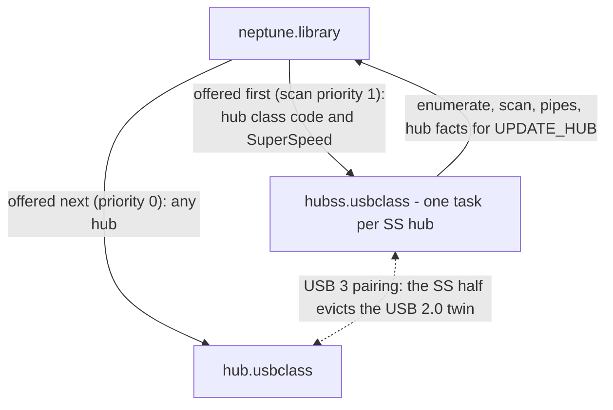
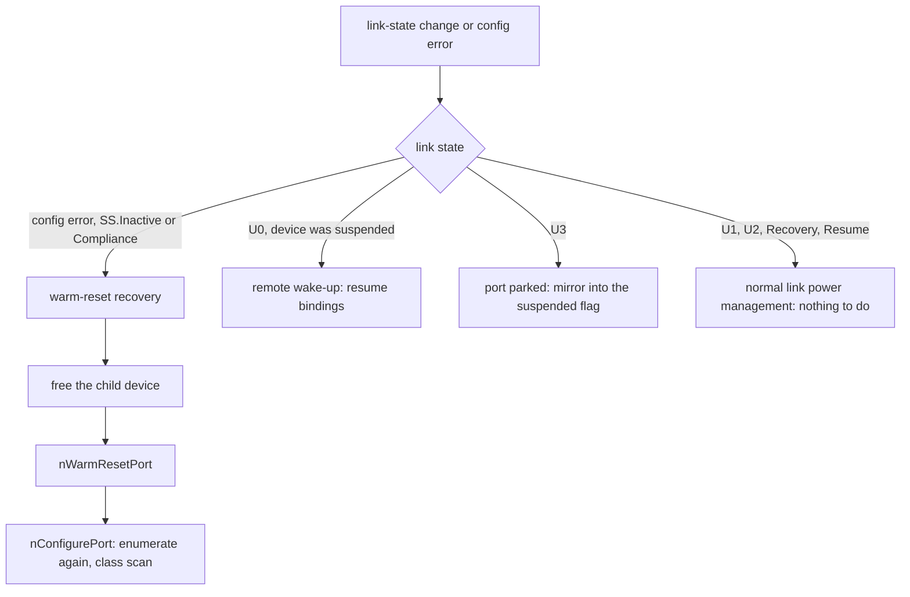

# hubss.usbclass - Architecture

> **Scope:** `hubss.usbclass`, the USB 3.x SuperSpeed hub driver. It is the SuperSpeed sibling of
> [`hub.usbclass`](hub.class-architecture.md) and shares its structure; this document describes what
> is shared only by reference and concentrates on what differs. Read the hub document first.
>
> Function names are anchors; the code is the reference for field layouts, timings and retry
> counts.

---

## 1. Purpose

`hubss.usbclass` drives **SuperSpeed hubs**, and the SuperSpeed half of every USB 3 hub. Its jobs are
the hub jobs (build the tree, track it live, serialise per-device changes; hub doc §1), plus the
client-side SuperSpeed hub services a USB 3 hub needs from the host software:

- tell the hub its depth in the tree, so it can route packets;
- understand USB 3 port status and link states;
- recover a failed link with a warm reset;
- suspend and resume through link states (U3/U0) rather than the USB 2.0 suspend feature;
- publish the hub's latency figures for link power management.

**Context HCDs only.** SuperSpeed devices exist as such only on a context HCD; on a legacy HCD the
controller presents USB 3 hubs as USB 2.0 hubs, and `hub.usbclass` binds them. `hubss.usbclass` checks
the HCD when it binds and declines on anything else. There is no legacy fallback anywhere in the
class.

---

## 2. Context

The split is decided by this class: it accepts only SuperSpeed hubs and is offered every hub
first. `hub.usbclass` takes whatever is left, which is why `hub.usbclass` must never gain a speed check
(hub doc §6, rule 8).

`hubss.usbclass` uses the same library services as `hub.usbclass`. It takes part in **no** address-0
serialisation: on a context HCD the controller assigns addresses atomically.

---

## 3. What is shared with hub.usbclass

The following work as described in the hub document and are not repeated here:

| Mechanism | Hub doc |
|---|---|
| One task per hub, the service loop and its four kinds of work, the settling flag for the ROM boot gate | §4 |
| Synchronous binding through `psdBorrowLocksWait` | §5.1 |
| Hot-plug handling, including hub-gone and the "ask a gone hub nothing" rule | §5.3 |
| USB 3 hub-half pairing (this class always plays the SuperSpeed half) | §5.4 |
| Method routing: direct, deferred, synchronous with the inline self-call | §5.5 |
| Suspend/resume ownership: the hub class is the only writer of the suspended flag | §5.6 |
| Teardown through `nFreeHub` | §5.7 |
| Design rules 1, 2, 4, 5, 6, 7 | §6 |

The two classes are **separate sources on purpose**. `hubss.usbclass` began as a copy of `hub.usbclass`
but has dropped the whole USB 2.0 path, while `hub.usbclass` keeps it. A change to a shared
mechanism has to be made in both files; that cost is accepted so that each class stays simple.

---

## 4. What differs

| Aspect | `hub.usbclass` | `hubss.usbclass` |
|---|---|---|
| Binds | any hub (catch-all) | SuperSpeed hubs on a context HCD |
| Hub descriptor | USB 2.0 hub descriptor; prefers the multi-TT interface | SuperSpeed hub descriptor; adds the header-decode latency and hub delay |
| Device speed | decoded from port status; split transactions for low/full speed behind a USB 2.0 hub | not decoded: every device on a SuperSpeed hub is SuperSpeed |
| Address 0 | class-local lock on legacy HCDs | none |
| Hub depth | not applicable | `SET_HUB_DEPTH` for every non-root hub |
| Port status | USB 2.0 format | USB 3 format, with link state |
| Reset | port reset | port reset; warm reset to recover a failed link |
| Suspend/resume | port suspend feature | link state U3 / U0 |
| Port disable | clears port enable | only frees the device; a SuperSpeed port cannot be disabled |
| USB 3 pairing role | USB 2.0 half: defers to the SS peer | SS half: evicts the USB 2.0 twin |

---

## 5. Key flows

### 5.1 Binding

As in the hub document, with two additions in `nAllocHub`:

- the HCD check: a hub on a non-context HCD is declined with an error log;
- after reading the SuperSpeed hub descriptor, the hub facts are published in one `psdSetAttrs`:
  port count, header-decode latency and hub delay. The port count arriving is what makes the
  library send the controller its `UPDATE_HUB`, so the latency figures reach the driver's link
  power management with it.

A non-root hub is then told its tier with `SET_HUB_DEPTH`; the tier is counted up the parent
chain, excluding the root hub. A failure is logged and is not fatal.

### 5.2 Enumerating a port

`nConfigurePort` follows the hub class's reset-and-enumerate shape, minus the USB 2.0 parts: no
address-0 lock, no speed decode, no split-transaction handling. Every new device is marked
SuperSpeed from the binding, so a downstream hub is offered to this class again. The reset is a
plain port reset; this function never issues a warm reset (§5.3).

### 5.3 Link-state events and warm reset

The hot-plug handler adds one branch to the hub class's. When the link state changes or a port
reports a configuration error:

A warm reset is the only way out of SS.Inactive or Compliance, and it returns the device to its
default state. The old device object is therefore freed first and the device enumerated again;
the warm reset is a recovery path, not a retry inside `nConfigurePort` (rule 1).

### 5.4 Suspend and resume

Per-device suspend drives the port's link to U3, resume back to U0. Ownership of the suspended
flag, the whole-hub suspend, and the EP1 rules are as in the hub class.

---

## 6. Design rules

The shared rules are listed in hub doc §6. In addition:

1. **Warm reset is recovery, never a reset retry.** It drops the device back to its default state,
   so calling it from inside `nConfigurePort` would leave the stack's device object pointing at a
   device that no longer has an address.
2. **Warm-reset recovery runs only on a real link event**, or after a real transfer timeout on a
   hub that is still connected. Never on hub-gone: a blanket synthesised change set includes the
   config-error bit, and once sent every port of an unplugged hub through warm-reset recovery,
   costing about half a second and a burst of misleading errors per port (hub doc §6, rule 5).
3. **Context HCDs only.** The class assumes atomic addressing, native USB 3 port status and a
   controller that understands `UPDATE_HUB`. Adding a legacy path would bring back everything
   `hub.usbclass` already does for that case.
4. **The pairing helpers for the USB 2.0 half are present but inert here** - this class is always
   the SuperSpeed half. They stay for parity with `hub.usbclass`.

---

## 7. Interfaces

**Implemented:** the same `usbclass` methods as `hub.usbclass` (hub doc §7), including
`UCM_HubResetPort` and `UCM_PortsPending`; scan priority 1.

**USB requests:** the SuperSpeed hub descriptor, hub and port status, `SET_HUB_DEPTH`, set/clear
feature on port power, port reset, warm reset (`BH_PORT_RESET`) and link state, and the USB 3
change bits (connection, link state, config error, warm reset, over-current, reset).
