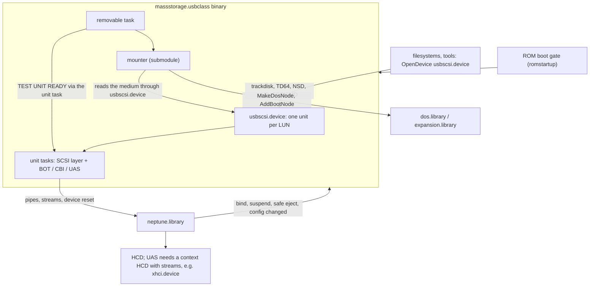
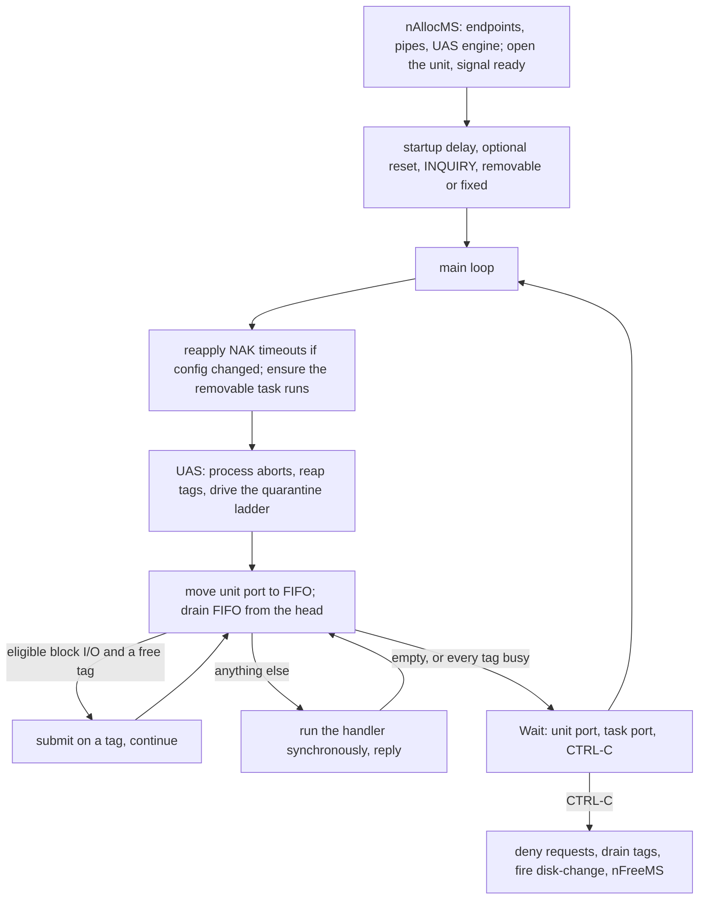
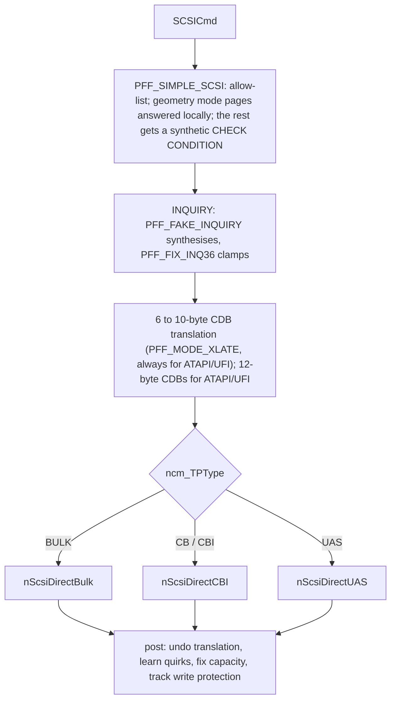
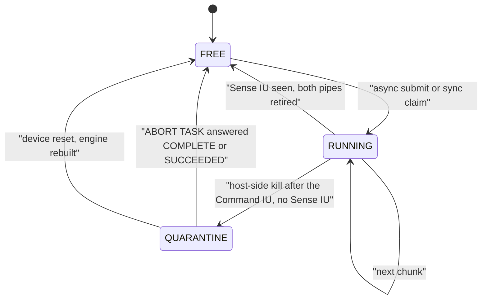
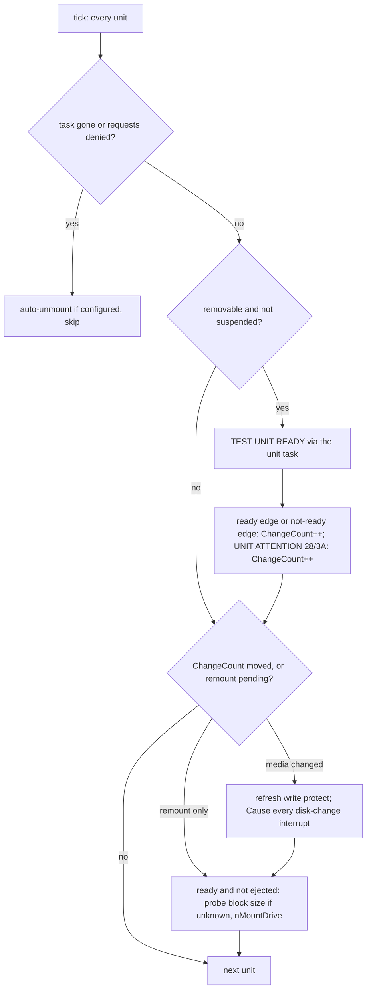

# massstorage.usbclass - Architecture

> **Scope:** `massstorage.usbclass`, the USB Mass Storage driver: an interface-level class, the
> embedded `usbscsi.device`, three USB transports, the removable-media task and the mounter
> (`classes/massstorage/mounter`, a fork of the a4091.device mounter, built into the class).
> It is a client of `neptune.library`; read [neptune.library-architecture.md](neptune.library-architecture.md)
> first (bulk streams §5.7, binding §5.5, lock borrowing §4.2, suspend and power policy §5.9-§5.10).
>
> This document describes structure, behaviour and the rules that keep it correct. It names
> functions as anchors; the code is the reference for field layouts, timings, retry counts and
> defaults.

---

## 1. Purpose

`massstorage.usbclass` turns USB storage into AmigaDOS volumes. It has four jobs:

1. **Expose storage as a disk device.** Every bound mass-storage interface becomes one
   `usbscsi.device` unit per LUN, speaking the trackdisk, TD64/NSD and `HD_SCSICMD` protocols that
   filesystems and tools already know.
2. **Speak SCSI over three transports** - Bulk-Only (BOT), Control/Bulk/Interrupt (CBI and CB),
   and USB Attached SCSI (UAS) with bulk streams - behind one `SCSICmd` interface, absorbing
   non-conformant firmware with per-device quirk flags that it can learn and persist.
3. **Watch the media and mount it.** A background task polls removable units, turns answers into
   disk-change events, and hands each new medium to the mounter (RDB, MBR, GPT, superfloppy, CD).
   Before DOS exists it also answers the ROM boot gate, so a USB volume can appear in the boot menu.
4. **Take volumes down safely.** Auto-unmount when a unit disappears, and a verified,
   all-or-nothing safe eject when the user asks first.

It binds at the **interface** level, on `MASSSTORE_CLASSCODE`.

---

## 2. Context



- **Downwards** it uses only the library: EP0, bulk pipes, a CBI interrupt pipe, and for UAS a
  plain command pipe plus per-tag stream pipes; `psdResetDevice` recovers a wedged UAS device.
- **Upwards** it *is* `usbscsi.device`, built by `libInit` with `MakeLibrary`, `AddDevice`d with its
  open count pinned while the class is resident, and removed by `libExpunge`. It also drives
  `expansion.library` and `dos.library` to create and remove DOS nodes.
- **Sideways**, the mounter talks to the class only through `usbscsi.device` and a recipe
  structure. The ROM boot gate polls `UCM_MediaPending`; `psdSafeEjectDevice` calls `UCM_SafeEject`
  and then disables the hub port itself.

---

## 3. Building blocks

| Block | Responsibility | Anchors |
|---|---|---|
| **Class base** | Unit list, the removable task handle, class-default config, method dispatch | `NepMSBase`, `libInit`, `usbDoMethodA` |
| **Embedded device** | Exec device vectors; classifies each command as inline, queued or NSD | `NepMSDevBase`, `devBeginIO`, `devAbortIO`, `cmdNSDeviceQuery` (`dev.c`) |
| **Unit** | One LUN; embeds `struct Unit` as its first field, so a unit pointer *is* the binding | `NepClassMS`, `usbForceInterfaceBinding`, `usbReleaseInterfaceBinding` |
| **Unit task** | The only executor of a LUN's USB I/O; owns its pipes and the request FIFO | `nMSTask`, `nAllocMS`, `nFreeMS`, `nWakeUnitTask`, `nWakeTransport` |
| **Block commands** | trackdisk/TD64 to SCSI: read/write chunking, geometry, start/stop, unaligned emulation | `nRead64`, `nWrite64`, `nSeek64`, `nGetGeometry`, `nFakeGeometry`, `nStartStop`, `nRead64Emul`, `nWrite64Emul` |
| **SCSI layer** | CDB translation, command filtering, INQUIRY fixes, learned quirks, write-protect tracking | `nScsiDirect`, `nTryFallback`, `nApplyFallback`, `nVendorQuirks` |
| **BOT transport** | CBW / data / CSW, and the reset ladder shared with CBI | `nScsiDirectBulk`, `nBulkReset`, `nBulkClear`, `nClearEndpointHalt` |
| **CBI transport** | ADSC command on EP0, data on bulk, status on interrupt | `nScsiDirectCBI`, `nCBIRequestSense` |
| **UAS transport** | Tagged IUs over stream pipes; async tag engine plus a synchronous path; ABORT TASK ladder | `nScsiDirectUAS`, `nUasDoCommand`, `nUasSubmitTag`, `nUasReapTags`, `nUasProcessQuarantine`, `nUasDrainTags`, `nUasInitTags`, `struct UasTag` |
| **Removable task** | Media polling, disk-change edges, mount dispatch, boot-gate verdict, auto-unmount | `nRemovableTask`, `nRTPollMedia`, `nRTMountPass`, `nRTDOSArrived`, `nIOCmdTunnel` (`massstorage_removable.c`) |
| **Mount glue** | Builds one recipe per filesystem from config and calls the mounter | `nMountDrive`, `MSFsTable`, `nFillMountFS`, `nCDFSCaps` |
| **Mounter** | Partition parsing, filesystem resolution, naming, node creation | `MountDrive`, `probe_unit`, `mnt_scan_rdb`, `mnt_scan_legacy`, `mnt_scan_cd`, `mnt_mount_volume`, `attach_fs` (`mounter/`) |
| **Unmount and eject** | Reactive unmount of a gone unit; verified device-wide eject | `nUnmountPartition`, `nRemoveDosNode`, `nSafeEjectDevice`, `nInhibitAll`, `nQuiesceDevice` |
| **Config and GUI** | Per-device and per-LUN IFF chunks, reload on prefs change, MUI window | `ClsDevCfg`, `ClsUnitCfg`, `nLoadBindingConfig`, `nReapplyConfig`, `nStoreConfig`, `nGUITask`, `AutoDetectMaxTransfer` |

**Units outlive bindings.** A unit is freed only in `libExpunge`; a re-plugged device is matched
back to it by device ID, interface ID and LUN and keeps its unit number. `ncm_DenyRequests` alone
separates a live unit from a dead one (rule 1).

---

## 4. Runtime model

| Task | Count | Waits on | Owns |
|---|---|---|---|
| Unit task (`nMSTask`) | one per LUN | unit port, task port, CTRL-C | the LUN's pipes, its FIFO, its UAS tags |
| Removable task (`nRemovableTask`) | one per class | timer, CTRL-C | the polling tick, the mount dispatch, its tunnel request |
| GUI task (`nGUITask`) | on demand | MUI | the config window |
| Caller tasks | any | - | inline device commands, safe eject, the suspend probe |

**The unit task has two ports, one per loop.**

- The **unit port** (`ncm_Unit.unit_MsgPort`, embedded, never freed) is the inbox. `devBeginIO`
  `PutMsg`s queued commands to it, and `nWakeUnitTask` raises its signal for flags the main loop
  services (config reload, removable-task restart, resume). Only the main loop waits on it.
- The **task port** (`ncm_TaskMsgPort`) is the reply port of every pipe. `nWakeTransport` raises
  it for the UAS abort flag. Everything that waits on it either pumps the UAS engine afterwards or
  is `psdWaitPipe`, which restores the signal.



**Serialisation.**

- **Per LUN**, the unit task is the single executor. On BOT and CBI every request is strictly
  serial. On UAS, eligible block I/O runs asynchronously on free tags, while everything else runs
  through the synchronous path on a tag of its own. Because the task executes one FIFO entry at a
  time, at most one synchronous command is in flight; the only concurrency is synchronous versus
  async block I/O.
- **Across LUNs** of one device, `ncm_XFerLock` in the LUN-0 unit is taken around each synchronous
  transport call, and only when the device has more than one LUN. UAS binds LUN 0 only, so the lock
  is inert there and the async tag path takes no lock at all.
- **Background I/O tunnels.** The removable task never touches a unit's pipes. `nIOCmdTunnel`
  `PutMsg`s a request to the unit port and waits for the reply, so even polling and geometry
  refreshes run in the unit task.

**Lifetimes.** Release sets `ncm_DenyRequests`, sends CTRL-C and waits (`psdBorrowLocksWait`);
the unit task drains its tags, fires the disk-change interrupts, fails everything queued and frees
its pipes. The removable task is (re)started by every unit task whose unit is removable or flagged
`ncm_ForceRTCheck` (`nStartRemovableTask` is idempotent). Pre-DOS it is a plain Task that never
exits; when `dos.library` appears it retires and the unit tasks respawn it as a Process, which makes
`DoPkt` legal. After that it exits once no unit is alive; a fixed disk's teardown restarts it so
the auto-unmount runs.

---

## 5. Key flows

### 5.1 Binding

```mermaid
sequenceDiagram
    participant LIB as neptune.library
    participant CLS as usbAttemptInterfaceBinding
    participant T as nMSTask, one per LUN

    LIB->>CLS: UCM_AttemptInterfaceBinding
    CLS->>CLS: decline BOT if a usable UAS alternate exists
    CLS->>CLS: check class, subclass, protocol
    CLS->>CLS: per LUN: config + quirks; GET_MAX_LUN once (BOT/CBI, LUN 0)
    loop each LUN
        CLS->>CLS: find or create the unit, assign unit number
        CLS->>T: spawn, wait (borrowing the caller's locks)
        T->>T: nAllocMS: endpoints, UAS alt switch, pipes, tag engine
        T-->>CLS: ready (ncm_Task set = success)
    end
    CLS-->>LIB: binding = the LUN-0 unit
    T->>T: startup delay, optional reset, INQUIRY
```

- **UAS preference.** A BOT interface is declined when the device is SuperSpeed, its HCD reports
  `HA_StreamsSupported`, and a UAS alternate exists; the class scan then offers the alternate.
  `PFF_NO_UAS` in the **class-default** config turns this off for all devices. `nAllocMS` switches
  to the alternate itself, before stream setup, because the enumerator's switch comes too late.
- **Config, then quirks.** `nLoadBindingConfig` starts from the class defaults, overlays the
  device's stored record, then ORs in `nVendorQuirks`. Its first set (model defaults) applies only
  when there is no stored record; the second set (known hardware facts) always applies. Every
  config reload goes through the same function, so the effective flags are the same as at bind.
- **LUNs.** `GET_MAX_LUN` is a BOT request, issued once on LUN 0 unless `PFF_SINGLE_LUN` or UAS.
  On failure the class learns `PFF_SINGLE_LUN`. Each LUN gets its own unit, task and unit number;
  all share `ncm_UnitLUN0`, which is also the binding handle.
- **What runs after ready.** The bind returns once the pipes exist. The startup delay, the optional
  Bulk-Only reset and INQUIRY run in the unit task afterwards. INQUIRY decides the peripheral type
  (optical units get 2048-byte blocks and a NAK-timeout floor) and removable versus fixed: a fixed
  unit is marked ready with a change pending, so the removable task mounts it (§5.8).
- **Release** stops every unit whose `ncm_UnitLUN0` is the binding. Unit memory is kept.

### 5.2 Request path

`devBeginIO` sorts each command three ways:

- **Inline**, in the caller's task: change count, change state, protection status, adding and
  removing disk-change interrupts, and the no-op commands. An added change interrupt is never
  replied; it lives in `ncm_DCInts` until removed.
- **Queued** to the unit task: block I/O, seek, format, geometry, start/stop/eject, reset/flush and
  `HD_SCSICMD`. While `ncm_DenyRequests` is set they fail at once instead.
- **NSD**: `NSCMD_DEVICEQUERY` reports a trackdisk device.

Block I/O is chunked at the configured maximum transfer into READ/WRITE(10), or (16) above 2 TB.
A request not aligned to the medium's block size learns `PFF_EMUL_LARGE_BLK` and is served by
read-modify-write through a one-block buffer. A UAS request is **eligible** for the tag engine only
when it is a plain aligned block read or write of non-zero length with a known block size and no
emulation; everything else, including the first block I/O after bind (which probes the block
size), takes the synchronous path. `nGetGeometry` combines READ CAPACITY and the geometry mode
pages; `nFakeGeometry` builds a CHS layout by factoring the block count when the device gives
nothing usable.

`devAbortIO` removes a request still in the FIFO, or flags its UAS tag (`ut_AbortReq` +
`nWakeTransport`) so it completes with `IOERR_ABORTED` through the normal reap; a request being
executed synchronously cannot be aborted. `CMD_RESET` and `CMD_FLUSH` drain the engine and fail
everything queued.

### 5.3 The SCSI layer and learned quirks

Every command, whether from a block handler, `HD_SCSICMD`, the removable task or the mounter,
goes through `nScsiDirect`. The transports receive an already-adjusted `SCSICmd`:



The default flag set is non-empty (`MODE_XLATE`, `NO_RESET`, `FIX_INQ36`, `SIMPLE_SCSI`), so this is
out-of-the-box behaviour. Optical units are allowed their CD commands even under `PFF_SIMPLE_SCSI`.

**Learned quirks.** When a device misbehaves, the class changes its own flags and saves them, so
the next bind starts adapted: a failed INQUIRY learns `FIX_INQ36`, then `FAKE_INQUIRY`; a phase
error on a non-basic command learns `SIMPLE_SCSI` (mode-sense failures step through `MODE_XLATE`
first); an off-by-one capacity learns or unlearns `FIX_CAPACITY`; a failed startup reset learns
`NO_RESET`; unaligned I/O learns `EMUL_LARGE_BLK`. All of them go through `nTryFallback`, which
refuses under `PFF_NO_FALLBACK` and logs the switch the device seems to need instead (rule 10).

**Optical NAK floor.** For CD/DVD units `nNakTimeoutMs` raises a short NAK timeout to a floor
(drives NAK for seconds while spinning up), on every pipe, without storing it; zero (off) stays off.

### 5.4 BOT - Bulk-Only

One command at a time: a 31-byte CBW on bulk OUT, the data phase, a 13-byte CSW on bulk IN whose tag
must match the CBW's. A failed status with autosense requested sends REQUEST SENSE as a second BOT
command. Queue depth 1 is the protocol's, not the driver's: the device must return the CSW before
the next CBW. UAS is the transport that adds queuing. The three phases cost little on large
commands: at 512 KB the host round trips are ~2% of the time. (Arming the data-IN and CSW-IN
transfers back to back on the bulk-IN ring would cut three round trips to one.

The transport is deliberately lenient so that it usually reaches the CSW, because the device's
status is authoritative: data and CSW stalls are cleared and passed, short packets accepted,
overflow forgiven (`nIsOverflowErr`), the residue ignored, and the CSW signature check skippable
(`PFF_CSS_BROKEN`). Data that turns out to be a CSW counts as a failed command.

Anything not forgiven - a bad CSW, a phase error, a failed transfer including a NAK timeout - goes
to `nBulkReset` and costs the command its one autoretry (if the caller asked for one). Error
recovery is summarised in §5.7.

### 5.5 CBI - Control/Bulk/Interrupt

The CDB goes out as an ADSC class request on EP0, data on bulk, and status as a 2-byte interrupt
report. With a data phase on true CBI, the status pipe is armed first and the data pipe second,
because the device may report completion before the data finishes; once the status is in, a data
transfer still pending is aborted. The status buffer is pre-set to a phase error, so an aborted or
empty report never reads as success. Plain CB has no interrupt endpoint and synthesises a pass.
A failed status is followed by `nCBIRequestSense`. Recovery shares `nBulkClear` and `nBulkReset`
with BOT; for CBI the reset is the class's 12-byte command-block reset.

### 5.6 UAS - USB Attached SCSI with streams

UAS replaces the CBW/CSW sequence with tagged Information Units on four endpoints: command OUT,
status IN, data IN and data OUT, found by their pipe-usage descriptors. On SuperSpeed the **tag
is the stream id**: the device returns status and data for tag *n* on stream *n* of the status and
data endpoints. The command pipe is a plain pipe. The library backs the stream pipes with real
rings on a context HCD (core doc §5.7).

**Engine setup** (`nUasInitTags`). The queue depth is latched from config at bind, clamped to the
tag array, and clamped down to what the endpoints offer; zero streams fails the bind. Each tag gets
status, data-in and data-out pipes labelled with its stream id. If the status endpoint has
headroom, one extra stream id is reserved for task management first, because the first stream id
on an endpoint sizes its ring set. The class then reads back how many rings exist and fails the bind
if any endpoint is short (rule 6). There is no non-stream UAS path.

**Async block I/O** (`nUasSubmitTag`). Per chunk the tag arms its status pipe, then its data pipe,
then sends the Command IU blocking on the shared command pipe. The main loop reaps completions;
a tag continues a large request chunk by chunk and replies it from `nUasFinalizeTag`. A status
other than GOOD aborts the data pipe, since a rejected command moves no data. Tags carry the SIMPLE
attribute, so completion order across tags is not guaranteed; concurrent requests cover disjoint
blocks and exec I/O promises no ordering.

**Synchronous commands** (`nUasDoCommand`). Any other SCSI command claims a free tag of its own
(`nUasClaimTag`, waiting and pumping the engine if all are busy) - plain pipes cannot reach
endpoints in stream mode. Sibling tags keep running, because `psdWaitPipe` consumes only its own
pipe's reply. Sense usually arrives inline in the Sense IU; REQUEST SENSE is sent only if autosense
was requested and none came. One autoretry is spent on UNIT ATTENTION only.

**Tag lifecycle.**



A host-side kill (NAK timeout, `AbortIO`, any pipe error) leaves the **device** owning the command
whenever the Command IU was delivered and no Sense IU came back. Reusing that tag would let the old
command's Sense IU land in the next command's status transfer, so the tag is quarantined and
`nUasProcessQuarantine` runs the ladder:

1. **ABORT TASK** Task Management IU for one quarantined tag at a time, carrying the reserved TM
   stream id. Without a reserved id the engine **borrows** a tag: it waits until every other tag is
   idle and lends one (never the target). At queue depth 1 there is nothing to lend, so it goes
   straight to step 3.
2. The **Response IU** arrives on the TM tag's status stream. Only "complete" and "succeeded"
   release the tag. The TM pipe's NAK timeout is the TMF deadline.
3. Anything else escalates to **`psdResetDevice`**: kill every tag, reset the port and re-address
   the device, then rebuild the engine on the fresh endpoint contexts. A failed rebuild denies
   further requests. If the stack cannot reset at all, the class releases the tags and accepts the
   stale-IU risk rather than wedging the unit.

Quarantined tags count as busy for `nUasTagsIdle`, so the drain and the suspend probe wait for the
ladder, which is bounded by construction. **UAS is LUN 0 only:** multi-LUN UAS would need REPORT
LUNS at bind and one tag engine shared by the LUN units.

**Where the concurrency comes from.** UAS is strictly one command to one tag: a command is never
split across tags, a tag never carries two commands, and status comes back on the tag it answers.
So concurrency comes only from splitting a large transfer into several commands, each on its own
tag, covering contiguous blocks and in flight together up to the queue depth. A system with a block layer above SCSI splits there; `usbscsi.device` is handed one
arbitrarily large `io_Length` with nothing above it, so the class splits and reassembles itself.
Throughput comes from queue depth, not command size: on PiStorm + Pi 4 with the VL805, a UAS SSD
reads 290 MB/s with one 1 MB command in flight and 370 MB/s with four, which is the PCIe Gen2 ×1
link's ceiling (~400 MB/s).

### 5.7 Error recovery

| | BOT | CBI / CB | UAS |
|---|---|---|---|
| Stall | data or CSW stall: clear the halt, continue to status; CBW stall: `nBulkClear`, resend | data stall cleared and accepted; status stall cleared; ADSC stall: `nBulkClear`, resend | a pipe error like any other: tag quarantined |
| Transfer failure | `nBulkReset`: class reset (once it fails, never again on that device), then clear both bulk halts | `nBulkReset` with the CBI command-block reset | tag quarantined, ABORT TASK ladder (§5.6) |
| NAK timeout | treated as any failure: reset, then the one autoretry | same | host-side kill, so quarantine |
| Command retry | one, if the caller set the autoretry flag; not on NOT READY or ILLEGAL REQUEST sense | one, if requested | one, on UNIT ATTENTION only |
| Device gone | `ncm_DenyRequests` or a CBW timeout ends the command as a phase error, no reset | same | `nUasClaimTag` bails when the engine is gone |

Clearing a halt goes through the library's `psdClearEndpointHalt`, which also cancels the library's
own pending stall recovery for that endpoint. The NAK timeout is a deadline on each transfer from
submit, so it is in effect the command timeout (rule 8).

### 5.8 Media change and mounting

The removable task runs a timer tick. Each tick visits every unit:



- **Edges, not levels.** `ncm_ChangeCount` moves only on a real transition (ready versus the
  previous `ncm_UnitReady`) or a media-change UNIT ATTENTION. The mount pass compares it with
  `ncm_LastChange`. The pass runs for **every** live unit, which is how fixed disks get mounted:
  their change comes from the unit task at bind.
- **Polling cadence.** The tick is slow normally and fast only while DOS is absent and some unit is
  unsettled, so the boot gate's short wait is enough.
- **The pre-DOS verdict.** `ncm_MediaUnsettled`, read through `UCM_MediaPending`, says whether a
  unit may still produce a boot volume. A volume mounted after DOS exists gets no boot node, so a
  unit that settles too early loses its boot menu entry for good. A ready unit stays unsettled until
  its mount resolves; "becoming ready" (ASC 04) keeps it unsettled (the gate's cap bounds it);
  MEDIUM NOT PRESENT settles it. UNIT ATTENTION - what a spun-up drive answers after a warm reboot -
  and unreadable answers keep it unsettled on a budget. A failed pre-DOS mount is retried on a
  budget too; a mount that only *deferred* is not.
- **Two passes.** Pre-DOS, the mounter creates only nodes it can service, which means a
  `FileSystem.resource` entry. A partition whose handler must come from `L:` is **deferred**
  (`ncm_MountDeferred`). When DOS appears, `nRTDOSArrived` sets `ncm_RemountPending` on units with
  something left to gain, and the next pass mounts them under their own names (rule 13).
- **The mounter** (`MountDrive`) dispatches on device type: RDB first (filesystems from
  `FileSystem.resource` or relocated from the RDB's own filesystem blocks), then MBR/GPT/superfloppy
  (each partition's boot sector picks the FAT, NTFS or exFAT recipe; the table type is only a hint),
  or for optical media a whole-disc mount with the CD recipe. It parses no filesystem formats: ISO,
  UDF and HFS are the handler's problem.
- **Recipes.** `nMountDrive` builds one `MountFS` per row of `MSFsTable` (dostype, handler, DOS
  name, buffers, control string, stack, flags) and maps the per-LUN switches to `MSF_*` scan flags.
  `MSF_*` gates a scan; `MOUNTFS_*` describes a recipe. The CD recipe carries `MOUNTFS_FORCELOAD`,
  so after DOS the configured handler wins over a ROM CD filesystem registered on the same dostype.
  `nCDFSCaps` adds the any-format and audio-disc flags only when the handler is ODFileSystem.
  RDB partitions keep their own names and environment.
- **Naming.** A recipe name gets a unit digit and is bumped past collisions (`fix_name_collision`);
  a volume whose device, unit and extent already have a node is skipped (`is_extent_mounted`).
- **DMA alignment.** The bind caches the HCD's `HA_DMAAlignment` and passes it as the mounter's
  `dmaAlign`. When it is above 1, recipe mounts get `de_BufMemType = MEMF_FAST|MEMF_PUBLIC`, which
  keeps the filesystem's own buffers out of Chip RAM; otherwise `MEMF_ANY`. `de_Mask` is always
  `0x7FFFFFFE`: no filesystem can honour an alignment set through the mask, and the HCD bounces
  misaligned or unreachable buffers itself. RDB partitions keep the RDB's values. Until 6.3 the mask
  was narrowed to the alignment and `MEMF_CLEAR` was set (GH #24). fat95 reads into a caller's
  buffer only if the buffer has every `de_BufMemType` bit, which `MEMF_CLEAR`, an allocation flag,
  never is; and a buffer that fails the mask goes through the filesystem's own buffers: fat95 fell
  back to its cache, one cluster at a time, FFS reads 512 bytes at a time, and PFS3, whose pool
  buffers can never be 64-byte aligned, raises a requester on every such read and stops responding.
- **Auto-unmount** (`nUnmountPartition`) runs from the removable task when a unit is gone: it sends
  inhibit and die blind to every handler riding the unit, removes the DOS node and unlinks any stale
  boot node. Nobody is left to veto.

### 5.9 Safe eject

`UCM_SafeEject` (`nSafeEjectDevice`) runs on the **caller's** task, which must be a Process, and
may block for seconds. It is **device-scoped**: every unit of the binding's `PsdDevice` takes part,
covering extra LUNs and extra storage interfaces.

- **Latch first.** `ncm_Ejected` is set on all of the device's units, so the removable task cannot
  mount behind the operation. It vetoes only mounting; change counts are still consumed.
- **All or nothing.** Every DOS node riding one of the units is collected under one device-list
  read lock, released before any packet is sent. Each handler gets a flush and a checked inhibit.
  One refusal re-enables the handlers already inhibited, clears the latch and returns
  `SAFEEJECT_BUSY` naming the volume. A handler that cannot inhibit proceeds after the flush.
- **Then the point of no return:** die and remove each node, then per unit synchronize cache,
  allow medium removal and stop, through a `usbscsi.device` request of the eject's own (the tunnel
  belongs to the removable task). Stop goes through the unit task, so it gets the UAS drain.
- The library disables the hub port afterwards; the class never touches the bus.

### 5.10 Suspend and resume

`UCM_AttemptSuspendDevice` **refuses rather than drains**: it fails while a synchronous command is
on the wire (`ncm_CmdBusy`), a UAS tag is busy or quarantined, or a sibling LUN holds the transfer
lock. Otherwise it clears `ncm_Running`, which stops the media polling. Queued I/O needs nothing:
`psdDoPipe` resumes the device, and a command that starts after the answer, while the library is
still suspending, either calls the suspend off or gets the device woken for it (core doc §5.9).
Resume sets `ncm_Running` and wakes the unit task. When to suspend
is the library's policy (core doc §5.10).

### 5.11 Configuration

Two IFF chunks, keyed by device and interface ID: `ClsDevCfg` per device (NAK timeout, patch flags,
startup delay, maximum transfer, UAS queue depth, and per filesystem the handler, dostype, control
string and stack) and `ClsUnitCfg` per LUN (mount switches, boot, default unit number, auto-unmount,
and per filesystem the DOS name and buffers). The class-default pair lives in `nh_DummyNCM`.

- **Reload.** `UCM_ConfigChangedEvent` (`nReapplyConfig`) reloads every unit; each unit task
  re-arms its own pipe timeouts. Queue depth, startup delay, unit number and mounts stay as bound.
- **No store before prefs.** `nStoreConfig` does nothing until the library has read the prefs, so a
  ROM bind cannot freeze hard-coded defaults into a per-device record.
- **The filesystem table.** `MSFsTable` holds labels, defaults, recipe flags and the **offsets** of
  each filesystem's config fields. Recipes, GUI, defaults and migration loop over it, so adding a
  filesystem is one row plus its fields. Chunks grow append-only (no version field; loaders copy no
  more than was stored, `nMigrateUnitFs` seeds missing slots from the FAT one).
- **GUI.** One MUI window per binding or for the class defaults: quirk switches (an inverted
  "Prefer UAS" over `PFF_NO_UAS`), NAK timeout, queue depth, filesystem rows built from the table,
  a per-LUN page, and `AutoDetectMaxTransfer`, a transfer-size benchmark run through
  `usbscsi.device`.

---

## 6. Design rules

Each rule exists because breaking it caused, or would cause, a real failure.

1. **`ncm_DenyRequests` is FALSE exactly while a live unit task owns the unit port.** Units are
   never unlinked, so this flag alone keeps `devOpen` from opening a unit with no task. The unit
   task clears it before its startup reset, which bails on the flag (clearing it later skipped the
   reset on every rebind and persisted `NO_RESET`); release, teardown and a failed `nAllocMS` set it.
2. **One executor per LUN; background I/O tunnels.** Only the unit task touches its pipes.
   The removable task uses `nIOCmdTunnel`; safe eject and the transfer benchmark use their own
   `usbscsi.device` requests. Touching pipes from another task brings back cross-task pipe races.
3. **Wake a flag on the port of the loop that services it.** Main-loop flags go through
   `nWakeUnitTask`, the UAS abort flag through `nWakeTransport`. A signal raised on the other port
   can be swallowed by a pipe wait. `nDeleteTaskPort` clears the pointer under Forbid before the port
   goes, which makes `nWakeTransport` safe against teardown.
4. **UAS completions are reaped with `psdCheckPipe` + `psdWaitPipe`, never `GetMsg`.** `GetMsg`
   followed by `psdWaitPipe` removes the node twice. `psdWaitPipe` also consumes only its own pipe's
   reply, which is what lets a synchronous command block on one tag while others stay in flight.
5. **A tag is reused only when both of its pipes have retired and the device has let go.** A late
   sibling reply would land in a reused tag's fresh transfer, and a quarantined tag's late Sense IU
   would close the wrong command. Only a Sense IU closes a command; any other IU on a command tag is
   a protocol violation and quarantines the tag.
6. **Stream rings are verified, and a missing ring fails the bind.** The library stays silently
   single-ring when stream allocation fails; at queue depth above 1 that interleaves tags on one ring
   and corrupts data. The binding already guaranteed a stream-capable HCD, so a failure here is a
   fault, not a degraded mode.
7. **Drain only where a barrier is the point.** `CMD_RESET`/`CMD_FLUSH`, the medium-state commands
   (start, stop, eject - spinning down under a write is what SIMPLE tasks would permit) and task
   teardown drain the engine. Synchronous commands take a tag instead; suspend refuses instead.
   Draining for everything serialises the device for nothing.
8. **The NAK timeout is the command timeout, and only `nNakTimeoutMs` / `nApplyNakTimeout` set it.**
   The HCD applies it as a deadline per transfer and nothing else times out, so a transport must
   never raise it to wait longer (unbounded hangs). EP0 gets a margin over the data pipes so recovery
   traffic outlives the pipe that timed out; `nApplyNakTimeout` applies it so that "off" stays off.
9. **"Device sent too much" is forgiven through `nIsOverflowErr` on every transport.** xHCI reports
   it as babble where older HCDs report overflow; any new check for it must use the helper.
10. **Quirks are learned only through `nTryFallback`, and persist.** It honours `PFF_NO_FALLBACK`
    and logs once per binding; `nApplyFallback` stores the result. Hard-coded model quirks are
    facts, not guesses, and are applied in `nLoadBindingConfig`, not here.
11. **Firmware reality wins over specification purity.** The BOT residue is ignored and the CSW
    signature check is skippable; do not "fix" either.
12. **Reused units must not inherit state.** `nUasCollectEndpoints` clears the endpoint pointers
    before collecting, `nFreeMS` NULLs every pipe pointer, and the unit task clears the eject latch
    at startup. Otherwise a rebind uses a freed device's endpoints, a UAS/BOT flip double-frees
    stale pipes, and a stale latch vetoes every future mount.
13. **A pre-DOS mount creates only nodes it can service.** A node whose handler cannot load still
    claims the DOS name, and the post-DOS pass then mounts the volume again under a bumped name.
    The second pass runs on `ncm_RemountPending`, never a change-count bump: a fake media change on
    the boot volume makes DOS ask for it to be reinserted. An extent match means "mine, skip"; a name
    collision means "another drive, rename" - never conflate them.
14. **The boot verdict believes only sense bytes the device returned.** A command that fails
    without sense is exactly what a bus reset produces; stale bytes misclassify a warm boot, and
    treating UNIT ATTENTION as "no medium" drops the drive from the boot menu on every reboot.
15. **Never send a DOS packet while holding the DOS list lock.** An inhibit may need that list.
    Safe eject collects under the lock and acts after releasing it.
16. **`usbscsi.device` stays inside the class.** Its units *are* the class's bindings (`NepClassMS`
    embeds `struct Unit`), and unit lifetime, the open gate and the request queue all live there.

---

## 7. Interfaces

**Implemented (`usbclass` methods):** interface binding (attempt, force, release), class
attributes (`UCCA_Priority` 0, class and binding config GUIs, supports suspend, supports safe
eject), `UCM_OpenCfgWindow`, `UCM_OpenBindingCfgWindow`, `UCM_ConfigChangedEvent`,
`UCM_AttemptSuspendDevice`/`ResumeDevice`, `UCM_SafeEject` and `UCM_MediaPending`.

**Implemented (`usbscsi.device`):** trackdisk block I/O, seek, format, geometry, change detection
and change interrupts, protection status, start/stop/eject, reset/flush; TD64 and NSD 64-bit
commands; `NSCMD_DEVICEQUERY`; `HD_SCSICMD` passthrough. Units are numbered from the configured
default unit upwards, one per LUN.

**Used from the library:** interface and device attributes (speed, hardware, DMA alignment, stream
support, alternates, endpoint stream counts), pipes and stream ids, `psdSetAltInterface`,
`psdClearEndpointHalt`, `psdResetDevice`, subtask spawning and lock borrowing, config chunks and the
prefs-read state, the error log.

**Used from the OS:** `expansion.library`, `dos.library`, `timer.device`, `FileSystem.resource`, MUI.

**External standards:** USB Mass Storage Class Bulk-Only Transport 1.0 and CBI 1.1; USB Attached
SCSI (T10 UAS, USB UAS 1.0) over USB 3 bulk streams; SCSI SPC/SBC/MMC command sets, with UFI and
ATAPI variants; AmigaDOS trackdisk, TD64 and NSD; RDB, MBR and GPT partitioning.
