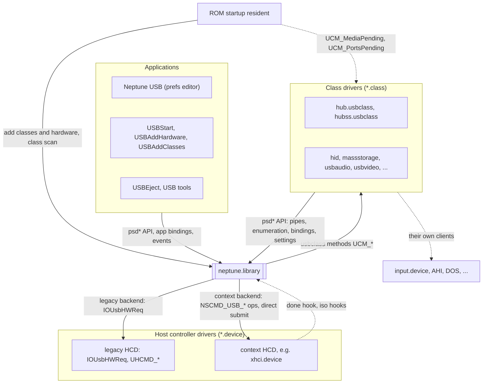
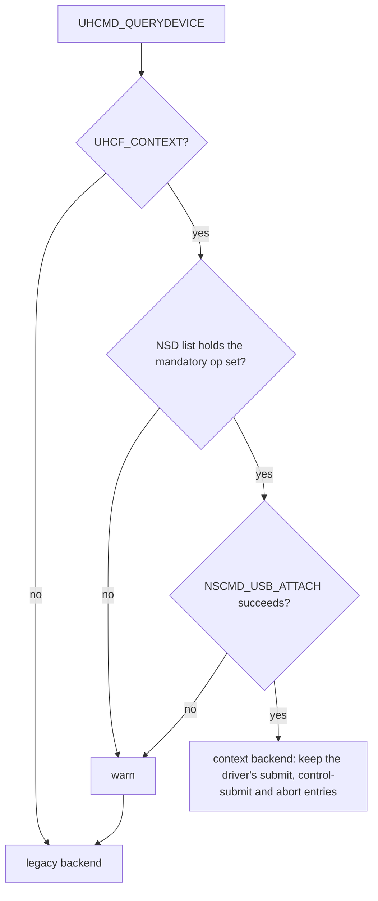
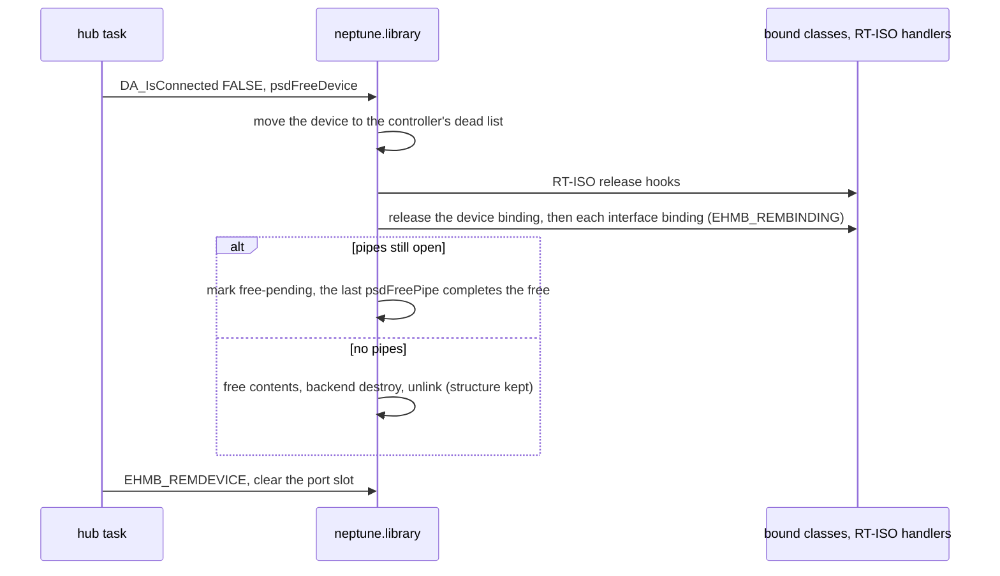
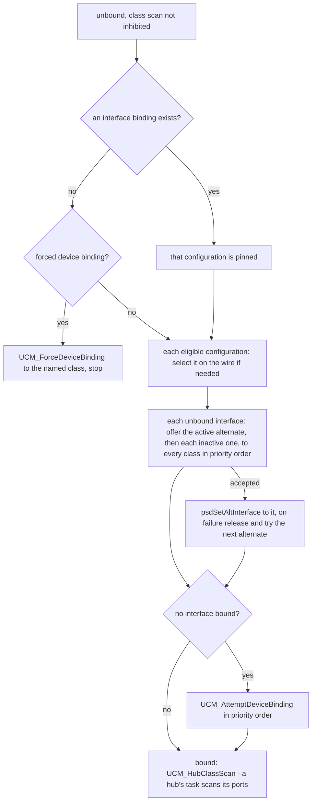
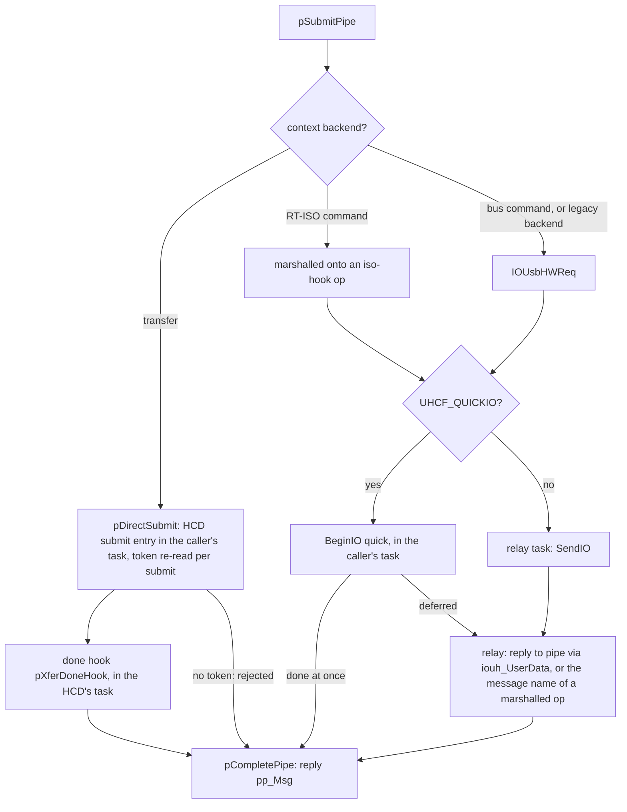
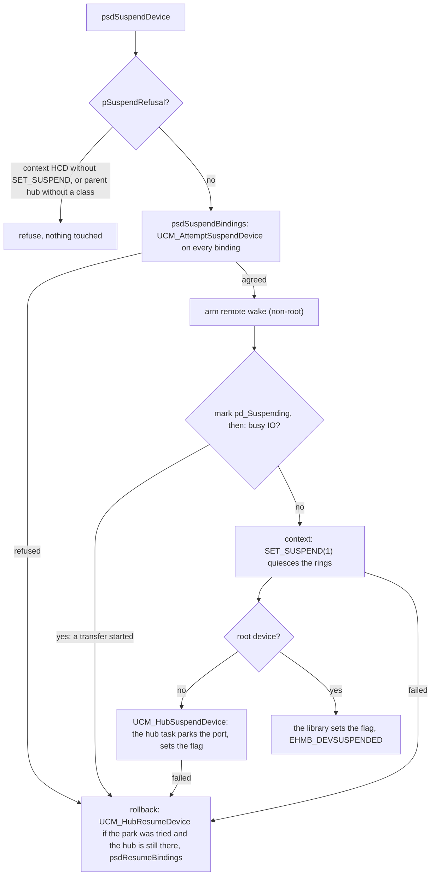
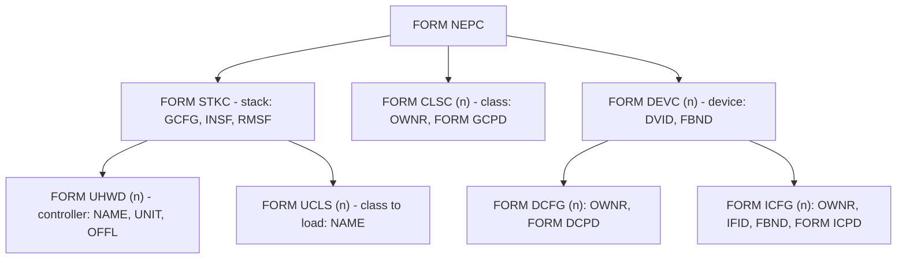

# neptune.library - Architecture

> **Scope:** `neptune.library`, the core of the Neptune USB stack: the device model, the two
> lower-edge backends, the `psd*` API, class binding, settings, events, the device notifier, stall
> recovery and power policy. Class drivers and applications appear only at the boundary; the major
> classes have their own documents (`hub`, `hubss`, `hid`, `massstorage`, `usbaudio`, `usbvideo`).
> The context HCD interface and its rationale are in [neptune-context-hcd-abi.md](neptune-context-hcd-abi.md).
>
> Sources: `neptune.library/` (`neptune.library.c`, `neptune_intern.h`, `neptune_main.c`,
> `neptune.sfd`, `notify.gui.c`, `numtostr.c`); public headers `include/libraries/neptune.h`,
> `include/libraries/neptune_class.h`, `include/devices/usbhcd_common.h`, `usbhardware.h`,
> `usbhcd_context.h`; on-disk names in `include/nep_paths.h`.
>
> This document describes structure, behaviour and the rules that keep it correct. It names
> functions as anchors; the code is the reference for field layouts, timings and retry counts, and
> `neptune.sfd` is the reference for the API.

---

## 1. Purpose

`neptune.library` owns all USB state on the machine and is the only component that understands
USB semantics: addressing, descriptors, configurations, topology and power. It has six jobs:

1. **Model the bus.** Keep the tree of controllers, devices, configurations, interfaces and
   endpoints, and enumerate every new device into it.
2. **Move data.** Give classes pipes onto endpoints and carry their transfers to whatever host
   controller driver (HCD) is underneath - a classic Poseidon HCD or a context HCD such as
   `xhci.device` - behind one completion contract.
3. **Bind drivers.** Offer every device and interface to the class drivers in priority order,
   record who took it, and release it on unplug, removal or request.
4. **Keep devices healthy.** Turn transfer errors into a dead-device verdict, clear endpoint halts
   that classes leave standing, keep the power budget, and run suspend, link power management,
   device reset and safe eject.
5. **Remember settings.** Hold the stack's, the classes' and every device's settings in one IFF
   tree; load, save and apply it, and import Poseidon's.
6. **Tell everyone.** Broadcast stack events, and show device popups through the built-in notifier.

It is a passive library: most of its code runs in the caller's task. Its own tasks relay HCD
traffic, do the housekeeping that has to block, and show popups (§4.1).

---

## 2. Context

- **Downwards** it talks to HCDs, which are ordinary Exec devices, through one of two backends
  chosen per controller (§5.2): the classic V1/V2 `IOUsbHWReq` ABI (`usbhardware.h`) for
  third-party Poseidon HCDs, and Neptune's context ABI (`usbhcd_context.h`) for drivers that own
  addressing and endpoint contexts. `usbhcd_common.h` holds what both share. The library contains
  no controller-specific code.
- **Upwards** it offers the `psd*` API to classes and applications, and calls classes through the
  three-vector `usbclass` ABI (`usbGetAttrs`, `usbSetAttrs`, `usbDoMethod`). Applications claim
  devices with app bindings and subscribe to events.
- **Sideways** it has no link to `input.device`, AHI or DOS volumes: those are the classes'
  clients. It uses DOS to load settings, spawn Processes and load drivers; the notifier uses
  Intuition, MUI and datatypes.

`hub.usbclass` is the one mandatory class. The library enumerates and scans only root hubs; every
deeper device is found by the hub class bound to its parent and enumerated in that hub's task
(§5.4). `USBStart` and the ROM startup resident (`romstartup/usbromstart.c`) populate the stack;
the library adds no USB state on its own (§5.1).

---

## 3. Building blocks

| Block | Responsibility | Anchors |
|---|---|---|
| **Library base** | Romtag, init/open/expunge, global lists, pools, the custom locks, the IFF root | `PsdBase`, `libInit`, `libOpen`, `libExpunge`, `neptune_main.c` |
| **Support** | Shared memory pool, strings, delays, subtask spawning, error log, number-to-name tables | `psdAllocVec`, `psdSpawnSubTask`, `psdAddErrorMsgA`, `psdNumToStr` (`numtostr.c`) |
| **Device model** | The object tree with up-links; device flags; identity strings | `PsdHardware`, `PsdDevice`, `PsdConfig`, `PsdInterface`, `PsdEndpoint`, `PsdDescriptor`, `psdGetNextDevice` |
| **Hardware attach** | One relay task per HCD unit; backend selection | `psdAddHardware`, `pDeviceTask`, `pCtxQueryCmdMask`, `pCtxAttach`, `psdRemHardware` |
| **Lifecycle backends** | Device and endpoint lifecycle behind one vtable | `PsdHCDOps`, `pLegacyHCDOps`, `pContextHCDOps`, `pCtxDoOp` |
| **Enumeration** | Root hubs and single devices: addressing, descriptors, BOS facts, quirks, configuration | `psdEnumerateHardware`, `psdEnumerateDevice`, `pGetDevConfig`, `pFixBrokenConfig`, `psdSetDeviceConfig`, `psdSetAltInterface` |
| **Transfer path** | Pipes, submit routing, the completion funnel, dead-device scoring, pipe streams, bulk streams, RT-ISO | `PsdPipe`, `psdAllocPipe`, `pSubmitPipe`, `pDirectSubmit`, `pXferDoneHook`, `pCompletePipe`, `psdWaitPipe`, `pCtxEnsureStreams`, `psdAllocRTIsoHandlerA` |
| **Binding** | Priority-sorted class list, class scan, bind, release and claim primitives | `PsdUsbClass`, `psdAddClass`, `psdClassScan`, `psdHubClassScan`, `psdHubReleaseDevBinding`, `psdHubReleaseIfBinding`, `psdClaimAppBindingA` |
| **Locks** | Reader/writer locks with lock borrowing | `PsdLockSem`, `pLockSemExcl`, `pLockSemShared`, `pUnlockSem`, `psdBorrowLocksWait` |
| **Settings** | IFF tree; load, save, import, apply; class and device settings | `PsdIFFContext`, `psdLoadCfgFromDisk`, `pMigrateCfg`, `psdParseCfg`, `psdSetClsCfg`, `psdSetUsbDevCfg`, `pCheckCfgChanged` |
| **Events** | Subscriber list and broadcast | `psdAddEventHandler`, `psdSendEvent` |
| **Event task** | Blocking housekeeping: settings change, link power, stall recovery, idle suspend, automatic port recovery, notifier start | `pEventHandlerTask`, `pStallRecoverySweep`, `pLinkPowerSweep`, `pIdleSuspendSweep`, `pAutoRecover` |
| **Power** | Suspend and resume, link power, power budget | `psdSuspendDevice`, `psdResumeDevice`, `psdSuspendBindings`, `psdResumeBindings`, `pLinkPowerArm`, `pSuspendRefusal`, `psdCalculatePower` |
| **Device services** | Reset without teardown, safe eject | `psdResetDevice`, `psdSafeEjectDevice` |
| **Notifier** | Popups and sounds; reports the automatic port recovery | `pNotifyGUITask` (`notify.gui.c`) |

**The device model.** Each controller keeps a **flat** list of all its devices, whatever their
depth; the tree comes from each device's parent hub and port. A device holds its configurations,
a configuration its interfaces, an interface its endpoints; every descriptor is also kept in one
flat list with up-links. Only the active alternate of an interface sits in the interface list; the
inactive ones hang off it.

- **State is flags.** A device has no state variable: its flags record speed, connected,
  has-address, has-descriptor, configured, dead, low-power, suspended, app-bound and free-pending.
- **Identity.** `pd_Handle` is the backend-neutral identity: the bus address on the legacy backend,
  the HCD's opaque handle on the context backend. `pd_IDString` (product, vendor and product id,
  serial, clone count) and `pif_IDString` (interface, alternate, class triple) key the settings and
  forced bindings.
- **Lifetime.** A freed device leaves the lists, but its structure is never freed (rule 1).

---

## 4. Runtime model

### 4.1 Tasks

| Task | Count | Spawned by | Waits on | Does |
|---|---|---|---|---|
| **Relay task** `pDeviceTask` | one per HCD unit | `psdAddHardware` | inbound port, completion port, CTRL-C | Opens the HCD, selects the backend, forwards message-framed requests and aborts, routes their replies, flushes at shutdown |
| **Event task** `pEventHandlerTask` | one | first `libOpen` | event port, a 500 ms timer, CTRL-C | Settings-change detection, the stall-recovery, link power and idle suspend sweeps, automatic port recovery, starting the notifier |
| **Notifier** `pNotifyGUITask` | at most one | event task | MUI, event port, timer | Popups, sounds (§5.13) |
| **Class tasks** | any | classes, via `psdSpawnSubTask` | their own | Hub tasks, binding workers, GUIs |
| **Caller tasks** | any | - | - | Most of the library: enumeration (in hub tasks), transfers, class scan, settings, suspend |

- **Spawning.** `psdSpawnSubTask` creates a Process when `dos.library` can be opened, a plain Task
  before DOS. Every subtask starts at the global `pgc_SubTaskPri` with a 32 KB stack, sized for the
  MUI tasks that share the one spawn path. The spawner waits for the child to publish its task
  pointer. The relay task raises itself to 21, the event task and the notifier drop to 0, and the
  tasks that feed `input.device` keep a floor of their own (hid doc §6, rule 1).
- **The relay carries only message-framed traffic**: legacy requests, context lifecycle and RT-ISO
  ops, bus commands and aborts. Context transfers never touch it (§5.6).
- **The event task is the library's own worker.** When the library must do blocking wire work - a
  link power change, a halt clear, an idle suspend - other tasks only raise a request flag (rule 13).

### 4.2 Locking

| Lock | Kind | Guards |
|---|---|---|
| PBase lock (`ps_Lock`) | custom reader/writer | the global lists: hardware, classes, every controller's device lists |
| Device lock (`pd_Lock`) | custom reader/writer, per device | bindings, configuration and alternates while they change |
| Config lock (`ps_ConfigLock`) | custom reader/writer | the IFF tree |
| `ps_ReentrantLock` | Exec | the event subscriber list, first-open initialisation |
| `ps_MemPoolSem`, `ps_StallRecoverySem` | Exec, leaves | the shared memory pool; the per-device endpoint-halt masks |

- **The custom lock** is reentrant per task, promotes a sole reader to writer, and wakes every
  waiter on every full release (rule 18). A shared request that cannot allocate its record takes
  the lock exclusively instead. Every lock is registered for the `psdDebugSemaphores` dump; there
  is no deadlock detector.
- **Order.** The usual nesting is PBase, then device, then config. A list walk that must block
  drops PBase around the blocking call and restarts from the head - the "`psdRemClass` idiom"
  (rule 14).
- **Lock borrowing.** `psdBorrowLocksWait(task, signals)` lends every custom lock the caller holds
  to `task` for the length of a `Wait`, then takes them back with their counts; a lock the target
  is already queued for is handed over directly. It serves one situation: a task holding locks
  must wait for a task that needs them. The class scan holds the PBase read lock and the device
  write lock while it calls a class's binding method; the class spawns its worker and waits for it,
  and the worker takes those locks while it starts. `psdAddHardware` waits for its relay task, and
  the hub classes for a new hub task (hub doc §5.1), the same way.

### 4.3 Ownership

- **Ports belong to the hub classes**: reset, power, suspend, and address-0 serialisation for legacy
  HCDs (hub doc §6, rule 3). The library reaches a port only through `UCM_Hub*` methods.
- **The suspended flag** of a non-root device is written only by its parent hub class; the library
  writes it only for a root device (rule 10).
- **Device add/remove events** for hot-plugged devices come from the hub classes. The library sends
  `EHMB_ADDDEVICE` only for root hubs, and `EHMB_REMDEVICE` for the devices it frees when a
  controller is removed.
- **A pipe** belongs to the task that allocated it; its completion goes to the port it was
  allocated with, whichever task delivers it.

---

## 5. Key flows

### 5.1 Startup and settings load

`libInit` (a coldstart resident, so the library can live in a Kickstart ROM) builds lists, pools
and locks. The first `libOpen` opens `timer.device`, builds the IFF root with the default global
settings and starts the event task. Neither adds USB state.

**`USBStart`** loads the settings (§5.12), supplies defaults where they say nothing - every class in
`DEVS:USBClasses` when no class is listed, the controller named on its command line when none is
listed or attached - and applies them with `psdParseCfg`. The test is what the settings list, not
whether a file existed. `USBAddHardware` and `USBAddClasses` do the two default jobs by hand.

**One stack at a time.** While `poseidon.library` is in exec's library list, at any version,
Neptune starts no host controller: `USBStart`, `USBAddHardware` and the ROM resident stop with one
log line, and `psdParseCfg` and `psdAddHardware` refuse for any other caller
(`include/nep_otherstack.h`) - two stacks must never drive the same controller. Class drivers are
not refused: Neptune's are `<name>.usbclass`, Poseidon's `<name>.class`, so ramlib never hands one
stack the other's, and the class drawer scan (`include/classdir.h`) loads `*.usbclass` only. A
class that provides an exec device does not start when a device of that name is already in the
system (`nDevNameTaken()`, `classes/common.h`).

**Apply** (`psdParseCfg`) reconciles the running stack with the settings' stack form: unlisted
classes and controllers are removed, missing ones added (`psdAddClass`; `psdAddHardware` and
`psdEnumerateHardware`), then a class scan binds the root hubs and the hub tasks take over. Settings
without a hardware list remove no hardware, settings without a class list remove no class, and an
in-use ROM class is never removed (rule 15). Before DOS it also waits out the boot delay.

**ROM boot.** The resident adds `hub.usbclass`, `hubss.usbclass`, `massstorage.usbclass` and the input classes
(`hid.usbclass`, or the boot keyboard and mouse classes), adds and enumerates the controller, runs a
class scan - unconditionally, since that scan latches the AfterDOS state below - and then polls
`UCM_PortsPending` on the hub classes and `UCM_MediaPending` on `massstorage.usbclass` until the hubs
have settled and no medium is still coming up, within a time cap. It never applies settings.

**AfterDOS.** A class scan from a Task before any settings were read latches `ps_StartedAsTask`. The
first class scan from a Process clears it and runs `pReleaseAfterDOSBindings`: bindings of classes
that set `UCCA_AfterDOSRestart` (the boot keyboard and mouse classes) are released so the
disk-loaded `hid.usbclass` can take the devices, and every class gets `UCM_DOSAvailableEvent`. The
pass belongs to the class scan, not to settings, so it runs without a prefs file too; `USBStart`
loads the disk classes before applying the settings so they exist for that scan.

### 5.2 Hardware attach and the two backends

`psdAddHardware` takes a bare driver name, refuses a controller already attached, spawns the relay
task and waits for it. The relay task opens the driver - by name if it is in memory, otherwise from
`DEVS:USBHardware` - reads identity and capability bits, and selects the backend:

Selection is capability-driven only; there is no override.

| | Legacy backend | Context backend |
|---|---|---|
| **Addressing** | The library: a slot of 1..127 in `phw_DevArray`, `GET_DESCRIPTOR(8)` at address 0, wire `SET_ADDRESS` | The HCD: `CREATE_DEVICE` with parent, port, speed and TT returns an opaque handle and an EP0 token |
| **Topology** | Every pipe carries address, speed and split-transaction fields | Given once at `CREATE_DEVICE`; hub facts follow with `UPDATE_HUB` |
| **Endpoints** | Implicit | `CONFIGURE_ENDPOINTS` before each wire `SET_CONFIGURATION` and `SET_INTERFACE`; returns one submit token per endpoint |
| **Transfers** | `IOUsbHWReq` through the relay, or quick I/O in the caller | Direct submit in the caller's task, completion through the done hook |
| **Optional ops** | none | `SET_SUSPEND`, `SET_LINK_POWER`, `RESET_DEVICE`, `ALLOC_STREAMS`/`FREE_STREAMS`, iso hooks - each only if the HCD lists it |
| **SuperSpeed** | No: the legacy ABI has no SuperSpeed flag | Yes |

The `PsdHCDOps` vtable carries the lifecycle moments: address device, update EP0 max packet,
configure endpoints, set interface, update hub, destroy device. On the legacy backend all but
address and destroy are no-ops.

**Root hubs** (`psdEnumerateHardware`): one `UHCMD_USBRESET` as a bus reset, then on a context
backend with `UHCF_USB30` the SuperSpeed root hub, then the USB 2.0 root hub when there is no
SuperSpeed one or the HCD reports two. The library sends `EHMB_ADDDEVICE` for each. A USB 3
controller on the context backend thus has two root devices.

### 5.3 Enumeration

`psdEnumerateDevice` runs under the device write lock, in the hub task for a device the hub class
has allocated, placed (parent, port, speed) and reset, or in `psdEnumerateHardware` for a root hub:

1. the backend addresses the device and reads the first eight descriptor bytes;
2. the EP0 max packet size is checked against the **link speed**, not `bcdUSB` (low, high and super
   speed each allow one value; only full speed has a choice), and pushed to the backend. A normal
   root hub has no link: it starts as full speed, so its own value is taken;
3. the full device descriptor, after which a normal root hub with `bcdUSB` 2.00 or above becomes
   high speed (hub.usbclass marks full- and low-speed devices below it for split transactions); a
   full-speed controller's stays full speed, and the SuperSpeed root hub is flagged before
   enumeration. Then BOS facts (LPM, BESL, U1/U2 exit latencies, container id) when
   `bcdUSB` is above 2.00; the strings, the clone count and `pd_IDString`;
4. the per-device settings: custom name, popup and power overrides;
5. every configuration descriptor parsed into the tree;
6. `psdSetDeviceConfig` on the first configuration, vendor quirks (`pFixBrokenConfig`), the power
   budget.

- **Configured during enumeration**, deliberately: some devices misbehave unconfigured, and an
  unconfigured device may draw only 100 mA. `psdSetDeviceConfig` builds the endpoint contexts,
  sends the wire `SET_CONFIGURATION`, arms remote wake when power saving is on, corrects the
  self-powered bit from `GET_STATUS`, and arms link power (§5.10).
- **Robustness.** The enumeration pipe has a NAK timeout so a mute device cannot wedge the bus;
  short and babbling descriptor reads are tolerated; on the legacy backend a `SET_ADDRESS` whose
  ACK was lost is retried at the new address. A failure before the descriptor rolls the address
  flags back and returns NULL; the hub class frees the device. A device whose configuration cannot
  be parsed is still returned and bindable.
- **Alternate settings** (`psdSetAltInterface`): the backend exchanges the endpoint sets, then
  `SET_INTERFACE` is sent and checked with `GET_INTERFACE`. If the switch does not take, the backend
  is called again with the alternates swapped back, so controller and model agree on the endpoints.

### 5.4 Connect and disconnect

The hub classes own the port mechanics (hub doc §5.2-§5.3); the library calls run in the hub task.

**Connect.** The hub task sees a port change, debounces it, and on a legacy HCD takes its
class-wide address-0 lock. It allocates a device, records parent, port and speed with
`psdSetAttrs`, resets the port, opens an EP0 pipe and calls `psdEnumerateDevice`. It then frees the
pipe, sends `EHMB_ADDDEVICE`, records the device in its port table and starts a class scan (§5.5).
A new hub gets a hub class binding and a hub task of its own, which repeats this for its ports:
discovery spreads one hub task per hub.

**Disconnect** has three triggers - a port disconnect; a `UCM_HubDisablePort` or
`UCM_HubPowerCyclePort` from the notifier, Neptune USB or safe eject; the hub itself gone or
released - and all end in `psdFreeDevice`:

Removing a hub stops its task, which frees its children first: a subtree unwinds leaf-first.

### 5.5 Binding and class scan

| Level | Fields | Example |
|---|---|---|
| Device | `pd_DevBinding`, `pd_ClsBinding` | `hub.usbclass` takes the whole device |
| Interface | `pif_IfBinding`, `pif_ClsBinding` | `hid.usbclass`, `massstorage.usbclass` take one interface each |
| Application | `pd_DevBinding` with `PDFF_APPBINDING`, no class | a tool claims a device for itself |

A binding is an opaque pointer the class returns, usually its per-instance context; the library
stores it, records the owning class, and hands it back on later methods. Device and interface
bindings exclude each other. The library calls a class through the `usbclass` stubs, whose library
base `neptune.library.c` defines as `puc->puc_ClassBase` (rule 9).

**The class scan.** `psdClassScan` scans only root devices; each deeper device is scanned by its
parent hub's task. `psdHubClassScan` handles one device under the PBase read lock and the device
write lock:

- **Priority.** Classes are sorted by `UCCA_Priority`, so a specific class gets first refusal before
  a generic one. A forced binding (`psdSetForcedBinding`, stored by device and interface id) offers
  the device or interface only to the named class, with `UCM_Force*`.
- **Probing is descriptor-only.** Classes decide from the parsed tree; the wire switches once, to
  the accepted alternate, so the probe loop walks a stable list and needs no restore.

**Release is direct, claim is routed** (rules 6 and 7). The release calls run the primitives
`psdHubReleaseDevBinding` and `psdHubReleaseIfBinding` in the caller's task: under the device write
lock they clear the binding field, then invoke the class's release method, so concurrent releases
of one binding invoke the class once. A class waiting for its worker to exit borrows locks. An app
binding's release hook runs in whichever task releases it. `psdClaimAppBindingA` sends
`UCM_HubClaimAppBinding` to the parent hub's class, which runs `psdHubClaimAppBindingA` in its task.
Other releases come from `psdRemClass`, `psdUnbindAll`, the AfterDOS pass, a forced suspend, and a
binding that refuses to resume (§5.9).

### 5.6 The transfer path

A `PsdPipe` joins a completion message (`pp_Msg`, replied to the owner's port) and an `IOUsbHWReq`
(`pp_IOReq`): the HCD's request on the legacy backend, the library's per-pipe state on the context
backend. `psdAllocPipe` fills it with endpoint, direction, type and speed, plus address and
split-transaction fields on the legacy backend. `psdDoPipe` submits and waits; `psdSendPipe` only
submits, and the owner collects with `psdWaitPipe`, `psdCheckPipe` or `GetMsg`.

- **One completion funnel** (rule 3). Every completion - direct, quick, relayed, rejected, or the
  fake completion on a disconnected device - goes through `pCompletePipe`. It copies a marshalled
  request's error back, ends the activity accounting, marks a halted endpoint (§5.8) and replies.
  It runs on whichever task delivers, and never blocks.
- **Activity.** A submit adds the pipe's weight to `pd_IOBusyCount` and stamps `pd_LastActivity`;
  the completion takes the weight back. Interrupt pipes weigh nothing, so a pending listener is not
  "busy". Lifecycle ops never count (rule 12). The idle sweep reads both (§5.10).
- **Dead-device scoring.** `psdWaitPipe` scores each result into `pd_DeadCount`: timeouts weigh
  most, NAK timeouts less, CRC, transaction and split errors least, anything else halves the count.
  Past a threshold - lower once the device has an address or descriptor - the device is flagged
  dead and `EHMB_DEVICEDEAD` sent once; the flag clears when the count decays to zero on a connected
  device. Aborts are not scored: neither the shadow message (`pWaitPipeUnscored`) nor the aborted
  transfer's `IOERR_ABORTED`. Recovery is the event task's (§5.13).
- **Abort follows the framing** (rule 4): a shadow message to the relay task, which calls `AbortIO`,
  or the HCD's abort entry for a direct submit. The completion still arrives through the funnel.
- **Guards.** On a disconnected device `psdDoPipe` returns `UHIOERR_TIMEOUT` after a short delay
  without the HCD, and `psdSendPipe` completes the pipe with that error. A transfer on a suspended
  device resumes it first.
- **Pipe state** is the message's node type: free, in flight, replied, free again once collected.
  `psdFreePipe` aborts and waits for a pipe still in flight.
- **Pipe streams** (`psdOpenStreamA`) buffer reads and writes over a set of pipes on one endpoint,
  in the caller's task.

### 5.7 Bulk streams and RT-ISO

**Bulk streams** (context backend; UAS). The library owns the HCD's stream rings; the class only
labels pipes, through a pipe stream opened with `EA_StreamBase` or `PPA_StreamID` on a plain pipe.
`pCtxEnsureStreams` then sizes the endpoint's rings to the highest id (`ALLOC_STREAMS`; growing
frees and re-allocates), and `psdCloseStream` or setting either attribute to 0 frees them. A
configuration rebuild or alternate change drops rings and tokens with the endpoint, so the library
forgets both. Classes see `HA_StreamsSupported`, `EA_MaxStreams` and `EA_StreamsAlloc`; a failed
allocation only warns and leaves one ring (rule 16).

**RT-ISO.** `psdAllocRTIsoHandlerA` registers a class's hooks on an isochronous endpoint; the HCD
pulls and pushes the data through them on its own clock, without pipes. It needs `UHCF_RT_ISO` and,
on a context backend, the iso-hook ops, onto which the commands are re-keyed together with the
handler's flags such as `RTA_ReportInErrors` (ABI doc §10.3). A running stream holds the device
busy from `psdStartRTIso` to `psdStopRTIso`, or to `psdFreeRTIsoHandler` if it was never stopped -
one hold per stream (`prt_Running`) - since its data never passes a pipe that could stamp
activity. On unplug each handler's release hook runs before the bindings are released.

### 5.8 Stall recovery

Most classes never clear an endpoint halt, so the library does it for them:

1. `pCompletePipe` marks the endpoint in the device's halt mask when a bulk or interrupt transfer on
   a connected, non-root device ends with `STALL`, or with a halt the HCD raised (`BABBLE`,
   `XACTERROR`, `SPLITERROR`), then raises the request and signals the event task.
2. `pStallRecoverySweep` takes one marked device per pass; a suspended, dead or gone device just
   loses its marks.
3. `pStallRecoverDevice` sends one `CLEAR_FEATURE(ENDPOINT_HALT)` per marked endpoint on a transient
   EP0 pipe and logs it, quietly on a timeout (an unplug), then re-raises the request so other
   devices follow on later passes.

The class still sees its error; the clear only resynchronises the device's toggle or sequence
number with the host's. A context HCD holds the endpoint until the clear completes (ABI doc §11).
A class that clears a halt itself, with `psdClearEndpointHalt` or a raw request, cancels the pending
mark through a snoop in `pSubmitPipe` (rule 11). One device per pass keeps an endpoint that
re-halts as fast as it is cleared from trapping the event task.

### 5.9 Suspend and resume

- **Bindings.** A class that supports suspend may say no. A class that does not is passed over when
  no IO is in flight, otherwise the suspend is refused - unless `pgc_ForceSuspend` is on and the
  device can remote-wake, in which case the binding is released. An app binding is treated the same.
- **Transfers that start meanwhile.** The bindings answer for the IO running when they are asked,
  and psdDoPipe wakes only a device whose flag is set, which the hub class does last. So a transfer
  starting in between would reach a ring about to be quiesced and wait there for a resume nobody
  asks for. The two sides are ordered against each other (`pTransferBegin`): a transfer counts
  itself busy before it reads the device's state, and the suspend raises `pd_Suspending` before it
  reads the busy count. A transfer counted there calls the suspend off ("Not suspending ...: a
  transfer started", no error); one that sees the mark leaves `pd_WakeWanted`, and the suspend wakes
  the device the moment it is parked and returns FALSE, so a hub suspending its ports does not park
  itself above a device that is awake. Of the state, the transfer reads the mark before the flag:
  the suspend sets the flag before it lowers the mark, so a suspend that ends between the two reads
  still leaves the flag to be seen. Compiler barriers keep these orders: there is one CPU, and a
  task switch comes only between instructions. The mark goes up after the remote-wake arming, whose
  own transfers would otherwise count, and after the bindings, so a hub's suspend of its children,
  which runs on the hub's EP0, does not trip it. A device found suspended is woken with the transfer
  uncounted, then counted again: a hub's resume unparks its ports over the same EP0 pipe, and each
  of those transfers pairs its own count. Interrupt transfers are not counted: a listener parked
  across a suspend is meant to be, and a synchronous one started before the mark ends at its NAK
  timeout, if its pipe has one. A stream start (`psdStartRTIso`) is a transfer here; the other
  RT-ISO commands are not.
- **Rollback** undoes a half suspend - bindings stopped and rings quiesced while the flag is clear -
  which nothing else would ever recover: auto-resume keys off the flag and the idle sweep has
  written the device off. It runs outside the device lock (rule 10).
- **Resume.** `psdResumeDevice` asks the parent hub's class to unpark the port (for a root device the
  library clears the flag first), then `psdResumeBindings` restarts the rings with
  `SET_SUSPEND(0)`, asks for a link power sweep if the policy changed meanwhile, and sends
  `UCM_AttemptResumeDevice` to every binding. A binding that refuses is released and the device
  rescanned for another class. A remote wake-up reaches `psdResumeBindings` from the hub class.
- **Root hub.** It has no port and no upstream link: "suspended" means its subtree is suspended and
  its own class is quiet, which is what both hub classes do for `UCM_AttemptSuspendDevice`. On a
  USB 3 controller this suspends one of the two root devices, not the controller.
- **`DA_CanSuspend`** answers from `pSuspendRefusal`, so a GUI and the call agree.

### 5.10 Power policy

| Setting | Default | Gates |
|---|---|---|
| `pgc_PowerSaving` | off | the idle suspend sweep; remote-wake arming at configuration time |
| `pgc_LinkPowerMgmt` | on | link power management: U1/U2 on SuperSpeed, hardware L1 on high speed, LTM |
| `DA_LinkPowerOverride` | inherit | per device: inherit, never or always; wins outright over the global switch |
| `DA_NoAutoSuspend` | off | per device: the idle sweep only; an explicit suspend still works |

The global switches are independent: link power is a link state the controller enters and leaves
on its own between transfers; suspend is a device state with a resume cost. The per-device values
live in the device's popup chunk (`struct PsdNotifyCfg`) in Neptune USB's per-device settings.

- **Arming** (`pLinkPowerArm`) needs a context HCD with `SET_LINK_POWER` and BOS facts that offer
  something. The op lets the HCD compute exit latencies, program its own state and return the wire
  parameters; the library then sends `SET_SEL`, the parent port's U1/U2 timeouts, and the device's
  U1/U2 and LTM enables. Every step that took is recorded in `pd_LpmArmed`, so **disarming** takes
  back exactly that, in reverse, ending with a `SET_LINK_POWER` that withholds everything
  (rule 16). Disarm is best-effort; only a failed HCD op keeps its bit, for the next sweep to retry.
  Arming happens in `psdSetDeviceConfig` and from the sweep.
- **Policy changes** reach running devices through `pLinkPowerSweep` on the event task. `psdSetAttrs`
  raises the request only on a real change - Neptune USB rewrites every setting on each click - and
  so does loading settings that change the switch. The sweep visits configured, connected, awake
  devices whose recorded decision differs, restarting from the head after each, which also keeps
  parents ahead of children as arming requires.
- **Idle suspend** (`pIdleSuspendSweep`, once a second with power saving on): configured, non-hub,
  not dead, suspended, app-bound or being freed, not pinned awake, nothing in flight, idle longer
  than `pgc_SuspendTimeout`, and every bound class supports suspend (or force applies). The
  activity stamp is zeroed before the attempt, so a failed suspend is not retried until fresh IO.
  Hubs are never auto-suspended (hub doc §6, rule 7).
- **Power budget** (`psdCalculatePower`), the electrical side: after every enumeration, free and
  power-information change, each root's supply is distributed down the tree; an overdrawn device is
  flagged low-power with `EHMB_DEVICELOWPW`, and the flag clears when the budget recovers.

### 5.11 Device reset and safe eject

**`psdResetDevice`** is a class's recovery of last resort (massstorage's UAS escalation): the device
object, its bindings and its handle survive; the wire state and the HCD's endpoint contexts are
rebuilt.

1. **Gate:** a context backend listing `RESET_DEVICE`, a live handle, a parent hub; otherwise FALSE
   with no wire traffic, and the class degrades.
2. **Port reset** by the parent hub's class (`UCM_HubResetPort`, in the hub task), under the device
   read lock.
3. **`RESET_DEVICE`** re-addresses the handle and drops every endpoint context but EP0.
4. **Restore** under the device write lock: `psdSetDeviceConfig` rebuilds the contexts (new tokens,
   stream counts cleared, link power re-armed), then `SET_INTERFACE` for each non-default alternate.

The caller owns quiescence: whatever is in flight fails and is not replayed.

**`psdSafeEjectDevice`** runs on a Process with no device lock held. Under the read lock it collects
the device- and interface-level bindings whose class sets `UCCA_SupportsSafeEject`, one per class;
outside the lock it calls `UCM_SafeEject` on each - storage classes flush and unmount, and may
answer busy with a reason. Only if all agree does it disable the parent port; the caller watches for
`EHMB_REMDEVICE`. `DA_CanSafeEject` uses the same collection.

### 5.12 Settings persistence and import

- **In memory** a form is a node; a form's chunks are one opaque big-endian blob, replaced by id.
  Classes exchange whole forms by copy: `psdSetClsCfg` and `psdSetUsbDevCfg` copy one in, keyed by
  owner and by device and interface id; the getters return the live form, and data comes out with
  `psdGetCfgChunk` (an allocated copy) or `psdWriteCfg`. Neptune USB keeps the custom name and the
  popup and power chunk in the device data it owns.
- **Load** (`psdLoadCfgFromDisk(NULL)`) tries `ENV:Sys/neptune.prefs`, then `ENVARC:`, then the same
  pair of `poseidon.prefs`. Neptune's files are `FORM NEPC`; 6.0-6.2 and the classic 4.x line both
  wrote `FORM PSDC`, so `pReadCfgFile` takes a `PSDC` file only with 6.x's `GCFG` length (50 bytes;
  4.5 writes 54). A classic file is that stack's own: Neptune starts with defaults, and a file
  loaded by name is refused the same way. A Poseidon file is saved straight back as
  `neptune.prefs`, so the import happens once; `poseidon.prefs` is never written. Each file
  replaces the tree (a `PSDC` one takes Neptune's form type on the way, in `pApplyCfg`), passes through
  `pMigrateCfg`, which rewrites Poseidon's names - class drawer, sound drawer, the prefs editor's
  owner key - to Neptune's (`nep_paths.h`), and is applied (§5.1). The default load saves a file
  that migrated anything straight back, like an import, so the conversion happens once (a mark
  alone would not last: `psdParseCfg`, which `USBStart` and Neptune USB call again after the load,
  records the applied config as saved). A file loaded by name is only marked unsaved, since no
  file holds that tree yet. `psdAddCfgEntry` migrates too. Migration is idempotent and keeps no
  state.
- **Save** (`psdSaveCfgToDisk(NULL)`) writes the live global settings into `GCFG`, then `ENVARC:`
  and `ENV:`.
- **Change detection.** Changes raise a check request or check at once (`pCheckCfgChanged`): a
  hash over the tree, compared with the one at the last load or save, tells clients about unsaved
  changes. A new hash reloads the live global settings and sounds and sends `EHMB_CONFIGCHG`; the
  event task coalesces those into one `UCM_ConfigChangedEvent` to every class about a second later.
- **Append-only.** `struct PsdGlobalCfg` is the `GCFG` chunk and `struct PsdNotifyCfg` the
  per-device popup chunk; both merge by copying the shorter of the saved and current lengths
  (rule 15).

### 5.13 Events and the notifier

**Events.** A subscriber registers a port and a mask (`psdAddEventHandler`); `psdSendEvent` puts a
note to each matching port. Replies go to a `PA_IGNORE` port and are freed lazily at the next send.
The sixteen event types cover hardware, devices, classes, bindings and error messages being added
or removed, settings changes, a device turning dead, low-power, suspended or resumed, and the
stack's handling of a dead or overdrawn one (`EHMB_DEVRECOVERY`). The
hardware-, device- and class-removal events are sent just before the object is freed, so it is
gone by the time a note is read: their parameter is an address for identity only (`neptune.h`).

**Automatic recovery** runs in the event task, on `EHMB_DEVICEDEAD` and `EHMB_DEVICELOWPW`, so it
works with popups off, before Workbench and on a ROM boot (`pAutoRecover`). A dead device with
`pgc_AutoRestartDead` has its port power-cycled (`UCM_HubPowerCyclePort` to the parent hub's class);
otherwise `pgc_AutoDisableDead` and `pgc_AutoDisableLP` disable the port (`UCM_HubDisablePort`). A
root hub has no port and is left alone (`pAutoRecoverAction`). Every such device then gets one
`EHMB_DEVRECOVERY` note with the outcome - `EHRA_POWERCYCLE`, `EHRA_DISABLE`, or `EHRA_NONE` when
nothing was done - the state and the product name, copied into the note (`struct PsdDevRecovery`,
valid until the note is replied; `pSendEventWithData`). All of it runs under the PBase read lock, which
`psdFreeDevice` needs for writing, so the device stays valid meanwhile and the note is queued before
the hub task can free it; the device parameter is for identity only.

**The notifier** runs when at least one popup kind is enabled and a Workbench screen exists; it
needs MUI and datatypes, and exits when the last popup kind is switched off. It shows popups with
per-device actions and plays the attach and detach sounds. It takes dead and overdrawn devices
from `EHMB_DEVRECOVERY` alone, so each gets one popup, built from the note: a recovered device's
says what was done, has no port buttons and outlives the device; one left alone offers Disable
and Power-cycle Port, if it has a port.

### 5.14 Teardown

- **`psdRemHardware`** frees every live device with its bindings (`EHMB_REMDEVICE` each), waits for
  devices whose pipes are still open, and after a bounded wait abandons them - unlinked, contents
  leaked because the open pipes point into them, use count left truthful. It then stops the relay
  task, which sends `CMD_FLUSH`, drains message-framed requests with a bounded wait of its own, and
  closes the driver. That drain does not count direct submits, which complete through the done
  hook.
- **`psdRemClass`** unlinks the class, releases its bindings, and closes the library only if its use
  count reached zero; otherwise it leaks the class rather than close a library still in use.
- **`libExpunge`** removes hardware, classes, log and settings, stops the notifier and the event
  task, and frees the pools.

---

## 6. Design rules

Each rule exists because breaking it caused, or would cause, a real failure.

1. **A `PsdDevice` is never freed, and a device with open pipes is freed late.** Events, the
   notifier, hub port tables and walks that dropped PBase may still hold the pointer, so a free
   releases contents and unlinks only. While pipes are open the free waits for the last
   `psdFreePipe`; the pending flag is cleared on entry to the real free, because the context
   destroy op runs a temporary pipe through `psdFreePipe`, which would re-enter it.
2. **The library scans only root hubs.** Deeper devices are enumerated and scanned in the parent
   hub's task; scanning them from the library brings back the re-entrancy between the scan and the
   hub tasks that this split removed.
3. **Every completion goes through `pCompletePipe`, and the activity accounting ends there.**
   Classes that collect with `GetMsg` never call `psdWaitPipe`; ending at collection leaked one
   count per transfer for them and blocked idle suspend forever.
4. **The completion bridges and the abort paths follow the framing.** Legacy requests carry their
   pipe in `iouh_UserData`, marshalled ops in their message name, direct submits return through the
   done hook; drop one and replies follow garbage pointers. Message-framed requests are aborted
   through the relay, even on a quick-I/O HCD, so the relay must stay alive; direct submits through
   the HCD's abort entry. A bus command keeps legacy framing on a context backend; a new
   device-addressed command needs a context framing.
5. **The relay's in-flight count is raised under `Forbid`.** Caller tasks raise it, the relay lowers
   it, and the read-modify-write is not atomic.
6. **Hub methods that need hub state are routed; nothing else is.** Claim, suspend, resume and port
   reset run in the hub task, because they drive its EP0 and port state.
7. **Releases are direct.** Routed through the parent hub, a release is dropped while the hub tears
   down, because the hub's own binding - the routing token - is NULL for its whole release. The
   library never sends the hub release methods.
8. **The binding field is cleared before the class is called**, under the device lock, so two
   concurrent releases of one binding invoke the class once.
9. **`usbDoMethod` needs the right `puc` in scope.** `UsbClsBase` is a macro over
   `puc->puc_ClassBase`; a wrong `puc` sends the method into another library, and nothing at the
   call site shows it.
10. **The suspended flag has one writer.** The parent hub class sets and clears it. The library
    writes it only for a root device, after its bindings stopped and before they resume, because
    the hub class's child operations use the root's EP0 and a transfer on a flagged device resumes
    it - the resume would recurse. A failed park rolls back bindings and rings and never sets the
    flag; the rollback runs outside the device lock, because resuming can need it for writing.
11. **One clear per stall.** A class's own clear cancels the library's pending one; a late duplicate
    resets the data toggle under resumed traffic.
12. **Lifecycle ops are not activity.** They never count or stamp. A rollback `SET_SUSPEND` that
    stamped would re-arm the idle sweep for a suspend it has just seen refused.
13. **The library's blocking work runs on the event task.** `psdSetAttrs` runs on the caller's task -
    the MUI task for Neptune USB - and only raises a request.
14. **Blocking walks restart from the head, and progress is decided before the unlock.** PBase is
    dropped around the blocking call; the link policy bit, the zeroed activity stamp and one device
    per stall pass keep the restart from looping. The link power and stall sweeps skip suspended
    devices, because any transfer would wake them; resume asks for a fresh sweep instead.
15. **Settings never shrink what they do not mention, and their structs only grow.** No hardware
    list removes no controller (a blank prefs file must not kill the boot keyboard), no class list
    removes no class (a file saved from a class settings window carries neither), and an in-use ROM
    class stays. Inserting, reordering or resizing a field of a settings struct corrupts every
    existing prefs file; retired fields keep their slot, and defaults are chosen so older files
    inherit what is wanted (link power on).
16. **Partial capabilities are made visible or undone completely.** A failed `ALLOC_STREAMS` leaves
    one ring - survivable at queue depth 1, data-corrupting above it - so a class running concurrent
    tags checks `EA_StreamsAlloc` and assigns ids highest first; a configuration rebuild clears
    tokens and stream counts, or the next allocation trusts phantom rings. Link power disarm
    withholds the capability facts as well as the enables, because the HCD evaluates LTM and USB 2
    hardware LPM from the facts alone.
17. **The core flags and heals by policy; the notifier only reports.** Dead and low-power devices
    are flagged and announced, and the event task applies the configured port recovery whether or
    not the notifier runs. Shutdown gives up rather than hang: the relay drain and the removal of
    devices with open pipes both end after a bounded wait.
18. **The custom lock wakes every waiter on every full release.** A waiter may already hold a shared
    lock on the same lock; waking only at count zero hangs it.

---

## 7. Interfaces

**Implemented: the `psd*` API** (`neptune.sfd`, register arguments, bias 30), in groups: memory,
strings, delays, subtask spawning, error log and number-to-name lookup; controllers and the power
budget; devices (allocate, free, enumerate, iterate, find, configuration, alternate setting,
strings, interface, endpoint and descriptor lookup); attributes (`psdGetAttrsA`/`psdSetAttrsA` over
the `PGA_*` object kinds); pipes, pipe streams, RT-ISO handlers and endpoint-halt clearing; classes
and binding (class scan, the hub-side scan and primitives, claim, release, unbind all, hub method
dispatch); events; settings (forms and chunks, class and device settings, forced bindings, load,
save, apply); locks (PBase, device, borrowing, debug dump); device services (suspend and resume of
devices and bindings, reset, safe eject). The LVO order is the ABI: new entries are appended to
`neptune.sfd` and `neptune_funcs.inc` together.

**Called: `usbclass` methods.** Binding (attempt, force, release, at both levels),
`UCM_AttemptSuspendDevice`/`UCM_AttemptResumeDevice`, `UCM_SafeEject`, `UCM_ConfigChangedEvent`,
`UCM_DOSAvailableEvent`; on the parent hub's class `UCM_HubClassScan`, `UCM_HubClaimAppBinding`,
`UCM_HubSuspendDevice`/`UCM_HubResumeDevice`, `UCM_HubResetPort`, `UCM_HubPowerCyclePort` and
`UCM_HubDisablePort`. Queried: `UCCA_Priority`, `UCCA_Description`, `UCCA_AfterDOSRestart`,
`UCCA_SupportsSuspend`, `UCCA_SupportsSafeEject`. Never sent: the hub release methods,
`UCM_LocaleAvailableEvent`, `UCM_SoftRestart`, `UCM_HardRestart`.

**Called: the HCD.** Shared: `UHCMD_QUERYDEVICE`, `UHCMD_USBRESET` (once per controller),
`CMD_FLUSH`, `NSCMD_DEVICEQUERY`. Legacy: the four transfer commands and the four RT-ISO handler
commands. Context: `NSCMD_USB_ATTACH`; the mandatory lifecycle ops `CREATE_DEVICE`,
`DESTROY_DEVICE`, `UPDATE_EP0`, `CONFIGURE_ENDPOINTS`, `UPDATE_HUB`; the optional `SET_SUSPEND`,
`SET_LINK_POWER`, `RESET_DEVICE`, `ALLOC_STREAMS`, `FREE_STREAMS` and iso-hook ops; the submit,
control-submit and abort entries. Never issued: `UHCMD_USBSUSPEND`, `UHCMD_USBOPER`,
`UHCMD_USBRESUME`, `NSCMD_USB_DECONFIGURE`.

**On disk.** One IFF tree (§5.12) with fixed form and chunk ids (`neptune.h`), integers big-endian,
the `GCFG` chunk a raw copy of an append-only struct; stored as `ENV:Sys/neptune.prefs` and
`ENVARC:Sys/neptune.prefs`, imported once from `poseidon.prefs` (`nep_paths.h`).
