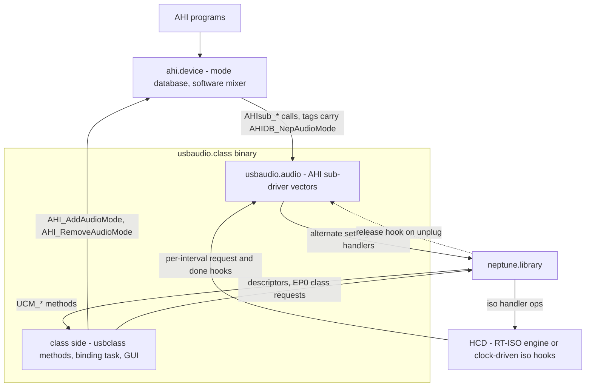
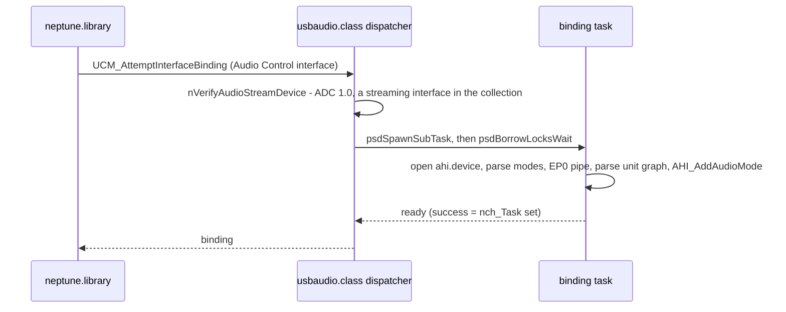
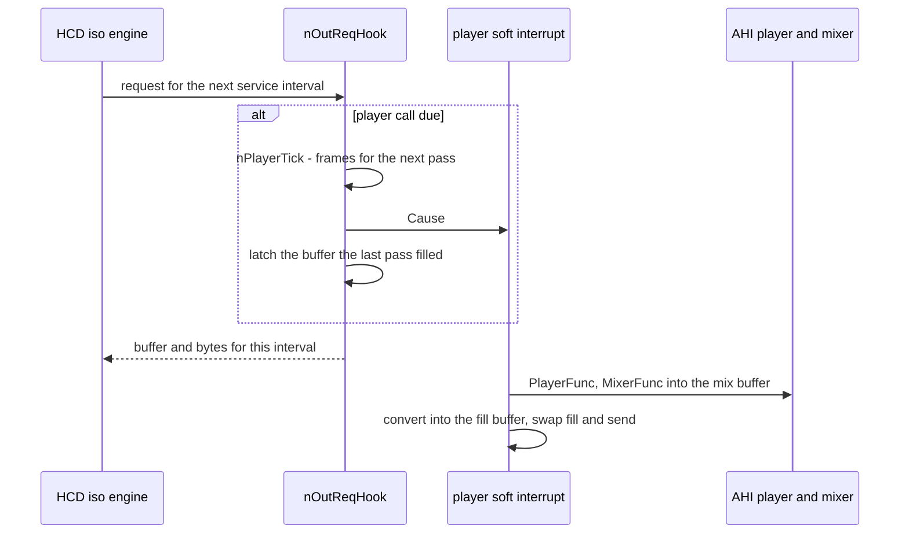
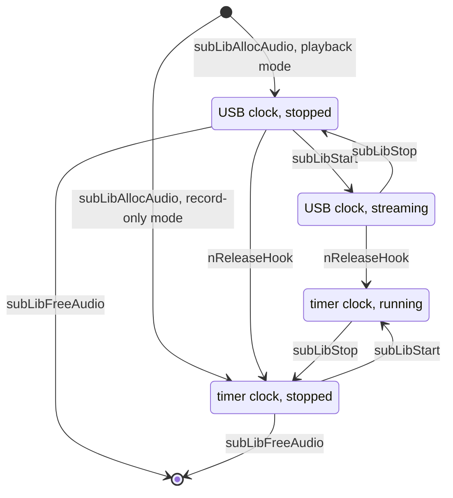

# usbaudio.class - Architecture

> **Scope:** `usbaudio.class`, the USB Audio Class 1.0 driver, and `usbaudio.audio`, the AHI
> sub-driver built into the same binary. It is a client of `neptune.library`; read
> [neptune.library-architecture.md](neptune.library-architecture.md) first (class binding §5.5,
> lock borrowing §4.2, disconnect §5.4). The clock-driven iso hooks a context HCD runs the streams
> on are in [neptune-context-hcd-abi.md](neptune-context-hcd-abi.md) §10.3. The sibling
> [usbvideo.class-architecture.md](usbvideo.class-architecture.md) follows the same binding and
> RT-ISO patterns.
>
> This document describes structure, behaviour and the rules that keep it correct. It names
> functions as anchors; the code (`classes/audio/`) is the reference for field layouts, buffer
> sizes, timings and retry counts.

---

## 1. Purpose

`usbaudio.class` turns a USB Audio device into an AHI sound card. It has four jobs:

1. **Understand the device.** Bind the Audio Control interface, read the formats of its
   AudioStreaming interfaces and the unit graph (terminals, feature, selector, mixer and other
   units) that connects them.
2. **Publish modes.** Offer each usable format to AHI as an audio mode, with the volume, input and
   output controls the graph provides.
3. **Stream.** When a program opens a mode, select the alternate setting that carries bandwidth and
   move PCM between AHI's mixer and the isochronous endpoint through RT-ISO hooks, converting the
   sample format and pacing the stream at the mix rate.
4. **Apply controls.** Turn AHI's volume, gain, monitor, input and output settings into USB Audio
   class requests.

It binds at the **interface** level, on the Audio Control interface of a USB Audio 1.0 device
(`bcdADC` 0x0100); 2.0 devices are declined. It is a post-mixing AHI driver (`AHISF_MIXING`): AHI
mixes every channel in software and the driver converts and ships the result.

---

## 2. Context

- **Downwards** it uses only the library: descriptor lookup, EP0 pipes for class requests and
  `psdSetAltInterface`, and RT-ISO handlers (`psdAllocRTIsoHandler`, `psdStartRTIso`). The library
  maps RT-ISO onto `UHCMD_ADDISOHANDLER` & co. on a legacy HCD and onto the iso hook ops on a
  context HCD, passing the class's `IOUsbHWRTIso` block as hook object so the hooks run unchanged.
- **Upwards** it implements the `usbclass` method set the library calls and the AHI sub-driver
  vectors of `<libraries/ahi_sub.h>` that ahi.device calls. The class config window is opened from
  the Neptune USB prefs editor.
- **Sideways** it opens ahi.device per binding (`AHI_NO_UNIT`), only to add and remove its modes in
  the AHI mode database.

---

## 3. Building blocks

| Block | Responsibility | Anchors |
|---|---|---|
| **Class base** | List of bindings; creates and owns the sub-driver library | `NepAudioBase`, `libInit`, `libExpunge` |
| **AHI sub-driver** | Second Exec library, `MakeLibrary`'d from a vector table and `AddLibrary`'d as `usbaudio.audio` at class init | `NepAudioSubLibBase`, `SubLibFuncTable`, `subLibInit` |
| **Binding** | One bound Audio Control interface: binding task, EP0 pipe, ahi.device handle, mode and unit lists, pending control updates | `NepClassAudio`, `usbForceInterfaceBinding`, `usbReleaseInterfaceBinding` |
| **Binding task** | Allocates and frees the binding's resources; after bind, the only issuer of control requests | `nAudioTask`, `nAllocAudio`, `nFreeAudio` |
| **Mode** | One streaming format: rates, endpoint, RT-ISO handler, buffers, player clock, ports | `NepAudioMode`, `nExamineAudioDescriptors`, `nRecMode` |
| **Unit graph** | A node per terminal or unit, edges from source IDs, tags for the USB stream each node serves, control discovery | `NepAudioUnit`, `nExamineAudioUnits`, `nFlowUp`, `nFlowDown`, `nFlowUpToUSBSource`, `nFlowDownToUSBSink` |
| **Port mapper** | Per mode: the inputs and outputs AHI is offered, each output's own Mute and Volume, the shared output volume | `NepAudioOutput`, `nMapOutputs`, `nOutputBranch`, `nSharedVolume`, `nInputName`, `nOutputName` |
| **Mode publisher / realiser** | Registers AHI modes; programs an opened mode onto the device and undoes it | `nAddAudioModes`, `subLibAllocAudio`, `nSelectAudioMode`, `nAltForFreq`, `subLibFreeAudio` |
| **Data path** | Iso hooks, player soft interrupts, sample converters | `nOutReqHook`, `nInReqHook`, `nInDoneHook`, `nReleaseHook`, `subLibPlayerIntV4`/`V6`/`Dummy`, `nPlayerTick`, `nConverter` |
| **Control path** | AHI control values to class requests; dB to linear factor and back | `subLibHardwareControl`, `subLibGetAttr`, `nSetVolume`, `nSetMute`, `nDbToFixed`, `nFixedToDb` |
| **Config GUI** | MUI window and the class config chunk | `nOpenCfgWindow`, `nGUITask`, `nLoadClassConfig` |
| **Name tables** | Terminal, unit, format and channel names for logs and AHI port names | `numtostr.c` |

---

## 4. Runtime model

| Context | Runs | Waits on |
|---|---|---|
| Library caller (bind, release) | `usbForceInterfaceBinding`, `usbReleaseInterfaceBinding` | the binding task's ready signal; its exit |
| **Binding task**, one per binding | `nAudioTask`: allocation and parsing, then the control loop | its EP0 port signal (pending controls), CTRL-C |
| AHI caller (the program, via ahi.device) | the `subLib*` vectors | synchronous EP0 requests on the mode's own pipe, in open and close |
| HCD completion context | `nOutReqHook`, `nInReqHook`, `nInDoneHook` | nothing - must not block |
| **Player soft interrupt**, per open mode | `subLibPlayerIntV4`/`V6` (USB clock), `subLibPlayerIntDummy` (timer clock) | `Cause` from `nOutReqHook`, or a timer reply on a `PA_SOFTINT` port |
| Library, on unplug | `nReleaseHook`, from `psdFreeDevice`, before the binding is released | - |
| GUI task, at most one | `nGUITask` | MUI input |

- **Pipes.** The binding's EP0 pipe belongs to the binding task: range reads while parsing, every
  control request afterwards. Each open mode has its own EP0 pipe, used from the AHI caller for the
  alternate setting and the rate.
- **Control updates** cross from AHI to the task as stored values plus a `UAF_*` bit in
  `nch_UpdateFlags` and a signal; the task takes and clears the word together with the current mode
  under `Forbid()`, then applies the bits to that mode. With no mode open they are dropped - the
  values stay in the mode, and AHI sets them again at the next open.
- **Playback buffers** are double: the device plays pass N while AHI mixes pass N+1. The soft
  interrupt alone writes the fill and send indices; the OUT hook reads the send index when it
  latches a buffer.
- **`nch_DenyRequests`** gates the data path: set from bind until a mode is realised, and again on
  unplug and release. While set, the OUT hook sends nothing and the player skips the mix.
- **One open mode per binding**, as `nch_CurrentMode`, the per-binding hook structures and the
  interface's alternate setting require. `subLibAllocAudio` claims `nch_CurrentMode` under
  `Forbid()` before anything else and refuses any open while it is held; `subLibFreeAudio`, which
  AHI calls even after a failed open, gives it back as its last step.

---

## 5. Key flows

### 5.1 Binding and topology parsing

- **Modes** (`nExamineAudioDescriptors`): every alternate setting of every AudioStreaming interface
  in the Audio Control header's collection that is Type I PCM, mono or stereo, with 8, 16 or 17 to
  32 bits; others are logged and skipped. A mode records its interface's zero-bandwidth alternate
  (the one without endpoints), the rate and pitch controls of its endpoint, and its rates: discrete
  rates as listed, a continuous range as the common rates inside it, none above 64 kHz.
  `bTerminalLink` ties it to the graph.
- **Graph** (`nExamineAudioUnits`), in passes: a node per terminal or unit; edges from source IDs
  (at most 8 per side); a USB streaming input terminal marks its mode playback, a USB streaming
  output terminal marks it record, and becomes the mode's root unit; the flow passes name each node
  and tag it with the USB streaming terminal it comes from (`nau_SourceUnit`) or goes to
  (`nau_SinkUnit`); last, per Feature Unit, the Volume and Mute bits of master, left and right and
  the volume range (`GET_MIN`/`GET_MAX` on the binding's pipe). A volume on the way to a USB stream
  is an input gain, one on neither way a monitor, both stored on their chain's root unit; volumes
  on a playback path are assigned per mode by the port mapper (§5.5). A Selector Unit attaches to
  the recording stream it feeds.
- **Pairing.** A record stream pairs with a playback mode of the same format and rate list, making
  it full duplex (`nam_RecStream`, `nam_PartOf`); failing that with one of the same rate list only
  (logged). A stream still unpaired is an AHI mode of its own (`nam_PartOf` NULL); unpaired streams
  of one interface that differ only in the alternate setting (a camera microphone has one per rate)
  fold into the first, which takes all their rates. `nAltForFreq` later finds the alternate for a
  rate.

### 5.2 AHI mode publication

`nAddAudioModes` registers every playback mode and every record mode that belongs to none. The tag
list lives in the mode (`nam_Tags`): the mode ID (`AHI_USB_MODE_BASE` + unit number << 12 + a
running number), a name from product name, resolution and layout ("Rec" for record-only, "HiFi"
above 16 bits), driver `usbaudio`, capability flags (volume if the mode has an output volume unit,
stereo and panning for two channels, HiFi above 16 bits), and **`AHIDB_NepAudioMode`**, the raw
`NepAudioMode` pointer.

That pointer is the whole bridge: AHI hands the mode's tags back to `subLibAllocAudio` and
`subLibGetAttr`, and the driver recovers its object with `GetTagData` (rule 1). `subLibGetAttr`
answers from the mode and the graph: bits, rates and nearest-rate index, record and full duplex
(both true whenever the mode has a record half), volume, gain and monitor ranges as linear factors,
input and output names. Registration reserves no bandwidth (rule 3).

### 5.3 Opening and closing a mode

`subLibAllocAudio` runs in the AHI caller:

1. Recover the mode; refuse if it is already open. Open the library and timer.device; the timer
   replies to a `PA_SOFTINT` port that causes the player interrupt (§5.6).
2. **Pick the rate** - the requested one if listed, else the nearest - before anything else
   (rule 10). AHI is told the result.
3. `nSelectAudioMode`, on the mode's own pipe: select the alternate for the rate, find the iso
   endpoint, convert its interval to milliseconds (rule 10), note what one service interval
   carries, set the rate and enable pitch control if the endpoint has those controls, allocate the
   RT-ISO handler with the direction's hooks and the release hook. A rate the endpoint cannot carry
   is logged.
4. Size the buffers for the most frames one player pass may mix (`nMaxMixFrames`, from the slowest
   player rate the program declared); pick the player interrupt (V4 or V6 by ahi.device version;
   the dummy player and timer clock for a record-only mode) and the converter.
5. Realise the record half, if any: two record blocks, a one-interval packet buffer, the record
   converter, `AHISF_CANRECORD`.

It returns `AHISF_MIXING` plus `KNOWSTEREO`/`KNOWHIFI` as they apply; control values start at unity
without a request. `subLibStart` derives the player step and frames per millisecond and starts the
USB stream (or causes the player on the timer clock); for `AHISF_RECORD` it resets the record
message and starts the record stream. `subLibStop` reverses each; stopping a recording logs the
frames received against what the rate should have brought, the one measurement of the record path.
`subLibFreeAudio` stops the timer clock and the handlers, frees the buffers, switches both halves
back to their zero-bandwidth alternates and frees pipes, timer and library.

### 5.4 Streaming

- **Pacing.** `nam_FramesPerMS` is the mix rate in frames per millisecond, 16.16. Each interval
  advances an accumulator by that times the interval and sends its whole frames; the part frame
  carries across intervals and buffer swaps (`nam_PlayCarry`), so the long-run rate is exactly the
  nominal one. Between latches the hook returns the same buffer with a new length and the HCD
  continues where it left off.
- **Player cadence.** AHI's player frequency becomes a millisecond step with a carried fraction;
  `nPlayerTick` gives the milliseconds to the next call and the frames to mix for them, whole and
  part frames apart so a slow player at a high rate cannot overflow 16.16, capped at what the
  buffers hold. The V6 player brackets the mix with AHI's pre- and post-timer hooks.
- **Recording.** `nInReqHook` hands out the packet buffer, capped at one service interval
  (`nam_IntervalBytes`). `nInDoneHook` converts into the current record block as 16-bit stereo and,
  when the block is full, passes it to `ahiac_SamplerFunc` and moves to the other block. A block has
  room for one interval more than its size, so the interval that fills it arrives whole; the block
  handed over stays untouched until the next goes. Blocks are the size AHI's own drivers use:
  handing over each interval as it came made recordings sound robotic.
- **No player of its own for recording.** In a full-duplex mode AHI's player runs on the playback
  clock; in a record-only mode on the timer, mixing into a buffer nobody hears.

### 5.5 Rate, format and controls

- **Rate.** No resampling: AHI mixes at the listed rate the device runs at, paced at the nominal
  rate; a feedback endpoint is not read (§7).
- **Format.** One conversion hook per mode, chosen by `nConverter` by bytes per sample (1 to 4)
  and channels (1 or 2). Playback converts AHI's big-endian 16-bit samples (32-bit in HiFi modes)
  to little-endian subframes; recording converts subframes to 16-bit stereo - 8 bits become the
  high byte, 24 and 32 bits keep their top 16, mono is duplicated.
- **Controls.** The task applies the output volume to `nam_OutVolume` (the volume upstream of every
  output), else to each output's own volume, muted ones included so switching needs no new level;
  input gain and monitor to the units of the selected input; input selection as `SET_CUR` on the
  Selector Unit (one input needs none); output selection by the Mute on each output's own branch,
  all unmuted for "All outputs", and only when the outputs are switchable.
- **Levels.** AHI works in linear factors, a Volume Control in 1/256 dB. `nFindLogVolume` reports a
  unit's range as factors (`nDbToFixed`, 10^(dB/20)); `nSetVolume` converts back (`nFixedToDb`) and
  clamps to the range, in integer arithmetic (a 2^(i/32) table, interpolated). A master Control is
  cascaded after the channel Controls (UAC 1.0 3.5.5): a unit with one gets the level on the
  master and its channels at 0 dB, a unit without gets it on each channel. `nSetMute` follows the
  same cascade.
- **Outputs** (`nMapOutputs`): the output terminals the playback stream reaches. An output's own
  branch runs from its terminal up the stream to the first unit that also feeds another output;
  `nOutputBranch` takes the first Mute and Volume on it. AHI is offered one output by name, or
  "All outputs" followed by each output if every one has its own Mute (`nam_OutputSwitch`). If the
  tagging reached no terminal, every terminal of the kind is named, without controls; a record-only
  mode offers no outputs.

### 5.6 Unplug while streaming

On unplug the library calls each RT-ISO handler's release hook before releasing the binding (core
doc §5.4). For a playback handler `nReleaseHook` stops the stream, swaps the player interrupt to
`subLibPlayerIntDummy`, moves the mode to the timer clock and causes the player if AHI is playing;
for a record handler it only stops the stream. On the timer clock the dummy player takes the timer
reply, works out the next pass with `nPlayerTick`, sends the next timer request at once (so the mix
does not stretch the interval), then calls AHI's player and mixer. The program plays into silence
until it stops.

### 5.7 Release, suspend and settings

- **Release.** `usbReleaseInterfaceBinding` (for example from the hub task in `psdFreeDevice`) sets
  `nch_DenyRequests`, sends CTRL-C to the binding task and waits for it to exit. The task first
  waits, polling, until AHI has closed the open mode (rule 8); then `nFreeAudio` removes the AHI
  modes, frees the unit graph and pipe, and closes ahi.device. The release then unlinks the binding
  from `nh_Units` and frees it with its modes (`nFreeBinding`).
- **A binding lives from bind to release.** Every bind allocates and parses afresh; a bind whose
  task fails is freed at once. A unit number is the lowest one not in `nh_Units`, so a replugged
  device gets its old number and AHI mode IDs back. The one exception: if AHI opened a mode in the
  instant between the task's last check and `nFreeAudio` taking the modes out of AHI, the release
  leaves the binding listed, and `libExpunge` - which runs only once AHI has closed the
  sub-driver - frees it.
- **Suspend.** `UCM_AttemptSuspendDevice` is refused while a mode is open. The idle sweep does not
  ask while a stream runs anyway: `psdStartRTIso` holds the device busy (core doc §5.7, §5.10).
  `UCM_AttemptResumeDevice` only signals the binding task.
- **Settings.** The class config chunk (`ClsGlobalCfg`, `UAUD`) carries no fields yet. It is loaded
  at library open, at bind and on `UCM_ConfigChangedEvent`; the window shows no settings, Save
  stores the chunk and writes the config to disk, Use only stores it. There is no binding window.
  Mixer levels are AHI's; the class persists none.

---

## 6. Design rules

Each rule exists because breaking it caused, or would cause, a real failure.

1. **Both libraries share one binary and one address space.** `libInit` `AddLibrary`s the
   sub-driver as `usbaudio.audio`, so AHI's open of driver `usbaudio` finds it in memory (no
   `.audio` file ships), and the mode database carries raw `NepAudioMode` pointers that only the
   same binary can follow. The class holds an open count on the sub-driver and expunges only when
   AHI has it open nowhere.
2. **A mode's AHI entry goes before the mode.** `nFreeAudio` removes the AHI modes first, and mode
   objects are not freed while the class runs. An entry outliving its object would hand
   `subLibGetAttr` or `subLibAllocAudio` a dangling pointer.
3. **Registration reserves nothing; closing returns to zero bandwidth.** Only an open mode holds a
   bandwidth-bearing alternate. Without the reset in `subLibFreeAudio` an idle device keeps
   isochronous bandwidth other devices then cannot get.
4. **Hooks neither block nor mix.** The OUT hook computes a length and causes the soft interrupt;
   the IN hooks hand out a buffer, convert, and pass on a full block. AHI's mixer in the HCD's
   completion context would stall the controller for every device on it.
5. **Control requests go through the binding task.** `subLibHardwareControl` only records and
   signals; a request there would block AHI's caller and race the task on the binding's pipe.
6. **There is always a clock.** AHI's player must be called until the program stops: the timer
   replaces USB on unplug and clocks a record-only mode from the start. Without it a program waits
   for ever after an unplug, or on a mode with nothing to play to.
7. **`nAbortTimer` alone stops the timer, and its request is collected once.** `AbortIO` only for a
   request that was sent (its command is set when the player first sends it). timer.device aborts
   synchronously, so the request is back in the port on return: `subLibStop` leaves it there,
   `subLibStart` lets the player take it, `subLibFreeAudio` takes it with `WaitIO`. Aborting a
   never-sent request, or removing a reply twice, corrupts the port.
8. **Release waits for AHI.** Nothing is freed while a mode is open: the hooks, soft interrupt and
   pipes would go from under a live audio control. The cost is that the releasing task blocks until
   the program closes the mode.
9. **No suspend while a mode is open.** Parking the device mid-stream would leave its alternate
   setting and handler allocated against a link that is down.
10. **Device facts are normalised before use.** The rate is chosen before the alternate setting:
    for a record-only mode it decides the alternate, and the rate request must carry the rate AHI
    got. High-speed and SuperSpeed intervals come in microframes and are converted to milliseconds;
    taken raw they were eight times too long. An endpoint served more often than once a
    millisecond counts as a 1 ms one: it records, but would play at the wrong pace.
11. **Levels are in dB, along the master cascade.** A linear spread over the dB range lost most of
    the level in the slider's first steps; setting both the master and the channel Controls applied
    the level twice.
12. **Outputs switch by the Mute on their own branch, never by a Selector.** A UAC 1.0 Selector Unit
    chooses between sources and sits on the recording path; a stream that fans out to speaker and
    headphones plays on both. Switching through a selector acted on nothing; muting a shared unit
    would silence every output.
13. **Indices from AHI are checked against what was offered.** `nInputName` and `nOutputName` give
    the count; beyond it a name is NULL and a selection is refused. Unchecked indices read past the
    name arrays and selected inputs that did not exist.
14. **The unit graph is acyclic.** Descriptors can wire a loop, so `nFindAndConnectAudioUnit`
    refuses an edge that would close one (a unit fed by itself, or by a unit it already feeds) and
    logs it; edges are capped at 8 per side. Every walk over the graph - the `nFlow*` passes,
    `nIsUpstream`, `nOutputBranch` - therefore ends; the last two also stop at `UNIT_DEPTH_MAX`.
15. **ROM-able: no writable globals.** The GUI task takes its MUI base from `tc_UserData`
    (`mui_base.h`), and `mui_compat.h` replaces the SDK's inline `MUI_NewObject`, broken at every
    optimisation level.

---

## 7. Interfaces

**Implemented (`usbclass` methods):** interface binding (attempt, force, release),
`UCM_OpenCfgWindow`, `UCM_ConfigChangedEvent`, `UCM_AttemptSuspendDevice`/`ResumeDevice`;
attributes `UCCA_Priority` 0, a class config window, no binding window, supports suspend.

**Implemented (AHI sub-driver `usbaudio.audio`, version 4):** `AllocAudio`/`FreeAudio`,
`Start`/`Stop`/`Update`, `GetAttr`, `HardwareControl`. `Disable`/`Enable` are no-ops (no
driver-owned interrupt to bracket); the per-channel vectors (`SetVol`, `SetFreq`, `SetSound`,
`SetEffect`, `LoadSound`, `UnloadSound`) return `AHIS_UNKNOWN`, as AHI mixes.

**Used:** from the library - descriptor, interface and endpoint lookup, device and endpoint
attributes (speed, interval, packet size, transactions per microframe, SuperSpeed bytes per
interval), pipes and alternate settings, RT-ISO handlers, the class config store, subtask spawning
and lock borrowing; from ahi.device - `AHI_AddAudioMode`/`AHI_RemoveAudioMode`, and the audio
control's player, mixer and sampler hooks (pre- and post-timer hooks from V6); timer.device
`UNIT_MICROHZ` for the timer clock.

**Standards:** USB Audio Class 1.0 (Audio Devices 1.0, Audio Data Formats 1.0 Type I PCM) - Feature
Unit Volume (`GET_MIN`, `GET_MAX`, `SET_CUR`) and Mute, Selector and endpoint sampling-frequency and
pitch `SET_CUR`; the AHI sub-driver interface (`ahi_sub.doc`).

**Not covered:** UAC 2.0; formats other than PCM; more than two channels per alternate setting;
rates above 64 kHz (the class treats AHI rates as 16-bit); the synchronisation endpoint, so an
asynchronous device's clock drift is not followed. Recording reaches AHI as 16-bit stereo.
