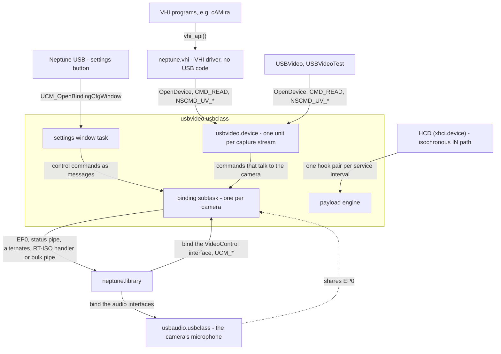
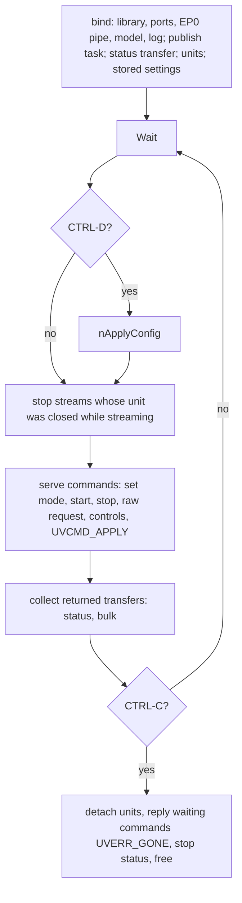
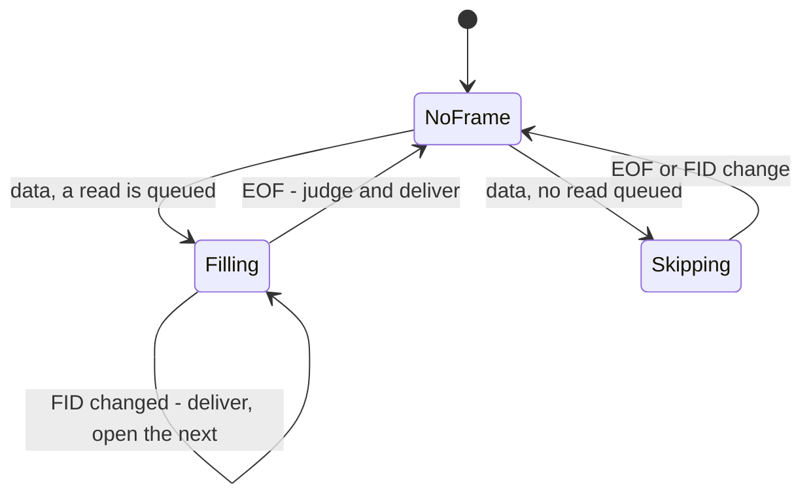

# usbvideo.usbclass - Architecture

> **Scope:** `usbvideo.usbclass`, the USB Video Class driver (UVC 1.0, 1.1 and 1.5), the Exec device
> it carries, `usbvideo.device`, and its clients: the VHI driver `neptune.vhi` and the tools
> `USBVideo`/`USBVideoTest`. It is a client of `neptune.library`; read
> [neptune.library-architecture.md](neptune.library-architecture.md) first (class binding §5.5,
> pipes §5.6, RT-ISO §5.7, power policy §5.10). It follows
> [usbaudio.class-architecture.md](usbaudio.class-architecture.md) for binding and RT-ISO use;
> the clock-driven iso hooks it relies on are in
> [neptune-context-hcd-abi.md](neptune-context-hcd-abi.md) §10.3. Sources: `classes/video/`,
> `include/devices/usb_video.h` (wire), `include/devices/usbvideodevice.h` (public), `vhi/`,
> `tools/USBVideo.c`, `usbvideo_gui.c`, `USBVideoTest.c`, `uvc_client.c`, `uvc_preview.c`.
>
> This document describes structure, behaviour and the rules that keep it correct. It names
> functions as anchors; the code is the reference for wire and field layouts, timings and retry
> counts. Open work: [implementation-plan.md](implementation-plan.md) §2.2 (stages), §3 (built,
> never run), §4.2 (video regression list). Notes on the specification and VHI:
> [uvc/notes/](uvc/notes/).

---

## 1. Purpose

`usbvideo.usbclass` makes UVC cameras usable to Amiga programs. It has four jobs:

1. **Model the function.** Bind a video function through its VideoControl interface and build an
   immutable model from its descriptors: the terminal/unit topology and, per VideoStreaming
   interface, the formats, frame sizes and intervals.
2. **Negotiate a stream** (PROBE/COMMIT) and reserve the bus bandwidth it needs.
3. **Reassemble** the camera's payload transfers, isochronous or bulk, into whole frames.
4. **Deliver** each frame into a buffer the application supplied, through `usbvideo.device`, and
   expose the camera's controls and status events on the same device.

It never decodes, converts, scales or displays: a frame leaves the class as the camera sent it,
minus the payload headers, with one exception (§5.6).

"UVC 1.5 compatible" means: every revision binds (nearly all MJPEG cameras are 1.0 or 1.1); the
host rules of 1.5 hold whether or not the feature behind them is used (negotiation block sized by
revision, uninterpreted fields round-tripped, unknown descriptors, units and trailing fields
skipped, payload headers parsed generically); coverage grows one payload-format row at a time.

It binds at the **interface** level, on the VideoControl interface. The function's VideoStreaming
interfaces are used through that binding and never claimed.

---

## 2. Context



- **Downwards** it uses only the library: descriptor walk, an EP0 pipe (class requests,
  `SET_INTERFACE`), an interrupt pipe on the status endpoint, per stream an RT-ISO handler or one
  bulk pipe, and the per-device settings store. On `xhci.device` the RT-ISO handler calls the
  class once per service interval with that interval's byte count - exactly UVC's
  payload-transfer unit.
- **Upwards** it provides `usbvideo.device`, made in `libInit` and added to the system list as the
  massstorage, serial and ethernet classes do, and a per-camera settings window for Neptune USB.
- **Sideways** it calls no other class. A composite camera's audio interfaces go to
  `usbaudio.usbclass`; the two share the camera's EP0 (rule 14).

---

## 3. Building blocks

| Block | Responsibility | Anchors |
|---|---|---|
| **Class glue** | Init/expunge, method dispatch, bind/release, the subtask loop | `libInit`, `usbDoMethodA`, `usbForceInterfaceBinding`, `usbReleaseInterfaceBinding`, `nVideoTask`, `nAllocVideo`, `nFreeVideo` |
| **Function model** | Descriptors to the immutable model; the payload-format table; mode lookup. Pure: no I/O, no allocation | `uvc_desc.c`: `UvcFunction`, `UvcPayloads[]`, `uvcAddControlDesc`, `uvcAddStreamDesc`, `uvcFindFormat`, `uvcSnapInterval` |
| **Units** | One unit per capture stream; attach to and detach from a binding | `NepVideoStream`, `nAttachUnits`, `nOwnUnit`, `nSpareUnit`, `nDetachUnits` |
| **Control plane** | The one class-request primitive, raw pass-through, negotiation, the H.264 unit | `uvc_ctrl.c`: `uvcRequest`, `uvcPassRequest`, `uvcNegotiate`, `uvcNegotiateEmbedded` |
| **Controls by name** | Table of standard camera-terminal and processing-unit controls; query, list, write | `uvc_controls.c`: `UvcControls[]`, `uvcControlQuery`, `uvcControlLocate`, `uvcControlWrite` |
| **Status plane** | One transfer waiting at the status endpoint; one event queue per binding | `uvc_status.c`: `UvcStatus`, `uvcStatusDone`, `uvcEventWait`, `uvcEventDeliver` |
| **Stream lifecycle** | Alternate choice, commit, start/stop for both transports | `uvc_stream.c`: `uvcFindAlternate`, `uvcStart`, `uvcStop`, `uvcAbortReads` |
| **Payload engine** | Payload transfers to frames; judging and delivering a frame | `uvcPayloadBegin`/`Data`/`End`, `uvcCloseFrame`, `uvcDeliver`, `uvcExtractEmbedded` |
| **Transports** | Isochronous: RT-ISO hooks. Bulk: one pipe, one transfer in flight, payloads cut out of transfers | `uvc_iso.c`: `uvcInDoneHook`, `uvcIsoStart`; `uvc_bulk.c`: `uvcBulkTransfer`, `uvcBulkAsk`, `uvcBulkDone` |
| **Device layer** | Open/close/`BeginIO`/`AbortIO`; read-only commands in the caller's context; forwarding | `dev.c`: `devOpen`, `devClose`, `devBeginIO`, `devAbortIO`, `nModeTable`, `nTopology` |
| **Settings and persistence** | MUI window task (Picture, Camera, Mode pages); the two stored chunks and putting them in force | `usbvideo.gui.c`: `nGUITask`, `nGuiRequest`, `nGuiStore`; `UvcCfgChunk`, `nApplyConfig`, `nApplyStoredControls` |
| **Clients** | VHI driver; the tools and what they share | `vhi/neptune.vhi.c`, `vhi/mjpegdht.h`, `tools/uvc_client.c`, `tools/uvc_preview.c` |

A unit (`NepVideoStream`) groups its changing state into sub-structures whose names say who may
touch them: mode in force with the negotiated block (`ns_Mode`), the user's default mode
(`ns_Default`), the read queue and the read being filled (`ns_Reads`, shared), transport state
(`ns_Iso` or `ns_Bulk`), the frame being assembled (`ns_Asm`, the engine's) and the counts
(`ns_Stats`). There is no frame buffer, pool or conversion state anywhere.

The model is one allocation, built once at bind, never modified. Its variable-length parts
(sources, control bitmaps, intervals, GUIDs) point into the descriptors the library keeps for as
long as the device exists.

---

## 4. Runtime model

| Context | Runs | May block |
|---|---|---|
| Caller of `UCM_*` | bind/release handshakes; the suspend and resume answers | bind/release yes; answers no |
| **Binding subtask**, one per camera | parsing, every EP0 request, start/stop, status transfer and event delivery, stored settings; for a bulk stream its transfers, the engine and read replies | yes |
| Settings window task, at most one per camera | MUI; sends commands to the subtask, waits for each | yes |
| HCD task | for an isochronous stream: hooks, engine, read replies | **no** |
| Application tasks | open/close (under `Forbid()`), `BeginIO`, `AbortIO`, the read-only commands | no |

**The subtask loop** waits on its command port, its pipe-reply port, CTRL-C (release) and CTRL-D
(stored settings may have changed):



**Ownership** (reasons in §6, rules 5-7): the model is constant; assembly state and counts have
one writer, the running stream's transport context; the read queue and the per-binding event
queue are shared under `Forbid()`, and so are a unit's binding pointer and modes; the read being
filled (`ur_Cur`) is the engine's. The subtask's pipe-reply port carries EP0 replies (waited for
where sent), the status transfer and bulk transfers (collected by the loop); an aborted bulk
transfer is waited for at the stop and never reaches the loop.

---

## 5. Key flows

### 5.1 Binding and the function model

`usbAttemptInterfaceBinding` takes class 0x0E, subclass VideoControl, protocol 0 or 1 with a VC
header descriptor, deciding on descriptors only; VideoStreaming interfaces are declined.
`usbForceInterfaceBinding` spawns the subtask and waits for it with `psdBorrowLocksWait`; the
bind succeeds if the task is running after it set itself up (`nAllocVideo`, the start box of the
loop in §4). `nBuildFunction` walks the class-specific descriptors twice (`nWalkDescs`): once to
count, so one allocation fits all, once to feed them in order - the VC interface's, then each
streaming interface the VC header names; after each stream `uvcAddEmbeddedFormat` may add one
format (§5.6). Parsing (`uvc_desc.c`) length-checks every descriptor against its own variable
parts before reading a field, counting (`uf_Skipped`) and dropping one that fails; ignores
unknown subtypes, trailing bytes and counts a descriptor states about others; records every
entity type (an extension unit's controls from its bitmap, not `bNumControls`); always records a
format, so its frames never attach to the wrong one; reads a zero interval as 1 and moves an
out-of-range default into range; and ignores frame-descriptor sizes and bit rates and the
format's fixed-size-samples flag, which cameras fill wrongly.
A function with no streamable format still binds (the settings window reaches its controls) but
gets no unit; the log names the formats it found.

**The payload-format table.** One row of `UvcPayloads[]` is all the class knows about a format:
descriptor subtypes, where the model's fields sit, framing, flags (fixed-size picture; starts
with JPEG SOI), where the naming GUID sits, the `bUsage` to request, the flag bytes in its
payload headers, and a FourCC for formats without GUID. One parser serves every row. **Row order
is preference order**: a request naming no format gets the camera's format of the earliest row.

| Row | Format / frame subtype | State |
|---|---|---|
| MJPEG | 0x06 / 0x07 | built |
| Uncompressed (any FourCC GUID: YUY2, NV12, ...) | 0x04 / 0x05 | built |
| Frame-based (GUID; in practice H.264) | 0x10 / 0x11 | built, never run |
| H.264 (UVC 1.5) | 0x13 / 0x14 | built, never run |
| VP8 (three flag bytes) | 0x16 / 0x17 | built, never run |
| H.264 inside MJPEG (twin of the MJPEG format) | none | built (§5.6) |

A GUID-named format is streamable only if the GUID stands for a FourCC (four characters plus the
fixed twelve bytes of Uncompressed Payload 1.5, table 2-1). A format without a row is recorded
as present but not streamable. Adding a payload is adding a row; nothing else changes.

### 5.2 Units

- **One unit per capture stream** with a streamable format. Units hang off the class base and
  **outlive their camera** until expunge.
- **Numbering** (`nAttachUnits`): a stream gets back the unit of the same vendor, product, serial
  number and interface if no camera is behind it (`nOwnUnit`); else the lowest number no unit has,
  or whose unit is camera-less and not held open (`nSpareUnit`). So a user's one camera is unit
  0, a camera returning to a unit a program holds open finds it there, and an unheld unit may
  change hands.
- **Open** (`devOpen`) needs a camera behind the unit and is **exclusive**: a camera has one
  committed format. Every opener starts without a mode. While the last opener's stream is still
  being stopped, open fails `IOERR_UNITBUSY`. An open unit counts as an opener of the class.
- **Life of a unit**: idle (no mode) - negotiated (`NSCMD_UV_SETMODE`) - streaming (`CMD_START`,
  back with `CMD_STOP`); close drops to idle; release leaves it camera-less, and what needs the
  camera fails `UVERR_GONE`; a re-attach clears the mode, so a program that kept the unit open
  sets it again.

### 5.3 Negotiation

```mermaid
sequenceDiagram
    participant APP as application
    participant T as subtask
    participant CAM as camera EP0

    APP->>T: NSCMD_UV_SETMODE (FourCC, size, interval; zeros = default)
    T->>T: look up format and frame, snap the interval
    T->>CAM: PROBE SET_CUR (keep-interval hint, indices, interval, bUsage)
    T->>CAM: PROBE GET_CUR
    T->>T: look up returned indices, repair three values, find an alternate
    alt no alternate carries the payload size
        T-->>APP: UVERR_NOBANDWIDTH
    else
        T-->>APP: mode the camera settled on, buffer size for reads
    end
```

- **Only SET_CUR and GET_CUR go to the probe control** (rule 3).
- **The block stays in wire format** (`um_Probe`, 26/34/48 bytes by `bcdUVC`) and goes back
  unchanged at commit (rule 2). Beside it the three working values, repaired where firmware slips:
  payload size (top 16 bits cleared when all ones), largest frame (zero becomes width x height x
  2), interval (zero becomes the one asked for).
- **An uncompressed frame size is computed** (`uvcPictureSize`, from bits per pixel), whatever
  the block says; the engine holds every frame against it.
- **The camera may settle on another mode**: if the returned indices name a streamable mode it is
  put in force and reported, else `UVERR_REFUSED`.
- **Time-stamp clock**: from the block from UVC 1.1 on, else (or when zero) the VC header's.
- **Default mode**: zeros select the first format by row order (MJPEG wherever a camera lists
  it), then the user's stored size and interval if the format has them (`ns_Default`), else the
  camera's. The mode table marks the same mode `UVMF_DEFAULT`.
- A refused negotiation leaves the previous mode in force; no automatic fallback (rule 10). Set
  mode while streaming is `UVERR_BUSY`.

### 5.4 Streaming: start, transports, stop

**Start** (`uvcStart`; without a mode `UVERR_NOMODE`):

1. For an embedded-H.264 mode, configure the camera's H.264 unit again (§5.6).
2. COMMIT the block as negotiated.
3. Alternate (`uvcFindAlternate`): of the isochronous alternates of the stream's video endpoint,
   the smallest whose per-interval capacity carries the payload size, so no more bandwidth is
   reserved than the mode needs. A refused `psdSetAltInterface` is `UVERR_NOBANDWIDTH`. A bulk
   endpoint lives in alternate 0: nothing is selected, no `SET_INTERFACE` is sent.
4. Scratch buffer (one interval, or one bulk transfer), counts cleared, transport started; then
   the stored controls are written again unless the window is open (§5.8).

**Isochronous**: an RT-ISO handler whose request hook points the controller at the scratch buffer
and whose done hook feeds the engine; `RTA_ReportInErrors` makes a lost interval reach the engine
even when it brought no data.

**Bulk** (never run on a camera): one pipe, no NAK timeout (a grabber without a source may be
silent for long), one transfer in flight, completed on the subtask (`uvcBulkDone`). A payload
transfer is one camera bulk transfer, ending with a short packet or at the negotiated size (maybe
a whole frame), taken in bounded pieces (`uvcBulkTransfer`): each asks for at most the rest of the
payload (rule 17); a short piece or the full size ends it; empty transfers between payloads are
ignored; a failed one damages the frame and resynchronises on the next; after repeated failures
nothing more is asked for and reads wait until the stop.

**Stop** (`uvcStop`): isochronous - `psdStopRTIso` (returns once drained), alternate 0. Bulk -
abort and wait for the transfer, then clear the endpoint halt: a bulk stream has no setting to
return to, and this is how hosts tell a camera nobody reads. Neither talks to an unplugged camera.
Reads stay queued; the one being filled returns to the queue head. **Close while streaming**:
`CloseDevice` (under `Forbid()`, no USB traffic) replies the unit's reads and event waits and
signals the subtask, which stops the orphaned stream. **Unplug**: the release stops every stream,
replies reads and queued commands with `UVERR_GONE` and leaves the units camera-less.

### 5.5 Frame assembly

Three calls per payload transfer, made by the isochronous done-hook for each interval, or by the
bulk transport per payload: `uvcPayloadBegin` (give up a called-back read, count a lost interval,
validate the header, **close** on a changed FID, take PTS and SCR for a frame it would open),
`uvcPayloadData` (**open** a frame if none is, append to the read, bounded by its length) and
`uvcPayloadEnd` (damage on ERR, **close** on EOF). A header needs two bytes and a
`bHeaderLength` within the payload; anything else damages the open frame. Two rules delimit
frames for every camera, with no per-device flag:

- **Close:** a payload carries EOF, or its FID differs from the open frame's.
- **Open:** the first payload with data while none is open; it takes the head of the read queue.



Compliant cameras close on EOF; one whose EOF is missing or lost closes on the next FID; one
whose FID never toggles closes on EOF, so the last needs no quirk entry (rule 4).

**Judging** (`uvcCloseFrame`): no read was waiting - skipped. Longer than the read's buffer -
returned with `UVERR_OVERFLOW` and what fitted (rule 10). Damaged (ERR bit, lost interval, bad
header, or a failed end check: MJPEG must start with SOI, an uncompressed frame must be exactly
its picture size) - dropped and its read kept for the next frame, unless the unit was opened with
`UVOF_DAMAGED`, which gets it flagged `IVRF_DAMAGED`. Otherwise delivered.

**Delivery** (`uvcDeliver`): `io_Actual` is the length; a request as long as `struct IOVideoReq`
also gets sequence number, flags, raw PTS, the bus frame of the first payload and the clock
pair. Frames are numbered from 1 at every `CMD_START`, counting every frame the camera started,
so drops show as gaps; `NSCMD_UV_GETSTATS` sorts them into delivered, skipped, damaged and too
long, with the causes of damage.

**Time**: the PTS is the capture time by the camera's clock (frequency in `NSCMD_UV_GETINFO`);
the clock pair (`ivr_SCRClock` at the camera's USB frame count `ivr_SCRFrame`) ties that clock to
the bus, and `ivr_BusFrame` is the host's frame for the same moment (0 on bulk). Two pairs give
the camera clock's true rate and so any PTS in bus time. The class computes nothing: no clock
recovery, no sync with sound.

Per interval the engine does one header check, one FID compare, one bounded copy and one EOF
test, and touches the queue once per frame.

### 5.6 H.264 inside MJPEG frames

UVC 1.1 cameras with the USB-IF *H.264 Payload 1.00* extension unit (layouts at the end of
`include/devices/usb_video.h`) stay MJPEG cameras and, once the unit is configured, carry H.264
in APP4 segments in front of each JPEG's picture data. The device offers this as an `H264` mode:

- **Mode** (`uvcAddEmbeddedFormat`): a stream with an MJPEG format, in a function with the unit,
  gets a twin entry of that format (same descriptor, frames, wire index) under the embedded row;
  every MJPEG size is also listed as H264. Nothing is asked of the camera at plug-in.
- **Set** (`uvcNegotiateEmbedded`): read the unit's configuration; set size, rate, embedding and,
  if requested, bit rate and key-frame interval (0 = the unit's; held to its 16 bits); probe,
  read back, commit; negotiate the **carrier on the MJPEG format's smallest picture** while that
  is in force (the camera's numbers depend on it; a full-size carrier does not fit the bus at
  1920x1080); restore the unit's configuration. The mode reported is the H.264's size and rate;
  profile and rate control stay as the unit has them and can be set raw beforehand.
- **Start**: `uvcStart` configures the unit again; the camera drops it when the stream ends, so
  nothing is undone at stop, close or unplug, and other clients meet a plain MJPEG camera.
- **Hand-over** (`uvcExtractEmbedded`): a whole frame's H.264 bytes are moved to the start of the
  read's buffer - **the one place the class changes what the camera sent** (rule 12). A frame
  with no H.264 is not counted, so sequence numbers stay gapless, and its read takes the next.

Reads of such a mode are sized for the whole carrier frame the camera states.

### 5.7 Controls and status events

Two layers, both on the subtask:

- **Raw.** `NSCMD_UV_REQUEST` (request, entity, selector, wire data) is passed to `uvcRequest`
  unchanged; the result is success, `UVERR_REFUSED` with the camera's request error code (read on
  every stall), or `UVERR_USB`. It always addresses the control interface, so the streaming
  interfaces and the negotiated mode are out of reach. `NSCMD_UV_GETTOPOLOGY` lists terminals and
  units from the model. This reaches everything - extension and encoding units, movements - and
  leaves meaning to the sender.
- **By name.** `UvcControls[]` covers the single-value controls of camera terminal and processing
  unit: public ID (`UVCID_*`), bitmap bit, selector, layout, kind (number, switch, choice), name;
  a two-value control (pan/tilt, white-balance components) is two rows. Order is listing order,
  automatic modes before what they govern. `NSCMD_UV_GETCONTROL` (`uvcControlQuery`) fills
  `struct UsbVideoControl` from the table, then `GET_INFO` (passed through in the low bits of
  `uvc_Flags`) and, if readable, current, default and what the kind needs (range and step, or
  available choices). `NSCMD_UV_NEXTCONTROL` does the same for the next control; the structure is
  its own bookmark. A listed control that does not answer comes back without `UVCF_GET`, not as
  an error, so listings do not stop. `NSCMD_UV_SETCONTROL` (`uvcControlWrite`) is one `SET_CUR`,
  after a `GET_CUR` when the block is shared; nothing is clamped or retried. Nothing is cached
  (rule 11). Controls are the camera's: every unit of a camera reaches the same ones.

**Status events.** If the control interface has an interrupt endpoint, one transfer waits there
from bind to release. Each packet goes **unread** to `NSCMD_UV_WAITEVENT` requests queued per
binding (an event is the camera's): the first waiting request of every unit and of the settings
window completes, so everyone sees each event once. Only the origin is checked: a streaming
interface's report (the button) does not reach other streams' units. Empty packets are dropped;
an event nobody waits for is lost. A failing endpoint is retried, then given up with
`UVERR_NOSTATUS` to its waiters; the camera works without. The class itself ignores events.

### 5.8 Settings window and persistence

One window per camera (`usbvideo.gui.c`), opened from Neptune USB (`UCM_OpenBindingCfgWindow`)
or by a client of the device (`NSCMD_UV_SETTINGS`), a task of its own; no class-wide window, no
preview (`USBVideo` is the viewer that runs beside it).

- **A client of the subtask, not of the device**: the unit is held exclusively by whoever
  streams, so the window sends the device's control commands straight to the subtask's port
  (`nGuiRequest`) and queues its event wait at the binding. It works while a program streams. It
  knows no control by itself.
- **Pages** are built at open from `NSCMD_UV_NEXTCONTROL`: Picture (processing unit), Camera
  (camera terminal), Mode (per stream: default size and rate). Unreadable controls, numbers
  without a usable range and choices without choices are left out.
- **A control acts at once**: the latest gadget position wins and is not resent if the camera has
  it; a refusal shows the camera's reason and re-reads; "not ready" (a motor moving) is retried
  briefly; switching an automatic mode re-reads every control; an event re-reads its control.
- **Buttons**: Save and Use store and close (Use until reset). Cancel and closing the window send
  back the snapshot taken at open (`UVCMD_APPLY`). Camera defaults writes each default,
  automatic modes first.
- **Stored form** (`psdGetUsbDevCfg` per device and interface): chunk `UVCV`, settable control
  values as (ID, entity, value), **automatic modes first**; chunk `UVCM`, per stream default size
  and interval. The class writes records in order and counts refusals (a value whose automatic
  mode is on is refused, as it should be).
- **Applying** (`nApplyConfig`, CTRL-D to the subtask): at bind, on `UCM_ConfigChangedEvent` (how
  a camera bound before boot-time settings load gets them), after Save/Use. A camera whose window
  is open is skipped by the config event. Stored controls are also written after every successful
  `CMD_START` (rule 13), so a program that sets controls itself does so after `CMD_START`.

The window stays inside the MUI 3.8 subset (`scripts/check-mui38.py`).

### 5.9 Suspend and resume

The class reports `UCCA_SupportsSuspend`. `UCM_AttemptSuspendDevice` says no while any unit of
the binding streams, else yes; `UCM_AttemptResumeDevice` says yes. The idle sweep does not ask a
streaming camera: a running RT-ISO stream holds the device's busy count, a bulk stream has a
transfer in flight, and the status transfer is an interrupt pipe that does not count.

Nothing is stopped at suspend or restarted at resume (rule 15): `psdDoPipe`, `psdSendPipe` and
`psdStartRTIso` resume a suspended device first, every way into the camera begins with a request
on the subtask, the HCD keeps the queued status transfer, and the mode is the class's block, sent
whole at `CMD_START`. A suspended camera reports no events; a waiting `NSCMD_UV_WAITEVENT` does
not keep it awake.

### 5.10 Clients: the VHI driver and the tools

**VHI** is AmigaOS's existing capture interface (VHI Studio, cAMIra): a library in `LIBS:VHI/`
with one entry, `vhi_api()`, centred on "digitize one picture into memory the application frees".
It has no mode list, rate, stream or control channel, so it cannot be the class's interface, but
it maps onto the device. `neptune.vhi` has no USB code and is laid out like a class module.
Details: [uvc/notes/vhi-notes.md](uvc/notes/vhi-notes.md).

- **Mapping**: OPEN makes a handle (reply port, three requests, timer, the first unit that
  opens); input n is unit n; sizes are the camera's picture sizes in its first of MJPEG, YUY2 - a
  requested size gets the nearest, no size gets the camera's **default**, not its largest;
  DIGITIZE_PICTURE is one `CMD_READ` straight into the application's memory, standard Huffman
  tables inserted if missing, returned as `VHI_JPEG`.
- **Pull on a stream**: the first picture starts the stream; it runs until close, input change or
  size change. Between calls no read waits and the class skips frames.
- **The stream is remembered** (`struct VhiStream`): a picture of the same size asks the unit
  nothing. Otherwise `vhiStream` asks the unit its state, reads the mode table and does what is
  missing, remembering only after all of it worked. A failed read or an input change forgets.
- **A picture that does not come** is called back after a timeout and the stream stopped (the
  sure way to get a read back); the call fails, the next restarts. Empty JPEGs (SOI, EOI only,
  sent by some grabbers) are skipped up to a limit.
- **A handle belongs to its opening task** (`vhi_api` checks the reply port's task): replies
  signal that task, so a call from another would wait forever.
- **No decoder**: cAMIra takes `VHI_JPEG`. A camera without MJPEG gets YUY2 sorted into the planes
  of `VHI_YUV_422` without arithmetic (never run).

**Tools**: `USBVideo` is the user tool: in the Shell it gives info, modes, frames or an H.264 stream
to files; from its icon or with `GUI` it is a MUI window (`tools/usbvideo_gui.c`, MUI opened at run
time); with `PREVIEW` it shows the stream without MUI. `USBVideoTest` is the test bench, built but
not shipped (each test ends in PASS or FAIL). Both use `tools/uvc_client.c` (camera, capture loop,
reads, files), `tools/uvc_preview.c` (the stream process) and `vhi/mjpegdht.h` (standard Huffman
tables, frame checks).

**The stream process** (`tools/uvc_preview.c`) runs a camera for the tools: reads, decoder, preview
window, files. Pixels stay out of the class; this is where they are. The reasons, because each
guards a failure:

- **A process of its own.** MUI blocks in the layer lock while a menu is held or a window dragged.
  In the same task that would stop reads coming back, and each menu would be a hole in an H.264
  stream and in a recording. Everything of the camera is made in that process, ports included, so
  its signals are its own; the caller sends commands and reads counts.
- **The buffers are the tool's, lent to the decoder** with `VC_ImportPacket()`. A read writes the
  frame straight into one and the VPU reads it there (by SMEM when it is 512 KiB or more and in the
  VPU's reach, else by bulk), with no copy on the 68k. So no read ever points into memory a session
  frees, a failed session leaves the stream saving, and a stream without a decoder is the same stream.
- **Stopping has one order:** `CMD_STOP`, reads taken back, session closed, buffers freed. The stop
  comes first because an abort alone leaves the read being filled with a silent camera (rule 7).
- **A flag per read says it is at the device** (`rd_AtDevice`); only then may it get `WaitIO()`
  (the client contract in section 7). With a decoder several reads are off the device at once.
- **Every port is emptied before each `Wait()`:** a `DoIO()` on the camera's request waits on the
  same port and can eat the signal of a read that came meanwhile.
- **MJPEG is not moved.** A frame is read 420 bytes into its buffer; a new SOI and either the
  standard tables or a comment of that length overwrite the room and the frame's own SOI
  (`uvcJpegFill`). Files are written before that, from the frame as it came. A frame with no
  picture or no EOI does not reach the decoder.
- **H.264 waits for a key frame** at the start and after any hole: what a decoder does with a stream
  that starts between two is not known. The camera is asked for one once a second
  (`UVCX_PICTURE_TYPE_CONTROL`), if it has the H.264 unit.
- **Only the newest picture is drawn,** and only if `AttemptLockLayerRom()` gets the layer: a slow or
  locked window costs pictures, never delay and never a read. A held menu does lock it on 3.2: over
  3.4 s of one, 102 pictures went undrawn during an H.264 stream and no frame was lost. The session's
  output follows the window's size; the size is compared first, as a call with the same size frees
  nothing and the frames held would be lost.
- **Priority 0 holds,** with Executive running: 1920x1080 H.264 lost no frame in a minute. A preview
  at that size takes about 15 % of the 68k, in either format.
- **The library must match.** The interface of `videocodec.library` is still moving under one version
  number: the stream process reports a library of 26 Oct as having no decoder, and the stream runs
  on without a picture.

---

## 6. Design rules

Each rule exists because breaking it caused, or would cause, a real failure.

1. **The application's reads are the frame buffers.** No frame memory or pool in the class: a
   pool adds memory, a copy and a queue to the hot path, and a size wrong for some camera.
2. **The negotiated block is sacred.** COMMIT sends `um_Probe` exactly as PROBE GET_CUR returned
   it; repairs go beside it. A host-order mirror needs a marshal pair kept in step and zeroes the
   fields a later revision adds; an edited block sends numbers the camera did not agree to.
3. **Only SET_CUR and GET_CUR on the probe control.** GET_MIN/MAX/DEF crash some firmware
   or return garbage; they tune compression, left to the device.
4. **Avoid rather than quirk.** Generic frame rules, untrusted size fields, zero-filled short
   control replies, interval fixes at parse time. No vendor table exists; a defect the rules
   cannot absorb would get one, consulted at bind.
5. **One engine caller per stream, and the engine is hook-safe.** The HCD task or the subtask,
   never both, so assembly state needs no lock. Nothing reachable from `uvcInDoneHook` may wait,
   allocate or call the USB stack; bulk shares the engine, so nothing that does may enter it.
6. **The subtask never touches a running isochronous stream's assembly state.** It stops the
   transport first; `psdStopRTIso` returning guarantees no hook runs.
7. **The read being filled is the engine's.** `AbortIO`, `CMD_FLUSH`, close and stop only flag
   it; the engine (or `uvcStop` after the transport stopped) replies it - replying it elsewhere
   hands back a buffer the engine still writes. Cost: a camera silent mid-frame keeps that read
   until `CMD_STOP`.
8. **The task pointer is published before the units appear.** `devClose` signals `ncv_Task` and
   `NSCMD_UV_WAITEVENT` queues at the binding; an earlier unit would signal nothing.
9. **Units outlive their camera; an open unit holds the class.** No program looks at freed memory
   after an unplug; the class is never expunged under an opener, so `libExpunge` has nothing to
   refuse and returned control names (`uvc_Name`) stay valid.
10. **Failure is reported, not hidden.** No alternate for a mode, or a bandwidth refusal, fails
    with a specific error - no fallback to a smaller mode. A frame longer than the read returns
    `UVERR_OVERFLOW` rather than vanishing: the negotiated size is a ceiling and applications
    allocate less. Damaged frames are dropped by default, offered flagged on request.
11. **Nothing about controls is cached.** Automatic modes disable what they govern and ranges may
    change; a copy goes stale.
12. **Frame data is edited in exactly one case**, an embedded-H.264 mode. Inserting missing
    Huffman tables is the consumer's, through the shared `mjpegdht.h`.
13. **Stored controls are rewritten after every successful start.** Cameras drop values at
    stream start (the C930e lost a manual exposure); a few writes cost nothing on one that does
    not. Not while the window is open: the camera is being set by hand.
14. **A composite camera's EP0 is shared and refusals are normal.** `usbaudio.usbclass` and this
    class both send requests a camera may stall. That is harmless only because the HCD retires
    just the transfer a halt happened on; aborting everything on the endpoint would let one
    class's refusal kill the other's request.
15. **Suspend holds no state.** Waking is the library's and the mode is the class's block. When the
    class declined suspend instead, a manual suspend made the library rebind on resume and a
    program holding a unit lost its reads and mode.
16. **The settings window is a guest of the subtask.** Every camera access is a message to the
    subtask; it reads only the model and the units' default modes. Release ends the window first
    and waits, so the subtask exists for every message.
17. **A bulk transfer asks for no more than the rest of a payload.** No short packet ends a
    full-size payload and the next follows at once; asking for more joins two.
18. **ROM-clean.** No writable static data: payload and control tables are constant; all state
    lives in the class base, the binding or the unit.

---

## 7. Interfaces

**Implemented (`usbclass` methods):** interface binding (attempt, force, release); attributes
(`UCCA_Priority` 0, binding settings window, no class window, supports suspend);
`UCM_OpenBindingCfgWindow`, `UCM_ConfigChangedEvent`, `UCM_AttemptSuspendDevice`,
`UCM_AttemptResumeDevice`.

**Implemented (`usbvideo.device`, `<devices/usbvideodevice.h>`):** a new-style device
(`NSCMD_DEVICEQUERY`) with its own block `NSCMD_UV_*` from 0x8A00 in the third-party area:

- **in the caller's context, read-only**: info (identity, revision, transport, mode in force with
  buffer size and clock), the mode table (variable-length records per format and size, with an
  interval list or range), the topology table, the counts; and `CMD_FLUSH`;
- **forwarded to the subtask** (they talk to the camera, or start its window): set mode,
  `CMD_START`/`CMD_STOP`, raw request, get/next/set control, open the settings window;
- **queued until completed**: `CMD_READ` (by the transport), `NSCMD_UV_WAITEVENT` (by the
  subtask) - the only abortable commands.

**Client contract:**

- Capture loop: open, set mode, allocate a few buffers of the reported size, `SendIO` a read for
  each, `CMD_START`, re-send each read as it returns; reading slower than the camera skips frames
  (`uvcNextFrame` in `tools/uvc_client.c`). There is no unit list: open 0, 1, 2 ... and ask each.
- Structures a command fills may grow at their end: pass the compiled size, trust `io_Actual`.
  A `struct UsbVideoModeReq` of the first form asks nothing of an encoder.
- An H.264/VP8 client reads a stream: keep reads waiting; after a sequence gap a decoder shows
  rubbish until the next key frame.
- **A read taken with `GetMsg()` gets no `WaitIO()`.** At an unplug all waiting reads are replied
  at once; a second removal through stale links corrupts memory the client then frees.
- `NSCMD_UV_REQUEST` is raw, extension units included; a settings change reapplies stored values
  over what a program set raw.

**Used from the library:** descriptor, interface and endpoint lookup; subtask spawn and lock
borrowing; pipes (EP0, status, bulk: do, send, wait, abort, clear halt); `psdSetAltInterface`;
RT-ISO handlers (`RTA_ReportInErrors`, start, stop, free); per-device settings (get, set, add
chunk, save); the error log.

**From the HCD:** one in-request/in-done hook pair per service interval that brought data, with
its length, and with `RTA_ReportInErrors` one for a lost interval too; hooks in the driver's task;
stop returns when the endpoint has drained ([neptune-context-hcd-abi.md](neptune-context-hcd-abi.md)
§10.3). Also: isochronous IN sized by the full interval payload of high-bandwidth endpoints,
queued transfers kept across suspend, and a halt that retires only its own transfer.

**External standards:** USB Video Class 1.5 (accepting 1.0/1.1 devices) and its payload
specifications (MJPEG, Uncompressed, Frame Based, H.264, VP8); USB-IF H.264 Payload 1.00 for the
UVC 1.1 H.264 unit; VHI (`include/vhi/vhi.h`). The class is not in the Kickstart ROM image.

---

## 8. Not supported / limits

**Left out by decision:** pixels (decoding, conversion, scaling, display); video output,
display terminals and the Media Transport Terminal; formats without frames (DV, stream-based,
MPEG-2 TS - no row, no modes); sound and time (the microphone is `usbaudio.usbclass`'s; no clock
recovery, no A/V sync); non-UVC cameras (makers' protocols, Apple iSight framing); a second
configuration (Neptune uses the first, so a camera with 1.0 and 1.5 configurations appears in its
older personality); makers' extension-unit controls in the window (raw requests reach them).

**Limits:**

- Only `xhci.device` is validated; on a legacy HCD high-bandwidth isochronous endpoints are not
  expected to work.
- An uncompressed picture is as large as its pixels (YUY2 640x480 at 30 fps is about 18 MB/s; a
  high-speed isochronous endpoint carries about 24 MB/s), so large uncompressed modes run only at
  low rates or fail with `UVERR_NOBANDWIDTH`. Only the frame size of such a format is checked.
- A lost interval condemns its frame even if it carried none of it. After a failed bulk transfer,
  a format without an end check (H.264) may deliver a frame joined halfway.
- A bulk stream waits while the subtask talks to the camera (one control query is up to six
  requests). A slow (asynchronous) control reports its outcome as an event and refuses with "not
  ready" until then; the class does not hide this.
- Two identical cameras without serial numbers cannot be told apart across a replug. An empty
  JPEG (SOI and EOI only) is a frame to the class.
- Two copies per service interval: letting the hook consume the HCD's staging buffer in place is
  not built; a stream's cost is per wake, not per byte.
- A camera that does not come back from suspend is kept awake with "Never suspend automatically"
  in its Neptune USB device settings; none is known.

**Built, never run on hardware:** the frame-based, H.264 and VP8 rows (§5.1); the bulk transport
(§5.4, tested on a PC against a simulated endpoint); the VHI driver's YUY2 path (§5.10); the stream
process, the `USBVideo` window and `NSCMD_UV_SETTINGS` (§5.10).

Quirk-table candidates, should a camera need one: echo `dwMaxVideoFrameSize` in PROBE
SET_CUR; `SET_INTERFACE(0)` before the first video request; compute an uncompressed payload size
from size and rate when the camera states one far too high.

Planned work ([implementation-plan.md](implementation-plan.md) §2.2) and where it lands - none
reopens the structure:

| Capability | Lands in |
|---|---|
| Still image methods 2 and 3 (stage 9) | `uvc_ctrl.c`: still probe/commit, a trigger command; a still flag in `ivr_Flags`; method 3 adds a bulk read on the still endpoint. Engine untouched |
| A format change started by the camera (stage 11) | engine reports ERR; the subtask reads the stream error code and PROBE GET_CUR, then raises an event |
| Several streams or layers in one (simulcast, SVC) | the payload header's layer field in `ivr_Flags`; the layout fields of the 1.5 block |
| Encoding Unit | already modelled and reachable raw; "not before commit" is the camera's to enforce |
| Decoding in the VHI driver | `vhi/neptune.vhi.c` only, if a client needs pixels from an MJPEG-only camera |
